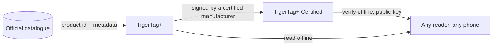

# TigerTag+

## Finalidade

**O `+` significa identificado.** Um TigerTag+ é um TigerTag cuja identidade carrega um
**ID de produto do catálogo oficial** — não valores que alguém digitou, mas o
produto exato: marca, cor, material, temperaturas, diâmetro, SKU, EAN,
direto da fonte. Além disso, ele pode carregar **metadados de enriquecimento opcionais**,
servidos pela Web API e passíveis de melhoria depois que o chip é gravado.

O chip em si continua **100% offline**. Tudo o que é preciso para imprimir está nele,
exatamente como em um TigerTag padrão — o ID do catálogo acrescenta a capacidade de
consultar dados mais ricos e mais recentes *quando você está online*, e não tira nada
quando não está. Um TigerTag+ lido no modo avião se comporta como qualquer outro
TigerTag.

E *“online”* também não é um requisito. Toda a referência é publicada como
um único arquivo — cada id de cada filamento do banco de dados, livre para qualquer pessoa copiar
e espelhar — de modo que um leitor que o tenha resolve um ID de catálogo sem nenhuma rede.
Veja [a Web API](../developers/web-api.md).

É o mesmo `+` do [TigerData+](../concepts/universal-filament-identity.md):
nos dois casos significa *esta identidade é um produto real do catálogo*, e em
nenhum dos dois significa *certificado*.

> **Nota sobre o nome:** antes vendido como **“TigerTag Pro”** — o nome agora é
> **TigerTag+**.

## O que o `+` acrescenta

| | TigerTag | TigerTag+ |
|---|---|---|
| Dados de impressão, **no chip** | ✅ | ✅ |
| Funciona totalmente offline | ✅ | ✅ |
| ID do produto do catálogo, **no chip** | — | ✅ |
| Metadados de enriquecimento, **pela Web API, opcional** | — | ✅ |
| Quem pode produzir um | todos | todos |

Os metadados de enriquecimento são a única linha que **não** fica no chip. Eles
são consultados no catálogo quando você está online, e podem
melhorar depois que o chip é gravado — e é justamente por isso que nunca podem ser
algo de que o chip precise. Tudo o que a impressora exige está no chip, o que
mantém todos os níveis 100% offline.

## A variante assinada

Um TigerTag+ que carrega também uma assinatura criptográfica é um
**[TigerTag+ Certified](./tigertag-plus-certified.md)** — o nível que pode
provar a origem de uma bobina, e o único restrito a fabricantes
certificados. Verificar uma assinatura continua grátis e offline para todos.

## Onde ele se encaixa

## Fazer backup de um chip — um recurso à parte

O Tiger Studio pode **fazer backup do conteúdo exato de um chip** na sua conta, vinculado
ao UID físico dele, e depois reprogramá-lo para esse estado. Isso é útil e
não tem relação com o `+`: vale para qualquer chip que você possa escanear, e ter um backup
não torna um chip um TigerTag+.

- **Restauração ao estado de fábrica**: se um chip for regravado ou corrompido por acidente,
 devolva-o exatamente como era — assinatura incluída, se ele tinha uma.
- **Somente o mesmo chip**: a restauração é válida no chip original, porque o
 backup está vinculado ao UID dele. Uma salvaguarda para *aquele* chip, nunca uma forma de clonar.
- **Prova de posse**: um escaneamento que corresponde ao backup mostra que o chip original
 está fisicamente em suas mãos.

> **Nota:** criar um backup exige atualmente o **Tiger Studio + um leitor USB
> (TigerPOD / ACR122U)**; o suporte no celular está planejado.

## Interações

| Com | Como |
|---|---|
| Tiger Studio + TigerPOD/ACR122U | Lê e verifica assinaturas; cria e restaura backups de chips |
| Tiger NFC Connect | Lê e verifica; suporte a backup em breve |
| SDKs | `tigertag[verify]` confere uma assinatura offline, em Python ou JS |
| Firebase (banco de dados de contas) | Guarda o catálogo, os metadados de enriquecimento e os backups de chips por conta |

## Links

- Chips oficiais: **[tigertag.io](https://tigertag.io)** (loja)

---

**◀ Anterior:** [TigerTag](./tigertag.md) · **▲ [Índice da documentação](../../README.md)** · **Próxima ▶** [TigerTag+ Certified](./tigertag-plus-certified.md)

**Veja também:** [Identidade universal de filamento](../concepts/universal-filament-identity.md), [O chip TigerTag](../concepts/tigertag-chip.md), [Documentação para desenvolvedores](../developers/README.md)
