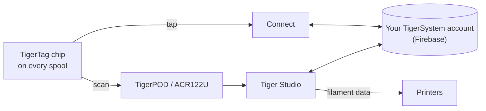

# TigerTag

## Finalidade

**O TigerTag dá a cada bobina uma memória própria.** Um pequeno chip NFC guarda
tudo sobre o filamento — marca, material, cor, como ele gosta de ser
impresso — para que você nunca precise adivinhar, etiquetar ou lembrar. Encoste o celular
nele e a própria bobina conta tudo.

<a class="ts-cta-primary" href="https://tigersystem.io/tigertag">O que é o TigerTag — em tigersystem.io</a>

<a href="https://github.com/TigerTag-Project/TigerTag-RFID-Guide"> A especificação aberta do chip</a>

Tecnicamente, é o coração do ecossistema: um padrão RFID aberto, legível
por qualquer aplicativo ou leitor compatível — sem dependência de fabricante, sem formato secreto.

## Onde ele se encaixa

## Recursos

- Chip padrão **NTAG213 / 215 / 216** (redondo de 25 mm recomendado), carga NDEF aberta
 de 144 bytes — dimensionada para caber no menor NTAG213; sem chaves, sem aprisionamento.
- **Dois chips por bobina, em lados opostos** — um sempre fica de frente para o leitor
 (slot da impressora, AMS, celular na mão) e cada um serve de backup para o outro
 ([por quê](../concepts/tigertag-chip.md)).
- Identidade resolvida com base no [banco de dados de referência](../concepts/universal-filament-identity.md) compartilhado.
- Gravável e **regravável** — possibilita o [fluxo de Segunda Vida](../philosophy/second-life.md);
 os chips oficiais da marca são fornecidos como NTAG215, de modo que o próprio chip possa ser reutilizado como um
 simples objeto NDEF (chaveiro, cartão de visita…) quando a bobina acabar —
 nunca lixo eletrônico.
- Legível por qualquer smartphone NFC, leitores ACR122U e pelo [TigerPOD](./tigerpod.md).
- Uma **área reservada de 64 bytes** (páginas `0x18`–`0x27`, restando 80 bytes de dados):
 livre para **funções complementares da comunidade** em um TigerTag padrão; carrega a
 assinatura de origem — 32 bytes de `R`, 32 de `S` — em um
 [TigerTag+](./tigertag-plus.md).

## Arquitetura

Veja [O chip TigerTag](../concepts/tigertag-chip.md) para o resumo do formato e o
[TigerTag-RFID-Guide](https://github.com/TigerTag-Project/TigerTag-RFID-Guide)
para a especificação canônica em nível de bytes.

## Interações

| Com | Como |
|---|---|
| Tiger NFC Connect | Toque NFC: ler, codificar |
| Tiger Studio | O escaneamento pelo leitor abre a bobina automaticamente; atualização guiada do chip |
| SDKs | Analisar / verificar / codificar a partir de JS ou Python |
| Impressoras | Indiretamente — pela [ponte do smartphone](../philosophy/smartphone-bridge.md) e pelas conexões de impressora do Studio |

## Em imagens

> **Nota sobre o nome:** os chips padrão eram antes vendidos como **“TigerTag Maker”**
> — o nome agora é simplesmente **TigerTag**.

## Os chips oficiais e os de todo mundo

**O TigerSystem fabrica os chips oficiais** e coloca o logotipo TigerTag
neles. Eles vêm em dois formatos, e ambos são fornecidos **em branco**:

| Formato | Para |
|---|---|
| **Adesivo** | qualquer bobina que você já tenha — um de cada lado ([por que dois](../concepts/tigertag-chip.md)) |
| **Suporte de refil** | [refis](../philosophy/second-life.md) de filamento com núcleo de papelão: um suporte já carrega **os dois chips**, fica dentro do núcleo antes de o refil ir para uma bobina-mestre reutilizável, de modo que o chip acompanha o filamento, não o carretel |

Quem pode dizer o quê, quando um chip está à venda:

| Quem | O que está vendendo | Pode chamar de | Logotipo |
|---|---|---|---|
| **TigerSystem** | os chips que ele fabrica | **oficial** — feito por nós | sim — ele aplica a marca |
| **Qualquer revendedor ou distribuidor** | esses mesmos chips genuínos | **oficial** — os produtos são | sim — a marca já está neles |
| **Um terceiro auditado pelo TigerSystem** | qualquer coisa que tenha criado — chips, inlays, suportes, um dispositivo, um aplicativo | **certificado** — concedido, auditado, listado, revogável | sim, no produto |
| **Qualquer pessoa que faça o próprio chip** | o próprio chip compatível | *“compatível com o TigerTag”* — e com o **TigerTag+** se ele verificar assinaturas. Nunca *“certificado”*, que só o TigerSystem concede | no aplicativo, na documentação e na página da loja; *“Compatible with TigerTag”* em texto simples na caixa de um dispositivo compatível — **nunca o logotipo nem o nome no chip (em qualquer formato), no suporte, na bobina ou na embalagem** |

Essa última distinção é toda a política de marca, e é mais restrita do que
parece. Dizer que seu produto *conversa com* o TigerTag é um fato sobre o seu produto,
e exibir o logotipo para dizer isso é livre. Colocar a marca — logotipo ou nome —
**em** um chip de qualquer formato é uma declaração sobre **quem o fabricou** — ela deixa de significar “isto funciona com o TigerTag”
e passa a significar “isto *é* um TigerTag”. Somente esse segundo uso exige
autorização por escrito. Veja o [TRADEMARK.md](../../TRADEMARK.md).

Mais de **2,5 milhões de chips TigerTag** já foram produzidos — a maioria integrada
na fábrica por marcas de filamento (Rosa3D, eSun, Sunlu, Landu, Jamg He, R3D,
Filforme, Lotactree, Smart3DPT, Nanovia — e outras em integração). Todas elas são
[parceiros certificados](../certified-partners.md); essa página é o registro e
a única forma autorizada de conferir se uma marca em uma caixa é legítima.

|| | |
|---|---|---|
|  |  |  |

|| | | |
|---|---|---|---|
|  |  |  |  |

*As caixas e as bobinas dentro delas — compradas em uma loja, não montadas para uma
foto. É assim que parece “o mais implantado”.* Mas o protocolo
**não está preso aos chips oficiais** de propósito: qualquer chip NTAG em branco e barato comprado
em qualquer lugar (Amazon, AliExpress, comércio local) funciona de forma idêntica, e nada o
impede. Os chips da marca ajudam a financiar a P&D; a adoção do protocolo é a primeira
recompensa. Outras formas de ajudar — incluindo as que não custam nada — estão em
[Apoie o projeto](../support.md).

A liberdade vale nos dois sentidos: **os chips nunca são protegidos contra gravação**. O TigerTag é
simplesmente o protocolo base com que as fábricas de filamento enviam as bobinas — se você preferir
outro protocolo NFC/RFID (personalizado ou existente), pode regravar o chip e
migrar os dados dele para esse protocolo. Sua bobina, seu chip, seu formato.

## Onde comprar

Os dois formatos são fornecidos **em branco**, e ambos são vendidos pelo TigerSystem e por seus
revendedores:

| | **Adesivo** | **Suporte de refil** |
|---|---|---|
| O que você recebe | chips adesivos redondos de 25 mm — **dois por bobina**, um de cada lado | um suporte = **dois chips já emparelhados**, um por ponta dobrada, para o núcleo de papelão |
| Para | qualquer bobina com abas | refis de filamento montados em uma bobina-mestre |
| Loja oficial | [tigertag.io](https://shop.tigertag.io/collections/tigertag-rfid-maker) | [tigertag.io](https://shop.tigertag.io/collections/tigertag-rfid-maker) |
| Revendedor (FR) | [TigerTag Officiel, Atome3D](https://www.atome3d.com/products/tigertag) | [TigerTag Refill Officiel, Atome3D](https://www.atome3d.com/products/tigertag-pro-for-refill-1000-pcs) |

Ambos vêm em vários tamanhos de pacote, até quantidades profissionais. E nada disso
é obrigatório: **qualquer chip NTAG em branco comprado em qualquer lugar funciona de forma idêntica** — comprar
os oficiais financia o protocolo, nada mais.

## Links

- Chips oficiais: **[tigertag.io](https://tigertag.io)** (loja — financia a P&D)
- Formato do chip: [TigerTag-RFID-Guide](https://github.com/TigerTag-Project/TigerTag-RFID-Guide)

---

**◀ Anterior:** [Produtos](./README.md) · **▲ [Índice da documentação](../../README.md)** · **Próxima ▶** [TigerTag+](./tigertag-plus.md)

**Veja também:** [Identidade universal de filamento](../concepts/universal-filament-identity.md), [Segunda Vida](../philosophy/second-life.md)
