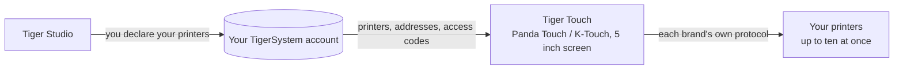

# Tiger Touch

**Seu Panda Touch está numa gaveta. Dê a ele todas as impressoras que você tem.** Um firmware
gratuito e de código aberto que transforma o BIGTREETECH Panda Touch e o K-Touch em uma
única tela sensível ao toque ao vivo para todas as suas impressoras 3D — sem solda, sem computador.

*Dois cartões de impressora ao vivo em uma tela: uma FlashForge AD5X e uma Bambu Lab X1C.*

<a class="ts-cta-primary" href="https://tigertag-project.github.io/Tiger-Touch/">Instale pelo navegador</a>

<a href="https://github.com/TigerTag-Project/Tiger-Touch"> Código-fonte</a>

A BIGTREETECH vende uma pequena tela sensível ao toque de 5" com dois nomes: o **Panda Touch**,
feito para impressoras Bambu Lab, e o **K-Touch**, feito para impressoras Klipper. A mesma
placa, dois firmwares, cada um preso a uma família de máquinas. Mudou de impressora, e
a tela vai para a gaveta.

**O Tiger Touch é um novo firmware para essa mesma tela**, escrito do zero. Ele
entra na sua conta TigerTag gratuita, encontra todas as impressoras que você declarou lá
e conversa com cada uma diretamente, pelo protocolo próprio dela, ao mesmo tempo. Se você
tem um Panda Touch ou um K-Touch que não combina mais com as suas impressoras, esse é o
hardware para o qual o Tiger Touch foi feito.

Código aberto sob **MIT**. Nada para soldar, nada para imprimir, sem Raspberry Pi,
sem servidor no meio: você liga a tela a uma porta USB, pressiona **Install** no
navegador e, dois minutos depois, ela mostra as suas impressoras.

## O que ele faz

- **Todas as marcas em uma tela** — Bambu Lab, Creality, Elegoo, Anycubic,
  Snapmaker, FlashForge, Prusa, além de qualquer máquina Klipper (Moonraker) ou OctoPrint.
- **Nuvem e LAN** — Bambu Lab pela nuvem da Bambu ou em modo LAN, Anycubic
  pela nuvem da Anycubic ou na LAN, as demais na sua rede local.
- **Ao vivo, todas elas** — estado, progresso, arquivo, tempo restante e hora de término,
  bicos, mesa, câmara e unidades de filamento (AMS, CFS, Station, ACE, pistas
  MMU / AFC), com até **dez impressoras** acompanhadas ao mesmo tempo.
- **Controles seguros** — pausar, retomar, parar (um toque longo de 1,5 s, para que um dedo distraído nunca
  encerre uma impressão) e a luz da impressora. **Nada além disso é enviado**: sem
  aquecer, sem mover, sem iniciar uma impressão.
- **Atualiza-se sozinho** — as novas versões chegam por Wi-Fi, são verificadas antes da instalação e
  revertidas sozinhas se falharem ao iniciar.
- **Onze idiomas** — inglês, francês, alemão, espanhol, italiano, chinês,
  português (Brasil e Portugal), polonês, russo, holandês.

<figure>

<figcaption><strong>Cartões</strong>: um cartão ao vivo por impressora, deslize para ver mais.</figcaption>
</figure>
<figure>

<figcaption><strong>Lista</strong>: todas as impressoras num relance. Um toque troca a visualização.</figcaption>
</figure>
<figure>

<figcaption><strong>Snapmaker U1</strong>: quatro cabeçotes, o ativo circulado.</figcaption>
</figure>
<figure>

<figcaption><strong>FlashForge AD5X</strong>: bobina externa e estação de materiais.</figcaption>
</figure>

## Onde ele se encaixa

## O que precisa existir antes

O Tiger Touch lê suas impressoras **da sua conta TigerSystem**, então nunca
pede um endereço ou um código de acesso em uma tela de 5". Crie a conta e adicione
suas impressoras no [Tiger Studio](./tiger-studio.md) de **desktop** (Windows,
macOS, Linux), que as encontra na sua rede — a versão web não consegue adicionar
impressoras.

> **Em resumo:** Tiger Studio → crie uma conta → adicione suas impressoras →
> *depois* configure a tela.

## Quais impressoras

O Tiger Touch escolhe a conexão pela **marca**, não pelo modelo: qualquer impressora
dessas famílias que o Tiger Studio consiga adicionar, o Tiger Touch consegue mostrar. O catálogo
do Tiger Studio conta mais de 400 modelos de cerca de 60 fabricantes.

| Marca | Conexão | Visto em uma máquina real |
|---|---|---|
| [Bambu Lab](../compatibility/bambu-lab.md) (X1, P1, P2S, A1, H2…) | Nuvem da Bambu, ou LAN (MQTT sobre TLS) | **Sim** — imprimindo pela nuvem (P2S), ociosa em modo LAN (X1C, A1) |
| [Creality](../compatibility/creality.md) (K2, K1, Hi, Ender-3 V4…) | WebSocket na LAN | **Sim** — imprimindo (K2), ociosa com o CFS (Ender-3 V4) |
| [Snapmaker](../compatibility/snapmaker.md) U1 | Moonraker WebSocket | **Sim** — ociosa, quatro cabeçotes |
| [FlashForge](../compatibility/flashforge.md) (AD5X, Adventurer 5M, Creator 5, Creator 5 Pro) | HTTP na LAN | **Sim** — AD5X: pausar, parar e a luz |
| [Anycubic](../compatibility/anycubic.md) (Kobra 3, Kobra X, Kobra S1…) | Nuvem da Anycubic, ou LAN (MQTT sobre TLS) | **Sim** — pela nuvem (Kobra X), com seu ACE: a luz, pausar, retomar e parar |
| [Elegoo](../compatibility/elegoo.md) Centauri Carbon 1 e 2 | MQTT (CC2), SDCP (CC1) | **Sim** — Centauri Carbon 2 e Centauri Carbon: pausar, retomar, parar, e a luz na CC2 |
| **Prusa** (MK4, Core One, XL, MINI) | PrusaLink | **Sim** — progresso, temperaturas, pausar, retomar, parar |
| [Klipper](../compatibility/klipper.md) — Voron, Qidi, Sovol, RatRig… | Moonraker HTTP | **Sim** — em uma impressora Klipper real: pausar, retomar, parar e a luz |
| **OctoPrint** — qualquer impressora Marlin por trás dele | API REST do OctoPrint | Somente contra a impressora de teste do Tiger Studio |

O OctoPrint só encontrou até agora a impressora de teste do Tiger Studio, e cada marca tem
modelos que ninguém experimentou ainda: **um relato da sua impressora é a coisa mais útil
que você pode enviar.** Pausar, retomar e parar funcionam onde quer que a conexão aceite
comandos (não pela nuvem da Bambu); a luz funciona em todo lugar, exceto na Prusa, no
OctoPrint e na Centauri Carbon 1. Cada marca tem a própria página, com a sua configuração
e as suas dúvidas, no [site do instalador](https://tigertag-project.github.io/Tiger-Touch/).
Cada campo e cada teste estão no
[status por marca](https://github.com/TigerTag-Project/Tiger-Touch/blob/main/docs/PRINTER-COMPATIBILITY.md).

**Uma impressora aparece como “offline”?** Verifique primeiro o modo LAN dela: ele vem desligado por padrão na
Creality, na FlashForge e na Bambu Lab.

## Uma tela, todas as marcas

Os firmwares que acompanham a tela conhecem, cada um, **uma** família de impressoras.

| | **Tiger Touch** | Firmware do Panda Touch | Firmware do K-Touch |
|---|---|---|---|
| Famílias de impressoras em uma tela | **9** | 1 (Bambu Lab) | 1 (Klipper) |
| Impressoras ao vivo ao mesmo tempo | **até 10**, todas atualizando juntas | várias Bambu Lab, fica lento a partir de cerca de 3 no nosso uso | **1** por vez (50 salvas, alternando entre elas) |
| Impressoras configuradas | pela sua conta TigerTag, nada digitado na tela | IP, número de série, código de acesso | IP e porta, ou uma varredura |
| Atualizações pelo ar | Sim, verificadas, com reversão automática | Não | Não |

Os firmwares da BIGTREETECH dão controle total da família única que atendem — iniciar impressões,
temperaturas, movimentos — o que o Tiger Touch deliberadamente não faz. Você pode voltar a
eles a qualquer momento.

*As colunas do Panda Touch e do K-Touch vêm do próprio wiki da BIGTREETECH (lido em
2026-10-16); “fica lento a partir de cerca de 3” é a experiência da própria equipe TigerTag, não
um número da BIGTREETECH.*

## Instale em dois minutos

1. **Declare suas impressoras** no Tiger Studio, como acima.
2. **Grave a tela pelo navegador.** Abra
   **<https://tigertag-project.github.io/Tiger-Touch/>** no **Chrome ou Edge** em
   um computador (WebSerial: não no Safari, não no Firefox, não em um celular), ligue a tela
   com um cabo USB-C de **dados**, pressione **Install** e escolha a porta dela. Se for substituir
   o firmware da BIGTREETECH: marque **Erase device**. Se for atualizar um Tiger Touch por
   USB: deixe desmarcado, seu Wi-Fi e sua conta são mantidos.
3. **Siga a tela.** Idioma, Wi-Fi, depois sua conta TigerTag — e-mail
   e senha, ou **Continue with Google** com um QR code escaneado pelo
   celular. Ative as impressoras que quer acompanhar, e pronto. *Depois* é
   sempre uma resposta válida: a tela inicia na hora e conecta em segundo plano.

Depois disso não há nada a fazer: a tela verifica se há uma nova versão uma vez por dia
e a instala com dois toques.

Primeira vez? O [guia de instalação](https://github.com/TigerTag-Project/Tiger-Touch/blob/main/docs/INSTALL.md)
cobre o driver USB (necessário no macOS), como guardar uma cópia do firmware da BIGTREETECH
para poder voltar, e a única caixa a marcar.

## O hardware

O **BIGTREETECH Panda Touch** e o **K-Touch** são projetados e fabricados pela
**BIGTREETECH** (BIQU): uma tela sensível ao toque IPS de 5" 800×480 em torno de um ESP32-S3 com 8 MB
de PSRAM e 16 MB de flash, Wi-Fi, USB-C e bateria. O Tiger Touch roda nele
sem modificações e se apoia no suporte de placa que a BIGTREETECH publicou para ele sob
a licença MIT. O K-Touch é a mesma placa do Panda Touch, então a mesma
imagem é destinada a ele — mas o Tiger Touch só foi executado em um Panda Touch até
agora: um relato de um K-Touch é bem-vindo.

O Tiger Touch é um projeto independente, não feito nem endossado pela BIGTREETECH, pela BIQU
nem por qualquer fabricante de impressoras citado aqui.

Compile você mesmo com o ESP-IDF 5.5 — os passos estão no
[repositório](https://github.com/TigerTag-Project/Tiger-Touch#build-it-yourself).

---

**▲ [Índice da documentação](../../README.md)** · **Veja também:** [Tiger Studio](./tiger-studio.md), [TigerSpool](./tigerspool.md), [Compatibilidade de impressoras](../compatibility/README.md)
