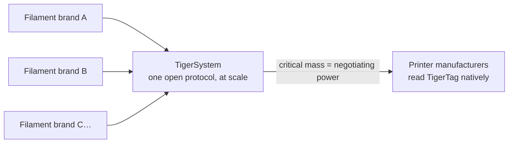

# Para fabricantes de filamento

> **Torne suas bobinas inteligentes e conectadas.**

## A bobina inteligente está acontecendo — a única forma aberta de fazê-la está aqui

As impressoras esperam cada vez mais um filamento inteligente: sistemas da classe AMS,
detecção de material por slot, ajustes automáticos. Todo fabricante de impressoras responde com uma
**tag fechada, presa às suas máquinas, alimentando a sua nuvem** — zero
interoperabilidade, zero valor para a sua marca fora das paredes deles. E toda
tag trancada serve a um segundo propósito: **direcionar seus clientes para o
filamento do próprio fabricante da impressora.** O TigerTag foi criado em 2023 justamente para que
marcas de terceiros tivessem uma resposta melhor — bobinas mais inteligentes que as
proprietárias, sem o jardim murado.

**O TigerTag é o protocolo RFID de terceiros mais implantado do mundo** —
e, hoje, a única solução aberta de bobina inteligente viável em escala: um
protocolo aberto, padronizado, agnóstico e multiplataforma, com mais de
**2,5 milhões de chips já produzidos** e integrados de fábrica por marcas
como Rosa3D, eSun, Sunlu, Landu, Jamg He, R3D, Filforme, Lotactree,
Smart3DPT e Nanovia.

## Integração na fábrica: dias, não meses

Temos a experiência e a tecnologia para colocar chips TigerTag na sua
linha de produção **de forma rápida, fácil e a um custo muito baixo — funcionando em
apenas 5 dias**, gravando **cada chip em cerca de 1 segundo** (milhares de
bobinas por dia, com um clique):

- Hardware NTAG padrão (sem componentes proprietários, sem dependência de ferramental),
 adquirido numa escala e a um custo escolhidos para um objetivo inegociável: **adicionar a
 tecnologia sem acrescentar um centavo ao preço final da bobina para o usuário.**
- Um roteiro de integração comprovado, já implantado em várias fábricas,
 movido pela suíte industrial [TigerTag Factory & Manager](../products/factory-suite.md):
 o banco de dados do seu filamento de um lado, a gravação em massa na velocidade da linha
 em cada bobina do outro — com a **assinatura de fábrica
 comprovando a origem de cada produto**.
- O banco de dados de referência compartilhado dá aos seus produtos uma identidade
 precisa e universal que todo aplicativo compatível resolve de forma idêntica.

As marcas que enviam TigerTags em seus produtos podem exibir a marca **TigerTag
Certified** — um sinal visível para os clientes de que a bobina é inteligente e
aberta.

> Entre em contato em **[tigertag@tigertag.io](mailto:tigertag@tigertag.io)** (ou
> pela [organização no GitHub](https://github.com/TigerTag-Project)) para
> iniciar a conversa.

## Obrigado, integradores

As marcas abaixo tornaram a bobina aberta real — cada uma no seu nível de
comprometimento, e todas merecem o crédito. Os níveis formam uma
**escada**: quanto mais uma marca se compromete, mais destaque ela recebe —
aqui e em todas as superfícies do ecossistema. As melhores ficam mais altas.

### Platina — o cume

**TigerTag+ em toda a produção**: todos os formatos de bobina, chips assinados
como padrão em cada bobina que sai da fábrica. Nada opcional,
nada parcial — a experiência completa de bobina aberta, para todo cliente, por
padrão. Os integradores Platina recebem o **destaque máximo em todo lugar**: nomeados primeiro,
com o maior logotipo, com a sua história contada.

**[Rosa3D](https://rosa3d.pl)** — o **primeiro do mundo** a levar o
TigerTag+ a toda a sua produção. A referência que todos os demais estão
perseguindo.

### Ouro — comprometidos, em escala

**Integração sob demanda no momento da produção**, com grandes quantidades já
produzidas, um alto nível de integração e um **compromisso público
oficial**. A um passo do cume: tornar os chips assinados padrão
em toda a linha e se juntar à Platina.

&nbsp;&nbsp;&nbsp;&nbsp;

**[R3D](https://r3dprint.com)** · **[eSun](https://www.esun3d.com)**

### Prata — a bordo

**A tecnologia integrada sob demanda** — o primeiro passo, que já é real:
os clientes deles podem comprar hoje bobinas equipadas com TigerTag. O próximo degrau
é o Ouro: aumentar os volumes e tornar o compromisso público.

&nbsp;&nbsp;&nbsp;&nbsp;&nbsp;&nbsp;&nbsp;&nbsp;

**[Sunlu](https://www.sunlu.com)** · **[Landu](https://www.landustore.com)** · **[Jamg He](https://www.jamghe.com)** · **[Filforme](https://www.filforme.com)** · **[Lotactree](https://www.lotactree.com)** · **[Smart3DPT](https://smart3d.pt)**

…e também na linha de produção —
[Nanovia](https://nanovia.tech) — com outras a caminho.

**Quer o seu logotipo nesta escada — e maior?** Uma linha de produção roda o
TigerTag em apenas 5 dias:
[tigertag@tigertag.io](mailto:tigertag@tigertag.io).

## Eles mesmos anunciaram

Publicações públicas nos canais das próprias marcas — não é um comunicado nosso
(fontes e anúncios completos:
[tigersystem.io/en/manufacturers](https://tigersystem.io/en/manufacturers)).
**Clique em qualquer imagem para abrir a publicação original:**

|| | |
|---|---|---|
|  |  |  |

> **ROSA 3D FILAMENTS** — *“integrou oficialmente o protocolo RFID aberto TigerTag
> em 100% da nossa produção de filamento.”* (*"officially integrated the open TigerTag RFID
> protocol across 100 % of our filament production."*) Mais de 250 000
> bobinas já produzidas com TigerTag.
> ([publicação original](https://www.instagram.com/p/DVyeOZajZSm/))

> **R3D Filament** — *“iniciou oficialmente a implantação em larga escala do protocolo RFID
> aberto TigerTag em sua produção de filamento na Europa.”* (*"officially begun large-scale deployment of the open
> TigerTag RFID protocol across its filament production in Europe."*)
> ([publicação original](https://www.instagram.com/reel/DVoAMqTk5ck/))

> **eSUN** — *“integrou oficialmente a tecnologia RFID TigerTag!”* (*"officially integrated TigerTag RFID technology!"*) — em piloto
> no mercado francês, expandindo pela Europa.
> ([publicação original](https://www.instagram.com/p/DUjydNXkc1W/))

## Como as tags entram nas suas bobinas

<table>
<tr>
<td align="center" width="55%">
<strong>Frente</strong> 
 
<strong>Verso</strong> 

</td>
<td align="center">

</td>
</tr>
</table>

*Frente — os dois chips da marca, com o adesivo industrial 3M
(468MP / 200MP) no meio. Verso — as duas antenas NFC independentes, uma
em cada ponta. Aplicado no refil: um chip de cada lado, seu operador descola e
cola — nada mais na linha muda.*

## Já nas prateleiras

|| | |
|---|---|---|
|  |  |  |

*Rosa3D, eSun, Sunlu — caixas reais, enviadas com TigerTag dentro.*

|| | | |
|---|---|---|---|
|  |  |  |  |

*O próprio filamento: Rosa3D, eSUN, Sunlu, R3D — todos estes são enviados
com chips TigerTag na bobina.*

## O que seus clientes recebem no primeiro dia

Uma bobina que se identifica para **qualquer celular NFC**, um ecossistema completo de inventário
(móvel, desktop, web), integração ao vivo com seis marcas de impressoras,
controle de peso, compartilhamento — uma experiência **muito além do que qualquer ambiente fechado
de um único fabricante oferece**, e que funciona com todas as impressoras que seus
clientes têm, não apenas com as de uma marca.

## Atualize os dados mesmo depois que saem da sua fábrica

Uma etiqueta impressa fica congelada no dia em que é impressa. Uma bobina TigerTag não:
como os chips resolvem sua identidade com base no **banco de dados de
referência compartilhado**, você pode refinar ou corrigir os dados de um produto — ajustes,
descrições, imagens — **mesmo para bobinas já vendidas e que estão nas casas dos
seus clientes**. O TigerTag é a única tecnologia neste mercado que mantém
os dados do seu produto atualizáveis depois que ele saiu da fábrica.

## A jogada coletiva

Cada marca de filamento que se junta ao TigerSystem fortalece todas as outras:

Sozinha, nenhuma marca de filamento consegue convencer os fabricantes de impressoras a ler as suas tags.
**Juntas, por trás de um protocolo aberto, nós conseguimos.** E o pedido é pequeno: um
fabricante de impressoras pode adicionar a leitura de TigerTag ao seu firmware em **menos de 3 dias**. Quanto mais marcas enviam
TigerTag, mais forte o argumento para um suporte nativo ao TigerTag, em nível de firmware,
nas próprias impressoras — e todos os participantes se beneficiam dessa
alavancagem.

---

**▲ [Índice da documentação](../../README.md)** · **Veja também:** [Por que o TigerSystem existe](./why-tigersystem.md), [Compatibilidade](../compatibility/README.md), [FAQ — Fabricantes](../faq/README.md)
