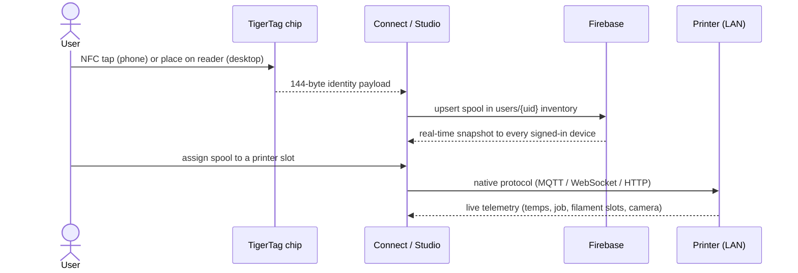
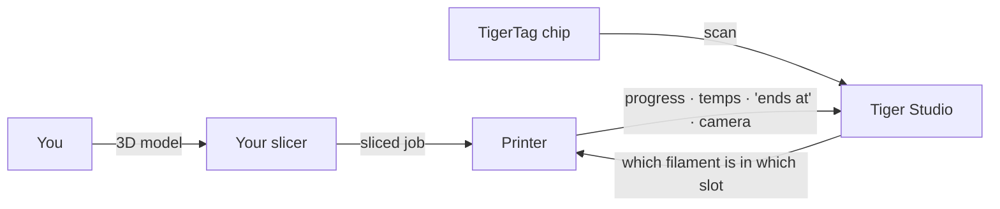

# Поток данных

## От касания до печати

Полный путь одной катушки через систему:

## Где живёт каждый вид данных

| Данные | Где живут | Примечания |
|---|---|---|
| Идентичность катушки | Чип + облачный инвентарь пользователя | Чип авторитетен для офлайн-использования |
| Справочная база данных (бренды, материалы…) | `cdn.tigertag.io` (тот же проект Firebase) | Поставляется с приложениями, обновляется из CDN |
| Изображения катушек (включая фотографии продуктов TigerTag+) | `cdn.tigertag.io` (тот же проект Firebase) | Раздаются всем приложениям |
| Инвентарь, стеллажи, друзья, настройки | Firestore `users/{uid}/…` | По умолчанию только для владельца, обеспечивается правилами |
| Публичные коды обнаружения | Firestore `publicKeys/{code}` | Поиск друга за O(1) |
| Учётные данные и телеметрия принтеров | **Только локально** (настольное приложение) | Трафик LAN никогда не проходит через облако |
| Живой вес (TigerScale) | Устройство → Firestore | Отображается вживую во всех клиентах |

## Где находится ваш слайсер

TigerSystem **не заменяет ваш слайсер** — она дополняет картину вокруг
него:

- Вы нарезаете и запускаете задания точно как раньше, в любом слайсере.
- Tiger Studio сообщает принтеру, **какой филамент в каком слоте**
 (AMS / CFS / Canvas / ACE / IFS), чтобы информация на стороне машины
 соответствовала реальности.
- Что бы ни запустило печать, задание отображается вживую в Tiger Studio —
 ход, температуры, время окончания, камера.
- Чип хранит рекомендуемые параметры печати филамента; **автоматического импорта
 профилей слайсера сегодня нет** — вы переносите их в профиль слайсера самостоятельно.

## Две плоскости, намеренно разделённые

- **Облачная плоскость** — идентичность, инвентарь, обмен. Интернет, Firebase,
 обеспечивается правилами.
- **Плоскость LAN** — управление принтерами и камеры. Только локальная сеть, нативные
 протоколы производителей, нулевая зависимость от облака (настольное приложение продолжает работать
 с принтерами и в офлайне).

> **Примечание:** исключение — **облачный режим** Anycubic, где связь с принтером
> идёт через облачный MQTT производителя — см.
> [Совместимость с Anycubic](../compatibility/anycubic.md).

---

**◀ Назад:** [Обзор архитектуры](./overview.md) · **▲ [Оглавление документации](../../README.md)** · **Далее ▶** [Продукты](../products/README.md)

**См. также:** [Инвентарь и облачная синхронизация](../concepts/inventory-and-cloud-sync.md), [Совместимость](../compatibility/README.md)
