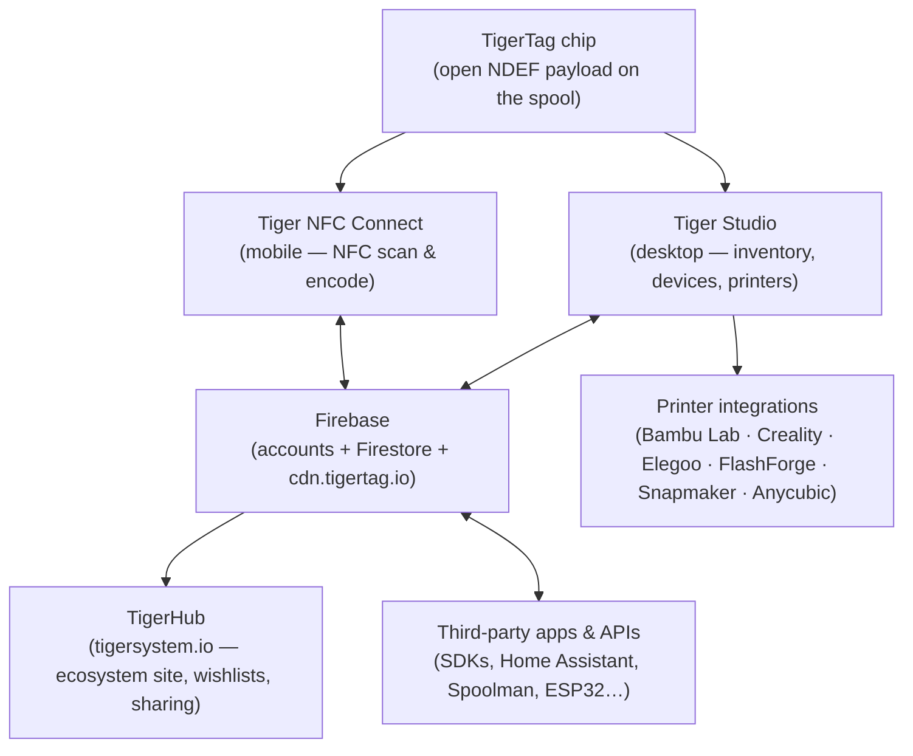
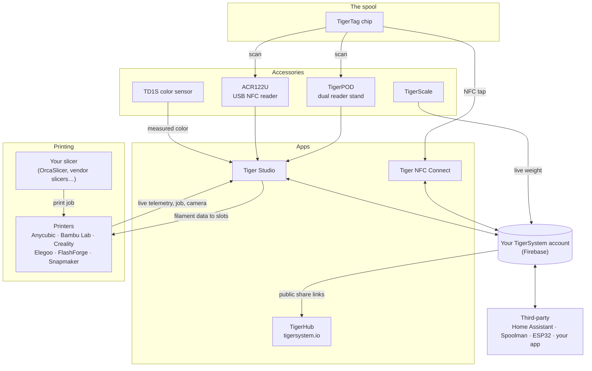

# Обзор архитектуры

## Стек сверху вниз

## Слои

| Слой | Роль | Канонические документы |
|---|---|---|
| **Чип TigerTag** | Переносимая открытая идентичность физической катушки | [Формат чипа](../concepts/tigertag-chip.md) |
| **Tiger NFC Connect** | Смартфон-мост: сканирование, кодирование, просмотр | [Страница продукта](../products/tiger-nfc-connect.md) |
| **Firebase** | Единая общая база данных — аккаунты, инвентарь, синхронизация; точка взаимодействия песочницы | [Инвентарь и облачная синхронизация](../concepts/inventory-and-cloud-sync.md) |
| **TigerHub** | Веб-дом экосистемы: витрина, списки желаний, друзья, обмен | [Страница продукта](../products/tigerhub.md) |
| **Tiger Studio** | Настольный верстак: инвентарь, стеллажи, датчики, принтеры | [Страница продукта](../products/tiger-studio.md) |
| **Интеграции принтеров** | Живые связи по LAN с принтерами шести брендов | [Совместимость](../compatibility/README.md) |
| **Сторонние API** | SDK + документированная поверхность Firestore для всех желающих | [Для разработчиков](../developers/README.md) |

## Полная карта — каждый элемент и его связи

Аксессуары, приложения, облако, принтеры, слайсеры и интеграции сторонних разработчиков на
одной схеме:

Читайте слева направо: **чип** опознаёт катушку; **аксессуары**
фиксируют реальность (сканирование, вес, цвет); **приложения** и **облако** поддерживают
синхронизацию всего этого; **принтер** получает данные о филаменте и отчитывается в реальном времени.
Ваш **слайсер остаётся при своём деле** — TigerSystem не нарезает модели, она следит за тем, чтобы
все (вы, машина, приложения) точно знали, какой филамент где находится.

## Принципы проектирования

1. **Чип самодостаточен.** Катушка опознаёт себя без облака, без
 аккаунта, без сети — нагрузка полна и открыта.
2. **Облако принадлежит пользователю, а не системе.** Всё состояние хранится в аккаунте
 пользователя; доступ обеспечивают правила безопасности на стороне сервера, а не
 клиентский код.
3. **Каждый слой необязателен.** Работает использование только с телефоном, только с настольным ПК, только с чипом
 или только через API; компоненты добавляют ценность, но никогда не блокируют друг друга.
4. **Интеграции говорят на родном протоколе принтера.** Никаких модификаций прошивки, никаких
 обходов через облако: Tiger Studio общается по MQTT/WebSocket/HTTP напрямую по LAN
 (см. [поток данных](./data-flow.md)).

---

**◀ Назад:** [Инвентарь и облачная синхронизация](../concepts/inventory-and-cloud-sync.md) · **▲ [Оглавление документации](../../README.md)** · **Далее ▶** [Поток данных](./data-flow.md)

**См. также:** [Продукты](../products/README.md), [Для разработчиков](../developers/README.md)
