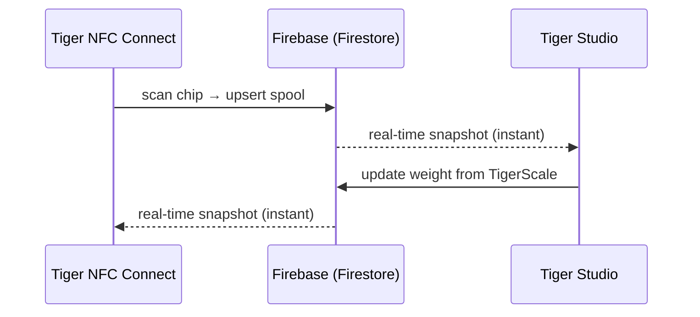

# Инвентарь и облачная синхронизация

## Один аккаунт, все устройства

Инвентарь пользователя живёт в **его аккаунте TigerSystem** на базе обычного
**Firebase** (Auth + Firestore) — намеренно безымянной инфраструктуры, задача
которой проста: **одна общая база данных в одном месте**, чтобы все элементы
песочницы (настольное приложение, мобильное, весы, веб) работали с одними и теми же данными. Каждый клиент — мобильный, настольный, веб — подписывается на одни и те же
документы в реальном времени:

«Кнопки синхронизации» нет: изменения распространяются через живые
слушатели Firestore, а клиенты хранят локальный кэш для чтения офлайн.

## Что синхронизируется

- **Инвентарь** — один документ на катушку (идентичность, вес, контейнер, изображение…).
- **Стеллажи** — физическая планировка полок и размещение катушек.
- **Друзья и обмен** — связи с друзьями, входящие запросы, уведомления.
- **Настройки** — язык, параметры аккаунта.
- **Резервные копии чипов** — записи чипов [TigerTag+](../products/tigertag-plus.md).

Авторитетная модель данных с описанием каждого поля приведена в
[репозитории интеграции Firebase](https://github.com/TigerTag-Project/TigerTag_Firebase_Integration)
(`docs/03-data-model.md`) — это справочник для сторонних интеграторов.

## Что покидает ваш верстак, а что остаётся

Экосистема везде говорит, что облако необязательно. Вот что это
значит на деле и чего стоит отказ от него.

**Идентификация локальна по замыслу.** Устройство не спрашивает у сервера, что за метка.
Таблицы брендов и материалов хранятся в его собственной памяти и обновляются из
**публичного** [справочного репозитория](https://github.com/TigerTag-Project/TigerTag-RFID-Guide)
не чаще раза в день. Поэтому поиск никогда не ждёт сети и работает
при отключённом интернете.

**Без аккаунта вы теряете ровно одно: синхронизацию между устройствами.**
[TigerScale](../products/tigerscale.md) по-прежнему взвешивает, читает метки,
определяет бренд и материал, обслуживает собственный веб-интерфейс в вашей локальной сети. Ничто
в самом чипе не требует нас — в этом и смысл записи данных
[на чип](./tigertag-chip.md).

**С аккаунтом — вот что устройство на самом деле отправляет.** На примере весов:
при каждом завершённом взвешивании и по heartbeat они записывают
в ваш собственный пользовательский документ: UID меток катушки, вес нетто/брутто/контейнера,
версию прошивки, уровень сигнала WiFi и IP, коэффициент калибровки, время последнего heartbeat,
состояние батареи и состояние экрана. Диагностика и измерения — не более. Каждое
поле описано в
[собственном справочнике весов](https://github.com/TigerTag-Project/Tiger-Scale-V3/blob/main/docs/TELEMETRY.md).

**А вот что оно хранит локально, и это важнее.** Устройство с выполненным входом
хранит refresh-токен, ваш идентификатор пользователя и учётные данные WiFi. Пароль оно никогда
не хранит — при входе он обменивается на токены. Но считайте настроенное устройство
**носителем учётных данных**: прежде чем одолжить, продать или отдать его, выйдите из аккаунта
*и* забудьте WiFi. Простая перепрошивка не очищает ни то, ни другое — это хранилище
сохраняется намеренно, чтобы обновление прошивки не стоило вам настроек.

**Два осознанных решения, о которых стоит знать.** LAN API устройства
**не аутентифицируется**: любой, кто уже в вашей сети, может прочитать его состояние и
выполнить тарирование. Это упрощение для домашней сети — поместите его в гостевую
VLAN, если не доверяете своей. А ключ Firebase, видимый в исходном коде, — это
**публичный идентификатор проекта**, а не секрет; его поставляет каждый клиент Firebase, а
контроль доступа обеспечивают серверные правила применительно к вошедшему пользователю, а не
сокрытие строки.

Для весов всё это подробно описано в
[`docs/CLOUD.md`](https://github.com/TigerTag-Project/Tiger-Scale-V3/blob/main/docs/CLOUD.md),
который является каноническим.

## Модель обмена (кратко)

- У каждого пользователя есть публичный **код обнаружения** (`XXX-XXX`) для поиска друга за O(1).
- Дружба **двусторонняя и основана на согласии**: запрос → принятие; любая
 сторона может её разорвать. Доступ на чтение к инвентарю друга обеспечивается
 на стороне сервера правилами безопасности Firestore — никогда клиентом.
- Инвентарь также можно пометить как **публичный** или поделиться им как веб-списком
 только для чтения через ссылки [TigerHub](../products/tigerhub.md).

## Модель безопасности (кратко)

- Все данные пользователя по умолчанию доступны только владельцу; доступ между пользователями всегда требует
 предварительной связи (дружба, запрос), обеспечиваемой серверными правилами.
- Конфигурация проекта Firebase намеренно публична (стандартная схема);
 **безопасность — в правилах, а не в секретности**. См.
 [Account API и интеграция](../developers/account-api.md).

---

**◀ Назад:** [Чип TigerTag](./tigertag-chip.md) · **▲ [Оглавление документации](../../README.md)** · **Далее ▶** [Обзор архитектуры](../architecture/overview.md)

**См. также:** [TigerHub](../products/tigerhub.md), [Для разработчиков — Account API](../developers/account-api.md)
