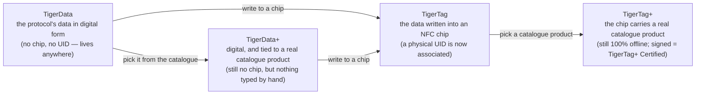

# Универсальная идентичность филамента

## Одна идентичность, читаемая везде

Чип TigerTag даёт катушке **универсальную идентичность**: единую открытую запись о том,
чем филамент *является*, независимо от того, кто его произвёл, кто продаёт и в каком
принтере он будет плавиться.

Идентичность охватывает (неисчерпывающий список):

| Семейство полей | Примеры |
|---|---|
| **Бренд** | любой производитель филамента, из общего справочного списка |
| **Материал / тип** | PLA, PETG, ABS, TPU… + подтип |
| **Аспект / цвет** | значение цвета, отделка |
| **Геометрия** | диаметр (1,75 / 2,85 мм) |
| **Параметры печати** | рекомендуемые температуры |
| **Жизненный цикл** | вес, дата изготовления |

## Общая справочная база данных

Идентичности — не свободный текст: бренды, материалы, аспекты, типы, диаметры и
единицы берутся из **общей справочной базы данных**, расположенной на `cdn.tigertag.io`
(в том же проекте Firebase, что и аккаунты). Все приложения разрешают одни и те же ID в одно и то же значение, поэтому
чип, закодированный одним инструментом, читается одинаково в любом другом.

> **TODO:** добавить ссылку на публичную точку просмотра базы данных / формат дампа, когда
> он будет описан в руководстве по RFID. Справочные данные поставляются в составе Tiger Studio
> (`assets/db/tigertag/`) и обновляются из CDN.

## Одна идентичность, четыре состояния

Идентичность — это *запись*, а не *чип*, и она проходит через четыре
состояния:

- **TigerData** — это протокол *до* чипа: та же идентичность, хранимая
 в цифровом виде — в инвентаре, базе данных, файле, где угодно. Протокол TigerTag
 может жить полностью вне RFID-чипа. Это понятие **виртуального
 чипа — инновация TigerSystem, нигде больше его нет**: ведите полный
 инвентарь без единого NFC-чипа, отправляйте идентичность в чип позже или никогда,
 и совместимость протокола сохраняется в любом случае.
- **TigerData+** — это TigerData, которая знает, *какой именно это продукт*. По-прежнему
 без чипа, по-прежнему ничего не нужно покупать — но вместо того, что ввёл владелец, она
 несёт настоящий продукт из официального каталога: точный бренд, цвет,
 материал, температуры, диаметр, SKU и EAN — прямо из источника. Это
 то, что получается, когда вы выбираете продукт, а не описываете его.
 >Это **не** TigerTag+ и никогда не претендует на это: нет чипа, нет UID. Знак `+`
 >означает *опознано*, а не *сертифицировано*. Для разработчиков: катушка является TigerData+,
 >если она без чипа **и** несёт настоящий идентификатор продукта — эта пара и есть
 >определение, и она отражена в записи как `protocol: "TigerData+"`, чтобы
 >можно было прочитать её напрямую. См.
 >[структуру данных Firestore](https://github.com/TigerTag-Project/TigerTag_Firebase_Backend#-firestore-data-structure).
- В момент, когда эти данные **записываются в NFC-чип**, они становятся
 **TigerTag**: с идентичностью наконец **связывается физический UID**.
- Запишите в этот чип **продукт из каталога**, а не введённые вручную значения,
 и это [**TigerTag+**](../products/tigertag-plus.md) — тот же `+`, что и у
 TigerData+, и с тем же значением: *опознано*. Подписанный сертифицированным производителем,
 он становится **TigerTag+ Certified**. В любом случае чип остаётся на 100 %
 читаемым офлайн.

TigerData может навсегда остаться цифровой или быть **атомарно переведена в настоящий чип**,
когда вы будете готовы (Tiger Studio делает это одним шагом). А
все четыре состояния путешествуют как файлы: формат
[**обмена `.ttag`**](../developers/ttag-format.md) переносит один или
несколько материалов инвентаря — TigerData, TigerData+, TigerTag или TigerTag+ — на USB-
накопителе, в письме, между инструментами.

---

**◀ Назад:** [Процесс «Вторая жизнь»](../philosophy/second-life.md) · **▲ [Оглавление документации](../../README.md)** · **Далее ▶** [Чип TigerTag](./tigertag-chip.md)

**См. также:** [Страница продукта TigerTag](../products/tigertag.md), [Инвентарь и облачная синхронизация](./inventory-and-cloud-sync.md)
