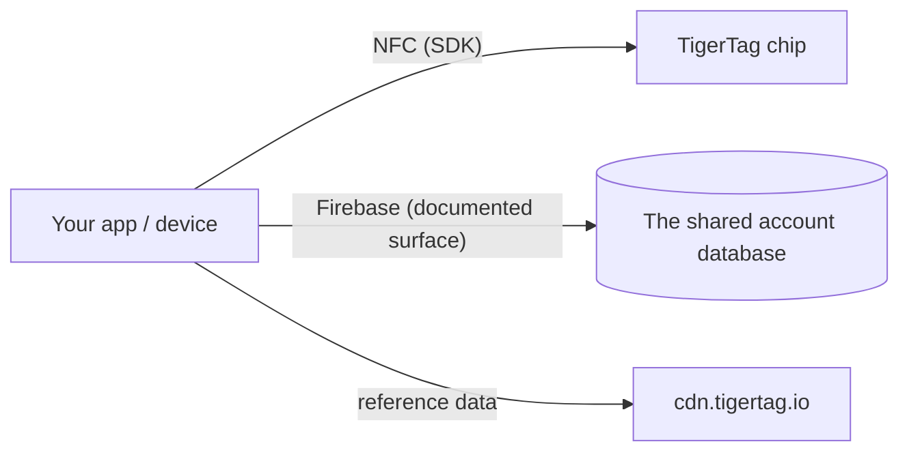

# Документация для разработчиков

Стройте на TigerSystem: читайте чипы, общайтесь с облаком или интегрируйте собственное
оборудование и программное обеспечение. Ничто не требует разрешения — протокол открыт.

## Что можно создать?

Для чтения TigerTag нужен **любой смартфон с NFC**, **USB-считыватель ACR122U**,
подключённый к компьютеру, или **самодельное устройство — простой ESP32 с модулем-считывателем PN532 или
RC522** (подход, который использует TigerScale). Обычное оборудование, никакой
проприетарной техники. Из этого единственного сканирования можно интегрироваться везде, где нужна
идентичность:

- **ERP / управление запасами** — свяжите идентичность и количество катушек с уже существующей
 в вашей компании системой учёта.
- **Учёт использования** — фиксируйте, какой материал пошёл на какое задание, машину или
 заказ клиента.
- **Собственные дашборды и автоматизация** — мониторинг ферм печати, оповещения о малом остатке,
 триггеры повторного заказа.
- **Системы выдачи** — фаблабы, школы, мейкерспейсы, ведущие учёт выдачи и возврата материала.
- **Исследовательские проекты, частные или публичные** — открытый, перезаписываемый, документированный
 носитель идентичности для экспериментов.

Ничему из этого не нужны наши приложения или наше облако: достаточно чипа и SDK. Подключайте
[поверхность аккаунта](./account-api.md), только если нужны аккаунты и синхронизация.

Создайте это — и оно **TigerTag Compatible**: бесплатно, по собственной декларации, без аудита и
без разрешения. Пройдите аудит — и оно может стать **TigerTag
Certified**, что открыто для всего, что создаёт третья сторона, оборудования или программы, в
двух областях (**TigerTag** и **TigerTag+**). Граница между уровнями определяется не тем,
чем является ваш продукт, а тем, проверял ли его кто-либо. Compatible говорит *«это
работает»* на ваше слово, Certified говорит *«мы это протестировали»* на наше
([критерии](https://github.com/TigerTag-Project/TigerTag-RFID-Guide/blob/main/CERTIFICATION.md), свяжитесь с нами через
[организацию на GitHub](https://github.com/TigerTag-Project)).

Управление намеренно двухступенчатое: **любой** вправе реализовать
протокол и сказать «совместимо с TigerTag» — без разрешения, никогда — и показывать
логотип TigerTag без изменений, чтобы сказать об этом: в приложении, документации,
карточке в магазине. Такое ссылочное использование бесплатно. Только **сертифицированные партнёры**
(перечисленные в реестре сертифицированных) вправе наносить знак — логотип **или название** — **на
чип любого формата (чип, инлей, наклейку, этикетку, носитель), катушку или её упаковку**, где
он перестаёт описывать совместимость и начинает утверждать происхождение; обычный текст
*«Compatible with TigerTag»* на коробке совместимого считывателя, принтера или приложения
остаётся свободным, и только они вправе выпускать **подписи TigerTag+** (закрытый ключ
хранит TigerTag). Барьер товарного знака — маркетинговый; барьер подписи
— технический; **ни тот, ни другой не ограничивает протокол ни на одну строку** — несертифицированный
чип работает отлично, он просто не может подтвердить своё происхождение.

Две детали, которые важно сформулировать точно. Заявление о совместимости распространяется и на
**уровень `+`**: проверка подписи TigerTag+ бесплатна, возможна офлайн и без ограничений —
открытые ключи опубликованы, — поэтому считыватель, проверяющий их, вправе сказать
*«совместимо с TigerTag+»*. Чего он не вправе, так это называть **метку** TigerTag+,
если она действительно не несёт подпись, выданную TigerTag. И слово **«certified»
никогда не присваивается самостоятельно**: его присваивает TigerSystem, а никто не заявляет его сам.

Это намеренно та модель, которую используют Zigbee и Matter, — бесплатный уровень *Compatible*,
в который может войти любой, и присуждаемый уровень *Certified*, значимый для
покупателя именно потому, что он присуждается. Полная политика, уровни сертификации и фирменные материалы:
[TRADEMARK.md](https://github.com/TigerTag-Project/TigerTag-RFID-Guide/blob/main/TRADEMARK.md) и
[CERTIFICATION.md](https://github.com/TigerTag-Project/TigerTag-RFID-Guide/blob/main/CERTIFICATION.md).

## С чего начать

| Я хочу… | Читать |
|---|---|
| Посмотреть, кто уже построил что-то на TigerTag | [Интеграции сторонних разработчиков](./integrations.md) |
| Понять составные части | [Обзор архитектуры](../architecture/overview.md) |
| Узнать, какой репозиторий за что отвечает | [Репозитории](./repositories.md) |
| Читать/записывать чипы TigerTag | [SDK](./sdks.md) |
| Обмениваться инвентарями в виде файлов | [Формат `.ttag`](./ttag-format.md) |
| Показывать цвет катушки так же, как все остальные приложения | [Образец материала](./material-swatch.md) — и его [живой эталонный рендерер](./material-swatch-playground.html) |
| Синхронизироваться с облачным инвентарём пользователя | [Account API и интеграция](./account-api.md) |
| Понять нагрузку чипа | [Чип TigerTag](../concepts/tigertag-chip.md) |

## Пути интеграции

1. **Только чип** — разбор и кодирование чипов с помощью SDK. Без аккаунта, без сети.
2. **С облаком** — аутентифицируйте *собственный аккаунт пользователя* и читайте/записывайте
 его данные в рамках серверных правил безопасности
 ([контракт интеграции](./account-api.md)).
3. **Оборудование** — существуют рабочие примеры для ESP32/Arduino, Home Assistant и
 моста Spoolman (см.
 [примеры в репозитории интеграции](https://github.com/TigerTag-Project/TigerTag_Firebase_Integration/tree/main/examples)).

## Соглашения

- **Версионирование** — релизы продуктов используют SemVer; нагрузка чипа несёт
 собственную версию формата для обратной совместимости.
- **Именование** — самоописывающие имена вместо закодированных/хитрых; никаких
 «магических» значений с несколькими состояниями.
- **ID, а не метки** — любая логика, зависящая от значения из справочных таблиц
 (`id_aspect`, `id_brand`, `id_material`, `id_type`,
 `id_diameter`, `id_measure_unit`, `id_version`…), сравнивает его **числовой ID**,
 а никогда не метку как строку. Метка — это отображаемый текст: она переводится, её
 можно переименовать или исправить в справочной базе данных, и она выглядит
 по-разному в каждом языке — ID не меняется никогда. Храните ID рядом с
 меткой, давайте имена ID, по которым вы ветвитесь (например, аспект `Tricolor 24`, `Rainbow 145`,
 `Bicolor 252`), а метки используйте только для отображения.
- **Цвет** — цвет катушки хранится как данные, а не как картинка, поэтому каждая
 поверхность должна превращать эти данные в одну и ту же картинку:
 [соглашение об образце материала](./material-swatch.md) нормативно и
 поставляется с [эталонным рендерером](./material-swatch-playground.html), по которому можно проверить
 собственную реализацию.
- **Вклад** — у каждого репозитория своё руководство; вклад в документацию подчиняется
 [CONTRIBUTING.md](../../CONTRIBUTING.md) здесь.

---

**◀ Назад:** [OpenSpool](../compatibility/openspool.md) · **▲ [Оглавление документации](../../README.md)** · **Далее ▶** [Репозитории](./repositories.md)
