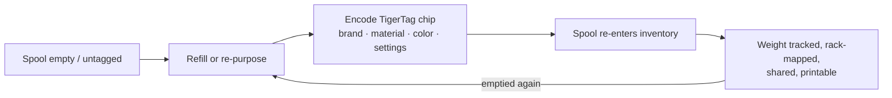

# Процесс «Вторая жизнь»

## Проблема «умных» катушек сегодня

Когда катушка с меткой от производителя заканчивается, метка умирает вместе с ней: она описывала
одну заводскую катушку в формате одного производителя и не может быть использована повторно.
Корпус катушки выбрасывают или заправляют «глупым» филаментом.

## Вторая жизнь: опознать заново, а не выбрасывать

Чип TigerTag **доступен для записи и перезаписи**. Когда катушка опустела и заправлена
заново — или когда у катушки любого бренда вообще нет полезной метки — пользователь
кодирует чип TigerTag реальным профилем нового филамента и клеит его. Катушка получает
*вторую жизнь* как полноценный, сам себя опознающий объект:

*Даже рефил без катушки несёт свою идентичность — чип крепится прямо к мотку.*

## Как происходит кодирование

- **Tiger NFC Connect** (мобильное) — программирование чипов касанием NFC.
- **Tiger Studio** (настольное) — управляемое обновление чипа со считывателем ACR122U /
 [TigerPOD](../products/tigerpod.md): поместите чип, проверка совпадения UID,
 проверенная запись.
- **Сначала цифра** — *TigerData* в Tiger Studio позволяет сразу создать полностью цифровую
 (без чипа) катушку и **позже превратить её в катушку с настоящим чипом, атомарно**.

> **Примечание:** каталог брендов, материалов и цветов, используемый при кодировании,
> поставляется общей [справочной базой данных](../concepts/universal-filament-identity.md), поэтому
> перекодированный чип так же точен, как заводской.

## Вторая жизнь самого чипа — ноль электронных отходов

Вторую жизнь получает не только катушка: **чипы тоже.**
На каждой катушке [два чипа](../concepts/tigertag-chip.md) — значит, с каждого килограмма
напечатанного филамента вам остаётся **два стандартных чипа NTAG**. Снимите
их и перекодируйте как обычный NDEF для чего угодно: умный брелок, NFC-визитка,
собственный подключённый объект — редактор встроен в приложение.
Он даже умеет переписать чип **в формате, которого ожидают принтеры Elegoo**:
ваш чип, ваш выбор.

Именно поэтому производство официальных фирменных чипов перешло на **NTAG215**:
больший запас памяти — больше возможностей повторного использования, когда катушка опустеет.
Цель проста — **чип катушки никогда не должен становиться электронными отходами.**

---

**◀ Назад:** [Смартфон-мост](./smartphone-bridge.md) · **▲ [Оглавление документации](../../README.md)** · **Далее ▶** [Универсальная идентичность филамента](../concepts/universal-filament-identity.md)

**См. также:** [TigerTag](../products/tigertag.md), [TigerTag+](../products/tigertag-plus.md)
