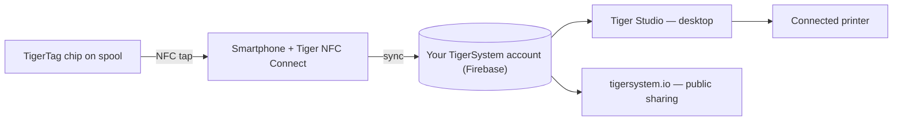

# Концепция смартфона-моста

## Главная идея

> В Китае мы всё время спрашивали: *«Где RFID-считыватели?»* Все отвечали:
> *«В Bambu Lab».* Неверно — считыватели Bambu находятся в AMS, а не в принтере;
> машина вообще не способна обнаружить стороннюю катушку. **RFID-считыватели у вас в
> карманах** — в каждом телефоне, готовые к работе, а вы об этом даже не знаете.

В каждом современном смартфоне есть считыватель NFC. Это значит, что **у каждого
пользователя 3D-печати уже есть оборудование TigerTag** — не нужны ни проприетарный
считыватель, ни обновление принтера, ни покупки для начала работы.

Телефон выступает **мостом** между физической катушкой и цифровым инвентарём:

1. **Касание** — профиль чипа (бренд, материал, цвет, параметры) считывается одним жестом.
2. **Синхронизация** — катушка мгновенно появляется в облачном инвентаре пользователя.
3. **Везде** — настольное приложение, веб и подключённые принтеры теперь знают эту катушку.

## Нативный RFID и мост

Некоторые принтеры читают метки нативно — обычно в собственном проприетарном
формате, изредка сам TigerTag; большинство не читает ничего. Мост делает
возможности принтера несущественными:

| Путь | Требуется | Работает с |
|---|---|---|
| **Нативный RFID — тег производителя** | Принтер, читающий заблокированную метку данного производителя | Только один бренд |
| **Нативный RFID — TigerTag** | Машина, чья собственная прошивка читает TigerTag, — редкость, и пока это работа сообщества | Любым брендом, без приложения посередине |
| **Смартфон-мост** | Любой телефон с NFC | **Любым принтером**, любого бренда, даже полностью автономными машинами |

Средняя строка — не наша, и она появилась недавно. Расширенная прошивка
сообщества делает [Snapmaker U1](../compatibility/snapmaker.md) первым принтером,
который читает TigerTag на самой машине; а **BT-AMS-C**, четырёхслотовый
считыватель, устанавливаемый на AMS от Bambu Lab, отправляет данные TigerTag
прямо в BMCU принтера ([стороннее оборудование](../compatibility/third-party-hardware.md)).
Оба случая остаются исключениями — и это довод в пользу моста, а не против
него: ему никогда не приходилось их ждать.

С мостом данные о филаменте попадают в принтер через
[интеграции принтеров Tiger Studio](../compatibility/README.md) (сегодня работают шесть
брендов) — катушка сообщает о себе *системе*, а система общается с машиной.

Доказательство на примере: **в принтерах FlashForge нет RFID-считывателя вообще** —
и благодаря мосту они теперь всё равно работают с филаментом, опознанным по NFC. Целая
новая возможность, добавленная чужим машинам, **совершенно бесплатно для
пользователя** ([случай FlashForge](../compatibility/flashforge.md)).

---

**◀ Назад:** [Открытая экосистема](./open-ecosystem.md) · **▲ [Оглавление документации](../../README.md)** · **Далее ▶** [Процесс «Вторая жизнь»](./second-life.md)

**См. также:** [Tiger NFC Connect](../products/tiger-nfc-connect.md), [Обзор архитектуры](../architecture/overview.md)
