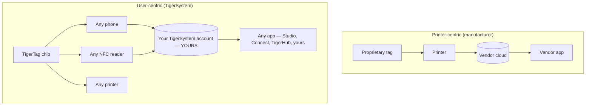

# Ориентация на пользователя vs ориентация на принтер

> **Интеллект на службе пользователя, а не только принтера.** (*Intelligence serving the user — not just the printer.*)

## Две противоположные архитектуры

В мире, ориентированном на принтер, в центре стоит **принтер**: метка существует для
обслуживания машины, а данные утекают в силос производителя.

В TigerSystem в центре стоит **пользователь**. Пользователю принадлежат:

- **филамент** — любого бренда, любого производителя;
- **метаданные** — материал, цвет, параметры печати, закодированные на чипе, который он контролирует;
- **инвентарь** — хранится в его собственном облачном аккаунте, его можно экспортировать;
- **история** — вес, местоположение, расход со временем;
- **синхронизация** — один и тот же аккаунт питает все приложения и устройства.

TigerSystem просто **соединяет все компоненты друг с другом**.

## Почему производители блокируют RFID

Метки производителей обычно защищены криптографически (подробности по каждому
производителю — в [разделе о совместимости](../compatibility/README.md):
ключи, производные от UID, секторы с шифрованием AES, подписи RSA). Блокировка выгодна
производителю: она привязывает покупку расходников к машине и оставляет конвейер данных
закрытым. Это также означает, что **ваш собственный инвентарь катушек вам не принадлежит**.

Чипы TigerTag занимают противоположную позицию: открытая нагрузка NDEF на стандартном
чипе NTAG, публично документированная, с открытыми SDK для чтения и записи.

---

**◀ Назад:** [Зачем существует TigerSystem](../vision/why-tigersystem.md) · **▲ [Оглавление документации](../../README.md)** · **Далее ▶** [Открытая экосистема](./open-ecosystem.md)

**См. также:** [Универсальная идентичность филамента](../concepts/universal-filament-identity.md), [Совместимость](../compatibility/README.md)
