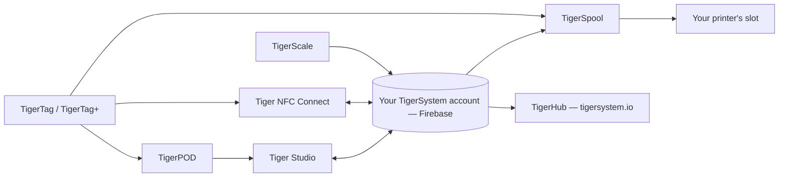

# Продукты

Экосистема TigerSystem: по странице на каждый продукт.

**Это официальные продукты** — разработанные и опубликованные TigerSystem.
«Официальные» здесь значит *мы это сделали*, а не *вам это нужно*: все они
с открытым исходным кодом и доступны для форка, а их названия (Tiger Studio, TigerHub, TigerScale,
TigerPOD, Tiger NFC Connect) намеренно **не заявлены как товарные знаки**.
Зарезервирован только сам знак **TigerTag**, и только для чипа.

Любой может создать и продавать альтернативу — считыватель, приложение, весы, целую
систему учёта. Что уже существует, см. в разделах [стороннее оборудование](../compatibility/third-party-hardware.md)
и [программное обеспечение на основе TigerTag](../developers/integrations.md). Сторонний продукт
**совместим с TigerTag** просто тем, что работает; **TigerTag Certified** он становится только
тогда, когда TigerSystem это подтверждает
([политика в отношении товарного знака](../../TRADEMARK.md)).

> **Примечание:** каждый **пользовательский** продукт ниже — и каждый будущий — это
> рабочее **доказательство концепции**. Их единственная цель — показать потенциал
> открытого, стандартного, независимого от производителей, кросс-платформенного протокола и вдохновить
> на то, что другие построят на его основе. (Заводской инструментарий программирования чипов
> — совсем другое дело: промышленного уровня, в производстве.) См.
> [Песочница, намеренно](../vision/why-tigersystem.md).

| Продукт | Что это | Тип |
|---|---|---|
|  [TigerData](../concepts/universal-filament-identity.md) | Виртуальный чип — идентичность в цифровом виде, чип не нужен, можно перевести в чип в любой момент | Концепция |
|  [TigerTag](./tigertag.md) | Открытый чип RFID/NFC + стандарт идентичности катушки | Оборудование + спецификация |
|  [TigerTag+](./tigertag-plus.md) | TigerTag с идентификатором продукта из каталога и необязательным обогащением — по-прежнему 100 % офлайн; будучи подписанным, это TigerTag+ Certified | Оборудование + спецификация |
|  [Tiger NFC Connect](./tiger-nfc-connect.md) | Мобильное приложение (iOS/Android) — сканирование, кодирование, просмотр | Приложение |
|  [Tiger Studio](./tiger-studio.md) | Настольное приложение — инвентарь, стеллажи, датчики, принтеры | Приложение |
|  [TigerHub](./tigerhub.md) | Веб-дом экосистемы — витрина, списки желаний, друзья и обмен на `tigersystem.io` | Веб |
|  [TigerPOD](./tigerpod.md) | Печатаемая на 3D-принтере подставка с двумя NFC-считывателями | Оборудование |
|  [TigerScale](./tigerscale.md) | Весы для филамента на ESP32 с открытым исходным кодом | Оборудование |
|  [TigerSpool](./tigerspool.md) | Коробка на ESP32 с открытым исходным кодом рядом с принтером — коснитесь катушкой, выберите слот, любой бренд | Оборудование |
|  [Tiger Touch](./tigertouch.md) | Прошивка с открытым исходным кодом для экрана BIGTREETECH Panda Touch / K-Touch — принтеры любого бренда, вживую, на одном экране | Прошивка |
|  [TigerTag Factory & Manager](./factory-suite.md) | Промышленные инструменты программирования чипов и базы данных филамента для заводов — **не для широкой публики**, производственного уровня | Промышленный |

---

**◀ Назад:** [Поток данных](../architecture/data-flow.md) · **▲ [Оглавление документации](../../README.md)** · **Далее ▶** [TigerTag](./tigertag.md)
