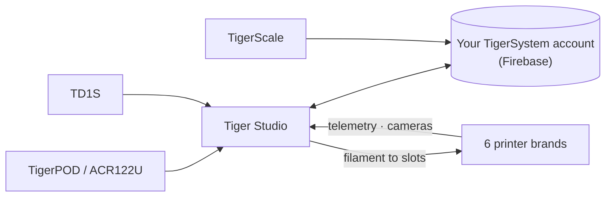

# Tiger Studio (настольное приложение)

## Назначение

**Tiger Studio — центр управления вашим филаментом.** Каждая катушка, каждый
стеллаж, каждый принтер на одном экране — отсканируйте чип, и катушка откроется,
обновите вес, и он синхронизируется везде, взгляните на принтер и увидите, что
он делает прямо сейчас. Открытый исходный код, Windows / macOS / Linux.

*Tiger Studio на столе, приложение в кармане, считыватель рядом — один и тот же
инвентарь, где бы вы к нему ни обратились.*

<a class="ts-cta-primary" href="https://tigersystem.io/download">Скачать Tiger Studio — бесплатно</a>

<a href="https://github.com/TigerTag-Project/TigerTag-Studio-Manager"> Исходный код</a>

Это намеренно **лаборатория, а не конечная цель** — демонстрация того,
что делает возможным открытый протокол: читаемая, доступная для форка и свободно копируемая
([философия](../philosophy/open-ecosystem.md)).

## Где он находится

## Функции (основные)

- **Инвентарь** — синхронизация Firestore в реальном времени, табличный/плиточный вид, панель
 сведений, отслеживание веса, калибровка контейнеров, цифровые катушки (TigerData) с
 атомарным переводом в чип.
- **Принтеры** — живые интеграции для **6 брендов** (телеметрия, филамент по
 слотам, ход задания, камеры, а для некоторых брендов — полные панели управления). См.
 [совместимость](../compatibility/README.md).
- **Стеллажи** — перетаскиваемое сопоставление физического хранилища.
- **Друзья и обмен** — коды обнаружения, инвентари друзей только для чтения.
- **Устройства** — собственные: [TigerPOD](./tigerpod.md) и
 [TigerScale](./tigerscale.md); сторонние: NFC-считыватель ACR122U,
 анализаторы **AJAX-3D TD-1 и TD1s** (TD + цвет прямо в профиль катушки)
 и **USB HID-весы** (DYMO серии M и любые совместимые) —
 полный список: [совместимое стороннее оборудование](../compatibility/third-party-hardware.md).
- **11 локалей** — EN · FR · DE · ES · IT · NL · PL · PT-BR · PT-PT · RU · 中文.

Полный, всегда актуальный каталог находится в
[FEATURES.md](https://github.com/TigerTag-Project/TigerTag-Studio-Manager/blob/main/FEATURES.md) репозитория приложения.

## Архитектура

Electron + чистый JS, без сборщика. Связь с принтерами использует **нативный
LAN-протокол** каждого производителя напрямую (MQTT / WebSocket / HTTP) — заметки по протоколам
каждого бренда ведутся в репозитории приложения (`renderer/printers/<brand>/PROTOCOL.md`).

## В картинках

## Ссылки

- Репозиторий и загрузки: [TigerTag-Studio-Manager](https://github.com/TigerTag-Project/TigerTag-Studio-Manager) (MIT)
- Полный каталог функций: [FEATURES.md](https://github.com/TigerTag-Project/TigerTag-Studio-Manager/blob/main/FEATURES.md)

---

**◀ Назад:** [Tiger NFC Connect](./tigertag-connect.md) · **▲ [Оглавление документации](../../README.md)** · **Далее ▶** [TigerHub](./tigerhub.md)

**См. также:** [Совместимость](../compatibility/README.md), [Архитектура](../architecture/overview.md)
