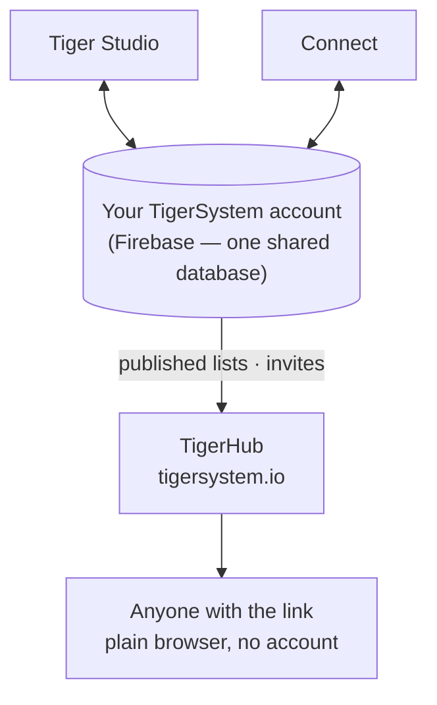

# TigerHub

## Назначение

**TigerHub — дом экосистемы в вебе**, сайт
**[tigersystem.io](https://tigersystem.io)**. Он представляет песочницу TigerSystem
и то, что делает возможным открытый протокол TigerTag, и содержит
**социальную часть** песочницы: поделиться списком желаний, пригласить кого-то
стать другом, опубликовать список только для чтения, который любой может открыть в браузере.

## Где он находится

## Функции — все работают уже сегодня

- **Витрина экосистемы** — главная страница рассказывает всю историю: как это работает,
 шесть брендов принтеров, компоненты и три уровня (TigerData —
 учёт только программно · TigerTag — офлайн-чип · TigerTag+ — проверенная
 подлинность).
- **Ваш аккаунт в вебе** (`/account`) — войдите в свой аккаунт TigerSystem
 из браузера.
- **Списки желаний** — публичные и только для друзей, оба вида развёрнуты.
- **Коды друзей и приглашения** — добавляйте друг друга в друзья из веба.
- **Публичные ссылки на списки** — делитесь инвентарём или списком желаний только для чтения как
 `https://tigersystem.io/list/<token>`; зрителю не нужны ни приложение, ни
 аккаунт.
- **Каталог материалов и справочная база данных** (`/materials`, `/database`) —
 просматривайте общий каталог, по которому работают все приложения.
- **Принтеры и функции** (`/printers`, `/features`) — что с чем работает.
- **3D-модели** (`/models`) — модели для печати (TigerPOD и другие).
- **Для производителей, разработчиков и прессы** (`/manufacturers`, `/developers`,
 `/press`) — история для B2B, указатели по интеграции, медиаматериалы.
- **Сувениры** (`/goodies`) — официальная кепка и поло. Покупка — один из
 способов [поддержать проект](../support.md).

## TigerHub — не база данных

Аккаунты пользователей и данные всех приложений находятся в **обычном Firebase**
(Auth + Firestore) — намеренно безымянной инфраструктуре: **единая общая
база данных в одном месте**, чтобы Tiger Studio, Tiger NFC Connect, TigerScale
и аккаунт TigerSystem работали с одними и теми же данными. TigerHub — это
**веб-поверхность**, построенная поверх неё. См.
[Инвентарь и облачная синхронизация](../concepts/inventory-and-cloud-sync.md).

## Взаимодействия

| С чем | Как |
|---|---|
| Tiger Studio / Connect | Создание и отзыв ссылок для обмена, отправка приглашений в друзья |
| Firebase (база данных аккаунтов) | Источник опубликованных данных |
| Посетители | Обычный браузер, аккаунт не нужен |

---

**◀ Назад:** [Tiger Studio](./tiger-studio.md) · **▲ [Оглавление документации](../../README.md)** · **Далее ▶** [TigerPOD](./tigerpod.md)

**См. также:** [Инвентарь и облачная синхронизация](../concepts/inventory-and-cloud-sync.md), [Архитектура](../architecture/overview.md)
