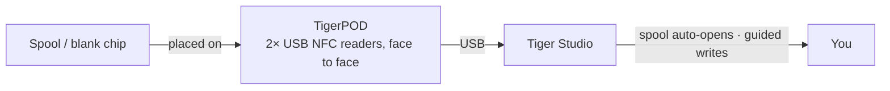

# TigerPOD

## Назначение

**Первый «CD-плеер» для умных катушек с филаментом.** TigerPOD ставит сканер катушек
на ваш стол — и вы печатаете его сами.
Бесплатная подставка с открытым исходным кодом, печатаемая на 3D-принтере, с **двумя** USB NFC-считывателями, **обращёнными
друг к другу**: поставьте катушку — она опознает себя в Tiger Studio; положите чистый
чип — закодируйте его. Так же естественно, как коснуться телефоном, но без рук, за настольным компьютером.

*Поставьте катушку — она сама представится.*

<a class="ts-cta-primary" href="https://tigersystem.io/tigerpod">Получить TigerPOD</a>
<a href="https://makerworld.com/fr/models/1289152-tigerpod-for-openspool-tigertag-rfid-filament#profileId-1318958">Напечатать — бесплатный STL</a>

<a href="https://github.com/TigerTag-Project/TigerPOD"> Исходный код</a>

## Почему два считывателя, обращённых друг к другу

В этом вся суть корпуса, и это единственное, что нужно сделать правильно. **Мы
рекомендуем всегда два считывателя.** Один технически работает, но ухудшает
впечатление двумя конкретными способами:

- **Чтение.** Катушка несёт
 [**два чипа на противоположных гранях**](../concepts/tigertag-chip.md). С одним
 считывателем катушку, оказавшуюся «не той» стороной, приходится поднять и
 перевернуть, прежде чем её увидят. Со считывателем с каждой стороны, как бы вы ни поставили
 катушку, чип уже оказывается перед считывателем. Ничего не нужно переворачивать, ни во что целиться.
- **Запись.** Когда вы размечаете катушку сами, вы записываете **оба** чипа. Один
 считыватель — это два прохода и два шанса сделать их разными. Два считывателя записывают
 пару **за один раз**, и Tiger Studio может сверить их друг с другом.

Pod существует, чтобы удерживать эту геометрию: два считывателя, вертикально, друг напротив друга, на расстоянии
катушки. Всё остальное — оболочка вокруг этого.

## Где он находится

## Два корпуса для печати — оба бесплатные

| | **TigerPOD Mini** — *рекомендуется* | **TigerPOD (оригинал)** |
|---|---|---|
| |  |  |
| Печать | Быстрее, меньше филамента | Дольше, больше филамента |
| Место на столе | Меньше | Больше |
| Кабели | Проложены **внутри** корпуса | Снаружи |
| Метки | TigerTag **и** OpenSpool (NDEF) | TigerTag **и** OpenSpool (NDEF) |
| Загрузка | **[MakerWorld — TigerPOD Mini](https://makerworld.com/fr/models/3190348-tigerpod-mini-for-openspool-tigertag-rfid-filament#profileId-3609236)** | **[MakerWorld — TigerPOD оригинал](https://makerworld.com/fr/models/1289152-tigerpod-for-openspool-tigertag-rfid-filament#profileId-1318958)** |

Оба удерживают одни и те же два считывателя класса ACR122U, обращённых друг к другу. Mini —
переработка оригинала и просто лучший Pod: начинайте с него, если только вам специально
не нужна более крупная люлька.

Лицензия **CC BY 4.0** — свободно переделывайте и адаптируйте.

## Из чего он состоит

STL — это корпус; вот детали, которые идут внутрь. Ничто здесь не является
эксклюзивным — подойдёт любой считыватель класса ACR122U и любой USB-C разветвитель, — но это
комбинация, под которую спроектирован корпус:

| Деталь | Количество | Что это |
|---|---|---|
| **TigerTag Player** | **2** | USB NFC-считыватель — устройство класса ACR122U. По одному с каждой стороны, чтобы оба чипа катушки охватывались за один проход. |
| **TigerTag Spliter** | 1 | USB-C в 2× USB-A, чтобы два считывателя подключались к компьютеру через один порт и могли программироваться параллельно. |
| **Печатный корпус** | 1 | **Mini** или оригинал — см. выше. |

### Где взять детали

Корпус — бесплатная загрузка; два считывателя и разветвитель — то, что нужно
покупать. Они продаются комплектом, что дешевле всего даёт правильную пару:

- **[TigerTag Player Bundle — 2 считывателя + Spliter](https://www.atome3d.com/products/tigertag-player-bundle-2pcs-spliter)** (Atome3D)
- Также доступно на **[tigertag.io](https://shop.tigertag.io/collections/tigertag-rfid-maker)**

> **Примечание:** самостоятельная сборка и покупка готового устройства приводят
> к совершенно одному и тому же устройству. Подойдут любые два считывателя класса ACR122U —
> комплект просто избавляет вас от поиска их по отдельности.

## Соберите свой

1. **Напечатайте корпус** — Mini или оригинал, выше.
2. **Возьмите два совместимых с ACR122U считывателя** в любом магазине, и пачку
 чистых чипов NTAG 213 / 215 / 216 для записи.
3. **Вставьте по считывателю в каждый паз** — без винтов, без клея, без проводки.
4. **Подключите оба к компьютеру.** Разветвитель делает из них один кабель; два USB-порта
 работают так же хорошо.
5. **Установите [Tiger Studio](./tiger-studio.md)** — он сам обнаружит считыватели.

Примерный бюджет при раздельной закупке — цены зависят от магазина и региона:

| Деталь | Кол-во | Прибл. | Где |
|---|---|---|---|
| NFC-считыватель, совместимый с ACR122U | 2 | €15–25 за штуку | [Amazon](https://amzn.to/4vok3d7) · или любой магазин |
| Чистые чипы NTAG 213 / 215 / 216 | 1 пачка | €10–20 — по два чипа на катушку, так что пачки хватит на многие | [Amazon](https://amzn.to/3TzxGc7) · [официальные чипы](./tigertag.md) |
| Печатный корпус | 1 | только филамент | MakerWorld, выше |
| USB-разветвитель (2× USB-A розетка → 1× USB-A вилка) | 1 | €5–10, по желанию | [Amazon](https://amzn.to/4plgsv8) |

> Некоторые ссылки в этой таблице — **партнёрские ссылки Amazon**: как участник программы
> Amazon Associate, TigerTag получает вознаграждение с подходящих покупок, **без дополнительных затрат
> для вас**. Это помогает финансировать открытый протокол. Покупка тех же деталей в любом другом месте
> работает ничуть не хуже.

Покупка [набора](https://shop.tigertag.io/collections/tigertag-rfid-maker)
стоит дешевле, чем закупка тех же деталей по отдельности, считыватели приходят
с официальным логотипом проекта, и это финансирует стандарт — один из
нескольких способов [поддержать проект](../support.md). Но сборка из
универсальных деталей — **не второсортный путь, это тот же Pod**. Именно это и значит
открытый протокол.

### Совместимость считывателей

ACR122U работает по **PC/SC** — стандарту смарт-карт уровня ОС, который реализуют все считыватели
этого класса. Поскольку Pod опирается на PC/SC, а не на драйвер производителя, та же
конфигурация работает на **Windows, macOS и Linux**, и им может управлять любая
библиотека PC/SC.

## Функции

- Печатаемый на 3D-принтере корпус — **бесплатные STL на MakerWorld**, в размерах **Mini** и
 **оригинал**.
- Вмещает два USB-считывателя класса ACR122U лицом к лицу (станции чтения + записи).
- Plug-and-play с [Tiger Studio](./tiger-studio.md): сканирование чипа
 автоматически открывает соответствующую катушку; управляемое обновление чипа использует его
 для записи с проверкой UID.
- Не привязан к TigerTag: те же два считывателя работают и с метками **OpenSpool** (NDEF).

## Больше, чем TigerTag — универсальная станция NFC

Pod **не привязан к протоколу TigerTag**. Это буквально два
стандартных считывателя PC/SC в держателе в форме катушки: **всё, что умеет ACR122U,
умеет и Pod.**

Вы полностью управляете чипом — читаете, что на нём, записываете новое,
меняете имеющееся, стираете до чистого. Все четыре действия, в обе стороны. Нет
однократной записи, нет улицы с односторонним движением, нет привязки к производителю. А для филамента это происходит в
режиме **Dual NFC**: оба чипа катушки обрабатываются вместе, на катушках любого бренда.

ACR122U умеет гораздо больше, чем NTAG: **ISO 14443 Type A и B**, **MIFARE**
(Classic 1K/4K, Ultralight, DESFire), **FeliCa**, **Topaz/Jewel** и **типы
меток NFC Forum 1–4**. Всё, что можно прочитать или записать ACR122U, можно
прочитать или записать в Pod — включая метки [OpenSpool](../compatibility/openspool.md).

Именно это делает [вторую жизнь](../philosophy/second-life.md) реальной.
TigerTag никогда не блокируется от записи, поэтому когда катушка закончилась, вы можете стереть её
чипы и переписать их как новые TigerTag — или превратить в нечто совсем другое:
обычную метку **NDEF** для домашней автоматизации, передачу Wi-Fi, URL, визитную
карточку. И снова в TigerTag, когда захотите. Чип — это многоразовый ресурс, а не
одноразовая упаковка.

## Взаимодействия

| С чем | Как |
|---|---|
| Чипы TigerTag | Чтение / кодирование / проверка — оба чипа катушки сразу |
| Tiger Studio | Мгновенное опознание катушки, перевод в чип и обновление |

## В картинках

## Ссылки

- Репозиторий: [TigerPOD](https://github.com/TigerTag-Project/TigerPOD)
- STL — **[TigerPOD Mini](https://makerworld.com/fr/models/3190348-tigerpod-mini-for-openspool-tigertag-rfid-filament#profileId-3609236)** · [TigerPOD оригинал](https://makerworld.com/fr/models/1289152-tigerpod-for-openspool-tigertag-rfid-filament#profileId-1318958)
- Считыватели: [TigerTag Player Bundle (2 шт. + Spliter)](https://www.atome3d.com/products/tigertag-player-bundle-2pcs-spliter)

---

**◀ Назад:** [TigerHub](./tigerhub.md) · **▲ [Оглавление документации](../../README.md)** · **Далее ▶** [TigerScale](./tigerscale.md)

**См. также:** [Процесс «Вторая жизнь»](../philosophy/second-life.md)
