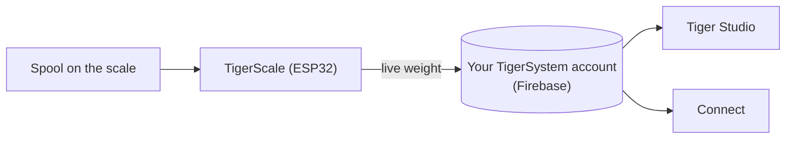

# TigerScale

## Назначение

**TigerScale отвечает на вечный вопрос: сколько филамента осталось?** Поставьте
катушку на открытые весы на ESP32, и вес в реальном времени попадёт прямо в ваш
инвентарь — без ручного ввода и без встряхивания катушки возле уха.

*Катушка поставлена, и весы уже знают, что это такое: чип сообщает
бренд, материал и цвет, тензодатчик — граммы. Ничего не вводится вручную,
ничего не угадывается.*

<a class="ts-cta-primary" href="https://tigertag-project.github.io/Tiger-Scale-V3/">Установить из браузера</a>

<a href="https://tigersystem.io/tigerscale">TigerScale на tigersystem.io</a>
<a href="https://makerworld.com/en/models/3161869-tigerscale-v3-best-smart-filament-scale-with-nfc#profileId-3573543">Напечатать корпус</a>
<a href="https://github.com/TigerTag-Project/Tiger-Scale-V3"> Исходный код</a>

> **Чип знает, чем филамент *является*; весы знают, сколько его
> *осталось*.** Вместе они делают инвентарь по-настоящему точным: идентичность
> от [TigerTag](./tigertag.md), количество в реальном времени от TigerScale.

## TigerScale V3 — текущее поколение

[Tiger-Scale-V3](https://github.com/TigerTag-Project/Tiger-Scale-V3), MIT.
Именно его стоит собирать.

- **Знает, какая катушка на нём лежит**: **два NFC-считывателя PN532**, по одному
 с каждой стороны, — [катушка с двойной меткой](../concepts/tigertag-chip.md) определяется
 в любом положении. Прочитать метку, взвесить, вычесть вес пустой
 катушки, синхронизировать — без ввода и без догадок.
- **ESP32-S3** (16 МБ флеш-памяти, PSRAM), **цветной сенсорный экран 3,5″ 480×320**
 (LVGL) с полной настройкой на экране: выбор WiFi + клавиатура, мастер калибровки,
 самотестирование оборудования, обновления по воздуху (OTA).
- **Питание от аккумулятора** (PMIC AXP2101, состояние зарядки на экране), аудиокодек.
- Точное взвешивание: HX711 + тензодатчик, медианная и адаптивная EMA-фильтрация —
 настроено на ощущения кухонных весов.
- **8 языков прошивки**, веб-интерфейс на 9 языках.
- **Отслеживание веса в реальном времени** — обновления появляются мгновенно в Tiger Studio и
 Tiger NFC Connect через Firestore.
- Работает с **калибровкой веса контейнера** в Tiger Studio, так что вес
 нетто филамента остаётся точным для каждого типа контейнера.
- **Работает офлайн.** Определение бренда и материала берётся из базы данных,
 хранящейся во флеш-памяти самого устройства и обновляемой не чаще раза в день, — поиск по метке
 никогда не ждёт сети.
- **Облачная синхронизация необязательна.** Весы полностью пригодны к использованию без аккаунта.
- **Собственный веб-интерфейс**, обслуживаемый самим устройством, удобный на телефоне, с обновлением
 по WebSocket на 10 Гц — не нужно устанавливать приложение, чтобы управлять им с телефона.
- **Никаких бинарных блобов**: всё компилируется из исходного кода.

*На верстаке: поставьте катушку, и она сама себя определит и взвесит.*

## Сборка

> **Не любите электронику?** USB-весы и [TigerPOD](./tigerpod.md) делают ту же
> работу без пайки и прошивки — это
> [официальная альтернатива без электроники](#usb-весы-и-tigerpod-без-электроники).

Весы собираются своими руками, и шаги, которые принято считать сложными, на деле простые:

1. **Напечатайте корпус.** Один проект Bambu Studio в формате `.3mf` с уже
 расставленными пластинами — [на MakerWorld](https://makerworld.com/en/models/3161869-tigerscale-v3-best-smart-filament-scale-with-nfc#profileId-3573543).
 Откройте его в Bambu Studio или Orca и нажмите «Нарезать»: ничего ориентировать не нужно, поддержки
 расставлять не нужно.
2. **Подключите компоненты.** Соедините тензодатчик, HX711, динамик и оба
 считывателя PN532 с платой по [схеме подключения](#схема-подключения)
 ниже — распиновка одинакова для обоих вариантов платы.
3. **Прошейте из браузера.**
 [Веб-установщик](https://tigertag-project.github.io/Tiger-Scale-V3/) всегда
 отдаёт текущий релиз; дальше весы обновляются сами по воздуху.

Детали — ходовой товар:

| Кол-во | Компонент | Где взять |
|---|---|---|
| 1 | Waveshare **ESP32-S3-Touch-LCD-3.5B** — сенсорный IPS 480×320 (вариант **-3.5** без B тоже подходит) | [-3.5B](https://link.amazon/B0gaANfF5) · [-3.5](https://link.amazon/B0dpgOlOQ) |
| 2 | NFC-модуль **PN532 V3** — нужны штыревая колодка **и** переключатель режимов | [Amazon](https://link.amazon/B0iTXrhjd) |
| 1 | Тензодатчик на 5 кг + HX711 | [Amazon](https://link.amazon/B09LOUuI1) |
| 1 | Кабель USB-C с 4 контактами + разъём | [кабель](https://link.amazon/B0aoW8qQx) · [разъём](https://link.amazon/B0aiEyjLx) |
| 1 | Li-ion аккумулятор — **необязательно**, весы работают от USB | [Amazon](https://link.amazon/B0etKlE1i) |
| — | Провода Dupont, самонарезающие винты M3 | [провода](https://link.amazon/B0bl6jvMs) · [винты](https://link.amazon/B0ekzxx1E) |
| — | 2× M4×30 и 2× M5×30 (тензодатчик), 4× M2×6 (дисплей) | любой строительный магазин |
| 1 | Небольшой динамик | входит в комплект платы ESP32-S3 |

<figure>

<figcaption><strong>Работают оба варианта, но им нужны разные прошивки.</strong> Прочтите шелкографию: <strong>-3.5B</strong> или <strong>-3.5</strong>. Веб-установщик спросит, какая у вас; подключение и корпус в обоих случаях одинаковые. Если прошить не ту сборку, весы запустятся без проблем, но никогда не увидят метку, а на экране не будет ни слова о причине.</figcaption>
</figure>
<figure>

<figcaption><strong>Предупреждение:</strong> у тензодатчика должно быть 2 резьбовых отверстия M4 и 2 резьбовых отверстия M5, а плата HX711 должна быть точно такой же, как на фото, — иначе она не встанет в предназначенное для неё место.</figcaption>
</figure>

> Некоторые ссылки в этой таблице — **партнёрские ссылки Amazon**: как участник программы
> Amazon Associate, TigerTag получает комиссию с подходящих покупок, **без дополнительных затрат
> для вас**. Это помогает финансировать открытый протокол. Покупка тех же деталей в любом другом месте
> работает ничуть не хуже.

Полная смета с ценами находится в
[репозитории](https://github.com/TigerTag-Project/Tiger-Scale-V3).

### Сборка корпуса

<figure>

<figcaption>Спереди в три четверти</figcaption>
</figure>
<figure>

<figcaption>Сзади в три четверти</figcaption>
</figure>
<figure>

<figcaption>Сзади в три четверти, крупным планом</figcaption>
</figure>
<figure>

<figcaption>Вид сбоку</figcaption>
</figure>

<figure>

<figcaption>Положение и ориентация весов</figcaption>
</figure>
<figure>

<figcaption>PN532 на своём месте в гнезде</figcaption>
</figure>

### Схема подключения

*[Интерактивная схема в Cirkit Designer](https://app.cirkitdesigner.com/project/c6aa6c0a-9462-498f-8923-9ad4454e0e69)*

### Устранение неполадок

**Не обнаруживается COM-порт для ESP32-S3 в [веб-установщике](https://tigertag-project.github.io/Tiger-Scale-V3/)?**

Возможно, в вашей системе не хватает драйвера. [Следуйте руководству по установке драйвера](../tutorials/tigerscale-serial-port-driver.md).

## Делайте и продавайте сами

**Любой может производить и продавать оборудование TigerScale. Без лицензионных платежей, без
роялти, без регистрации.** Соберите, прошейте официальную прошивку, продавайте.

Единственное условие, чтобы называть ваш продукт **TigerScale**, — работа на этой
официальной прошивке **без изменений**, чтобы каждое устройство вело себя одинаково внутри
экосистемы. Хотите что-то поменять — сделайте форк и дайте форку другое
название. Вот и вся сделка.

## Где он находится

## История на сегодня

Три поколения, и на каждом форма устройства менялась:

| | Считывание | Экран | Плата | Форм-фактор |
|---|---|---|---|---|
| **V1** — публично не выпускалась | **один** PN532 | мини-OLED | ESP32 | **держатель катушки**: центральная опора, проходящая через середину катушки |
| **V2** — [Tiger-Scale](https://github.com/TigerTag-Project/Tiger-Scale), MIT | 2× RC522 | OLED 0,96″ | ESP32-WROOM, питание от USB | плоские весы |
| **V3** — [Tiger-Scale-V3](https://github.com/TigerTag-Project/Tiger-Scale-V3), MIT | 2× PN532 | цветной сенсорный экран 3,5″ | ESP32-S3, аккумулятор | плоские весы, автономные |

В V1 уже была, по сути, электроника V2 — ESP32, мини-OLED,
плата HX711 с тензодатчиком на 5 кг, — но с **одним** считывателем и
совершенно другим корпусом.

> **V3 — это другое оборудование, а не обновление прошивки.** Они не
> взаимозаменяемы: уже собранная вами V2 остаётся в своём репозитории и продолжает
> работать. Просто она больше не развивается.

Все три полностью открыты (MIT) и построены на ходовых деталях — это живое доказательство того,
что ESP32 и модуль NFC-считывателя (класса PN532 / RC522) достаточны, чтобы
собрать устройство, читающее TigerTag.

## USB-весы и TigerPOD, без электроники

**Официальная альтернатива для тех, кто не хочет собирать весы.** Обычные
USB-весы и [TigerPOD](./tigerpod.md), оба подключены к
компьютеру, а остальное делает Tiger Studio — ничего не нужно паять, подключать или прошивать.

1. **Подключите весы к компьютеру** по USB.
2. **Поставьте TigerPOD сверху** — Mini или оригинальный.
3. **Обнулите весы (тара)** с TigerPOD на них.
4. **Откройте Tiger Studio.**
5. **Поставьте катушку на TigerPOD.** Он считает чипы катушки, и Tiger
 Studio откроет её карточку.
6. **Весы взвесят её**, и Tiger Studio сам обновит вес катушки.

### Какие весы подходят

Tiger Studio читает стандартные **USB-устройства «HID Scale»** (страница использования HID
`0x8D`, использование `0x20`): начиная с **DYMO M5** и остальной серии DYMO M
(M10, M25… тот же протокол) и **любых соответствующих стандарту HID Scale**, независимо от
бренда. Весы — стороннее оборудование, а не продукт Tiger; настройка вокруг них
официальная и поддерживается.

Протокол, проверенный на реальном оборудовании — 6-байтовые *Scale Data Reports* с частотой ~1 Гц:

| Байт | Значение |
|---|---|
| `[0]` | идентификатор отчёта `0x03` |
| `[1]` | статус: 1 сбой · 2 стабильно на нуле · 3 в движении · 4 стабильно · 5 отрицательное · 6 перегрузка |
| `[2]` | единица (коды HID PoS): `0x02` грамм · `0x0B` унция · `0x0C` фунт |
| `[3]` | знаковый показатель степени десяти, применяемый к исходному значению |
| `[4..5]` | вес, LE16 (младший, старший байт) |

Идентификатор производителя DYMO `0x0922`; у M5 pid `0x8009`. Особенность: самый первый кадр
сразу после тарирования сообщает единицу `0x00`.

> **DYMO M2 не поддерживается** — у неё вообще нет порта USB, так что
> подключать к компьютеру нечего. Протокол здесь не имеет значения.

## Взаимодействия

| С чем | Как |
|---|---|
| Firebase (база данных аккаунтов) | Записывает вес в реальном времени в аккаунт пользователя |
| Tiger Studio / Connect | Показывают вес в реальном времени; мониторинг состояния |

## Ссылки

- **V3 (текущая)**: [Tiger-Scale-V3](https://github.com/TigerTag-Project/Tiger-Scale-V3) (MIT)
- Прошить из браузера: [веб-установщик](https://tigertag-project.github.io/Tiger-Scale-V3/)
- Напечатать корпус: [MakerWorld](https://makerworld.com/en/models/3161869-tigerscale-v3-best-smart-filament-scale-with-nfc#profileId-3573543)
- V2, больше не развивается: [Tiger-Scale](https://github.com/TigerTag-Project/Tiger-Scale) (MIT)

---

**◀ Назад:** [TigerPOD](./tigerpod.md) · **▲ [Оглавление документации](../../README.md)** · **Далее ▶** [Совместимость](../compatibility/README.md)

**См. также:** [Инвентарь и облачная синхронизация](../concepts/inventory-and-cloud-sync.md)
