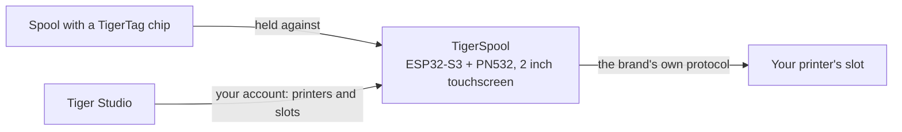

# TigerSpool

**Небольшая коробка рядом с принтером. Выберите слот, приложите к ней катушку — и
филамент будет записан в этот слот — на принтере любого бренда.**

*Коробка, катушка и слоты самого принтера на экране — каждый показывает,
что в него загружено. Выберите слот, приложите катушку к коробке — готово.*

<a class="ts-cta-primary" href="https://tigertag-project.github.io/TigerSpool-RFID/">Установить из браузера</a>

<a href="https://github.com/TigerTag-Project/TigerSpool-RFID"> Исходный код</a>

У вашего принтера уже есть список слотов. У вашей катушки уже есть своя
[идентичность](../concepts/universal-filament-identity.md). TigerSpool — это
тридцать сантиметров между ними: не нужно открывать приложение, не нужна клавиатура, ничего не нужно перепечатывать
из того, что чип уже знает.

Открытый исходный код под **MIT**, ESP32-S3, около **40 €** обычных деталей.

## Что он делает

1. **Коснитесь нужного слота** на сенсорном экране — с теми же названиями слотов,
 что использует сам принтер.
2. **Приложите катушку к коробке.** [Чип TigerTag](../concepts/tigertag-chip.md)
 считывается при касании, и назначение сразу уходит на принтер по
 собственному протоколу этого бренда: материал, бренд, цвет и температуры — в
 правильный слот. Подтверждать ничего не нужно.
3. **Загрузите катушку.** Коробка подскажет, в какой слот она была записана.

Он говорит на девяти языках, первым делом спрашивает, на каком, и обновляется
сам по воздуху.

:::caution[Предупреждение]
Сканирование TigerTag в слот на экране ничего не
загружает — оно лишь сообщает принтеру, чем *является* катушка. **Вам всё равно нужно
физически поставить катушку в этот слот самостоятельно** — CFS, AMS,
блок ACE или как бы ни назывался собственный лоток этого принтера. Если этого не сделать,
принтер сообщит об отсутствии филамента, потому что его действительно нет.
:::

## Где он находится

TigerSpool — не устройство для записи чипов: это работа [TigerPOD](./tigerpod.md)
на столе. TigerSpool берёт уже существующую идентичность и помещает её туда,
где её ожидает принтер.

## Что должно существовать заранее

**Именно здесь люди чаще всего попадаются, поэтому это идёт раньше оборудования.**

У коробки нет клавиатуры и нет способа ввести адрес принтера — намеренно.
Она читает ваши принтеры **из вашего аккаунта TigerSystem**, а значит,
два условия должны быть выполнены, чтобы она была полезна:

1. **Аккаунт, созданный в [Tiger Studio](./tiger-studio.md).** Коробка входит
 в него — по e-mail или через Google с помощью QR-кода, так что ни один пароль
 никогда не вводится на двухдюймовом экране.
2. **Ваши принтеры, добавленные в Tiger Studio.** Адрес, код доступа, бренд и
 модель — всё это хранится там.

Если это пропустить, список принтеров на коробке будет **пуст**. Это не
неисправность, и ремонтировать в устройстве нечего: оно показывает вам ровно то,
что содержит ваш аккаунт. Добавьте принтер в Tiger Studio, и он появится
при следующей синхронизации.

> **Коротко:** Tiger Studio → создайте аккаунт → добавьте свои принтеры →
> *затем* настройте коробку.

## Какие принтеры

**Охвачены шесть брендов, которые интегрирует Tiger Studio** — написано и проверено
на оборудовании. Это не все принтеры на рынке, и *«любой принтер»*
остаётся целью; это каждый бренд, с которым эта экосистема работает сегодня:

| Бренд | Прошивка | Транспорт |
|---|---|---|
| [Creality](../compatibility/creality.md) | реализовано, проверено | WebSocket |
| [FlashForge](../compatibility/flashforge.md) | реализовано, проверено | HTTP |
| [Bambu Lab](../compatibility/bambu-lab.md) | реализовано, проверено | MQTT поверх TLS |
| [Snapmaker](../compatibility/snapmaker.md) | реализовано, проверено | Moonraker поверх WebSocket |
| [Elegoo](../compatibility/elegoo.md) | реализовано, чтение проверено — запись на принтере пока не подтверждена | MQTT |
| [Anycubic](../compatibility/anycubic.md) | реализовано, чтение проверено — запись пока не подтверждена; только режим LAN | MQTT поверх TLS |

Названия слотов следуют названиям принтера: `Ext.` и `1A`–`1D` у Creality и
FlashForge, `A1`–`A4`, затем `B1`–`B4` у Bambu Lab, `E1`–`E4` у Snapmaker, `S1`–`S4` у
Canvas Elegoo и по одной букве на каждый блок ACE у Anycubic — `A1`, `A2`… затем
`B1`… для второй коробки.

Проверьте [статус по брендам](https://github.com/TigerTag-Project/TigerSpool-RFID/blob/main/docs/PRINTER-COMPATIBILITY.md)
перед покупкой деталей для конкретной машины.

## Соберите свой

Три вещи для покупки, четыре провода, один печатный корпус — плюс два дополнения, достойных
внимания. **Электроника одинакова для всех брендов принтеров** — меняется только
корпус, благодаря чему остаётся одна прошивка и один список деталей.

| Кол-во | Компонент | Где |
|---|---|---|
| 1 | Отладочная плата Waveshare **ESP32-S3-Touch-LCD-2** — 2,0" 240×320 IPS ёмкостный сенсор, ESP32-S3**R8**, 16 МБ флеш, 8 МБ octal PSRAM. Экран, сенсорная панель и MCU на одной плате, а 16 МБ делают два слота OTA комфортными | [Amazon](https://link.amazon/B0c5hr3uf) |
| 1 | Модуль NFC **PN532 V3** — DIP-переключатели, должен поддерживать **HSU/UART**, оба переключателя в положение `0` / OFF. Набор из двух стоит едва ли дороже одного | [Amazon](https://link.amazon/B0dyEfwKa) |
| 1 | Кабель USB-C **с передачей данных** — скорость не важна, подойдёт любой кабель данных USB 2.0 | [Amazon](https://link.amazon/B00Xg3WT4) |
| 1 | Магнитный разъём USB-C — **рекомендуется**: порт — деталь, с которой работают каждый день, и отпускает кабель, а не гнездо | [Amazon](https://link.amazon/B0bWVIBa0) |
| 1 | Литий-полимерный аккумулятор 3,7 В 1000 мАч, PH1.25 — **необязательно**, заряжается по USB; тогда коробка работает без кабеля. Плата не может определить аккумулятор, поэтому вы объявляете его в Settings › Battery. Проверьте полярность | [Amazon](https://link.amazon/B0fL0jjf3) |

> Некоторые ссылки в этой таблице — **партнёрские ссылки Amazon**: как участник программы
> Amazon Associate, TigerTag получает вознаграждение с подходящих покупок, **без дополнительных затрат
> для вас**. Это помогает финансировать открытый протокол. Покупка тех же деталей в любом другом месте
> работает ничуть не хуже.

**Четыре соединительных провода идут в комплекте с PN532** — 3V3, GND, TX, RX, и это
вся проводка. Никаких преобразователей уровня: PN532 работает при 3V3, как и плата.
Аккумулятор **необязателен** — обычно коробка стоит рядом с принтером, который
и так подключён к сети, а указанный аккумулятор нужен на случай, когда это не так.

*Вся проводка. На PN532 два вывода данных подписаны `SDA` и
`SCL` — в режиме HSU по ним идёт UART: **TX платы идёт к `SCL`**, её
**RX — к `SDA`**, и оба DIP-переключателя в положении `0` / OFF.
[Интерактивная схема](https://app.cirkitdesigner.com/project/5b546f4e-70b8-4735-afff-be6bd36bc10c).*

**Прошивка делается из браузера** — подключите плату, нажмите Install, подождите
минуту. Chrome, Edge или Opera на настольном ПК; Safari и Firefox не
реализуют WebSerial, как и ни один мобильный браузер.

**[Установить из браузера →](https://tigertag-project.github.io/TigerSpool-RFID/)**

### Три ловушки, о которых стоит знать до заказа

- **Считыватель подключается к GPIO43/44, никогда к GPIO6/7.** Эта пара — шина I²C
 с подтяжками на этой плате: PN532, подключённый туда, включается, отвечает
 и возвращает случайные UID со сбоями чтения. Это выглядит как плохая метка. Это не она,
 и это стоит дня работы.
- **`TXD` соединяется с RX платы, `RXD` — с её TX.** Передача говорит с
 приёмом. Если считыватель при запуске сообщает версию прошивки 0, поменяйте эти два
 местами, прежде чем менять что-либо ещё.
- **Кабель только для зарядки делает рабочую плату мёртвой на вид.** Экран
 загорается, а последовательный порт так и не появляется, поэтому веб-установщик не находит,
 куда устанавливать. Используйте кабель, про который вы знаете, что он передаёт файлы.

Waveshare продаёт несколько похожих плат; модели 1,28", 1,69" и 3,5" из
того же семейства имеют другие контроллеры панелей и распиновку, и эта прошивка
на них работать правильно не будет. Смотрите на шелкографию, а не на название в объявлении.

Полный список деталей, схема подключения и чек-лист запуска:
[TigerSpool-RFID](https://github.com/TigerTag-Project/TigerSpool-RFID).

## Где всё стоит сегодня

Записано, а не обнаружено:

- **Первый печатный корпус опубликован**: отдельно стоящая настольная подставка
 с катушкой слева или справа, в
 [Model3D/](https://github.com/TigerTag-Project/TigerSpool-RFID/tree/main/Model3D).
 Корпуса для установки на конкретный принтер следуют тому же правилу — та же плата, тот же
 считыватель, те же четыре провода, тот же вход USB-C — поэтому один образ прошивки работает на
 каждой модели, и любой может внести свой корпус, не трогая код.
- **Прошивка не подписана.** Соединение для обновления проверяется по
 хранилищу корневых сертификатов, так что коробка знает, с кем говорит, — но не знает, кто
 создал образ.
- **Не более десяти принтеров, подключённых одновременно** — из 24, которые аккаунт может ей передать, —
 и не более трёх, использующих TLS (Bambu Lab, Anycubic), которые требуют больше всего памяти.

---

**▲ [Оглавление документации](../../README.md)** · **См. также:** [TigerPOD](./tigerpod.md), [Tiger Studio](./tiger-studio.md), [Чип TigerTag](../concepts/tigertag-chip.md), [Совместимость принтеров](../compatibility/README.md)
