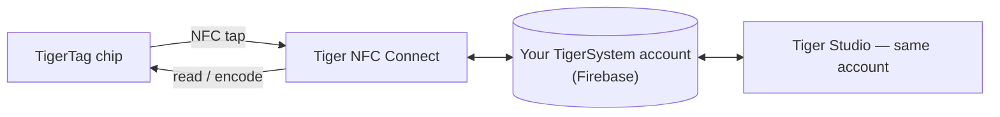

# Tiger NFC Connect (мобильное приложение)

## Назначение

**Ваш телефон уже является считывателем TigerTag — Connect его включает.**
Приложение для iOS/Android читает любую катушку одним касанием, так же легко записывает чипы
и хранит всю вашу коллекцию в кармане. Это повседневная точка входа в
экосистему и воплощение
[смартфона-моста](../philosophy/smartphone-bridge.md).

<strong>iPhone · iPad</strong>
<a class="ts-cta-primary" href="https://apps.apple.com/app/id6745437963">App Store</a>
Наведите камеру или нажмите кнопку

<strong>Android</strong>
<a class="ts-cta-primary" href="https://play.google.com/store/apps/details?id=com.tigertag.connect">Google Play</a>
Наведите камеру или нажмите кнопку

<a href="https://tigersystem.io/download">Все загрузки на tigersystem.io</a>
<a href="https://testflight.apple.com/join/jVHhmK4C">Бета-версия в TestFlight (iOS)</a>
<a href="https://play.google.com/apps/testing/com.tigertag.connect">Бета-версия в Google Play</a>

Бесплатно, в обоих магазинах. Приложение читает чип собственным NFC телефона — ничего
покупать не нужно, ни считыватель, ни аккаунт для чтения.

## Где оно находится

## Функции

- **Сканирование NFC на ходу** — коснитесь катушки и увидите её полный профиль.
- **Программирование чипов** — кодирование и перекодирование чипов TigerTag с телефона.
- **Просмотр каталога** — общая справочная база данных брендов/материалов/цветов.
- **Общий аккаунт** — тот же бэкенд Firebase, что и у Tiger Studio: инвентарь,
 друзья и стеллажи синхронизируются в реальном времени между устройствами.
- **USB-C аксессуары** — поддерживается анализатор филамента AJAX-3D **TD-1 / TD1s**
 по USB-C: измерьте Transmission Distance филамента (и
 цвет) прямо с телефона
 ([совместимое стороннее оборудование](../compatibility/third-party-hardware.md)).

## Где получить

- **Выпущено** в **App Store (iOS)** и **Google Play (Android)** —
 сегодня версия 1.0.2.
- Также доступны **публичные бета-версии** (TestFlight на iOS, открытая бета на Android).
- Все ссылки для загрузки: **[tigersystem.io/download](https://tigersystem.io/download)**
 — QR-код всегда доступен и в боковой панели Tiger Studio.

> **О названии:** ранее публиковалось как *«TigerTag RFID Connect»* — переименовано
> в **Tiger NFC Connect**, чтобы отразить NFC-считыватель, уже имеющийся в каждом телефоне.
> Приложение **бесплатно, но проприетарно** (не с открытым исходным кодом) — пока что,
> в отличие от Tiger Studio, SDK и оборудования, которые открыты.

## Архитектура

Приложение на Flutter, работающее с Firebase (Auth + Firestore) — единой общей
базой данных аккаунтов всех приложений. Подключение к принтерам на мобильном ориентировано на облако там, где
это позволяют производители.

## Взаимодействия

| С чем | Как |
|---|---|
| Чипы TigerTag | Чтение и запись касанием NFC |
| Firebase (база данных аккаунтов) | Синхронизация инвентаря / друзей / настроек в реальном времени |
| Tiger Studio | Настольный компаньон — тот же аккаунт, дополняющие функции |

## В картинках

|| | | |
|---|---|---|---|
|  |  |  |  |

---

**◀ Назад:** [TigerTag+ Certified](./tigertag-plus-certified.md) · **▲ [Оглавление документации](../../README.md)** · **Далее ▶** [Tiger Studio](./tiger-studio.md)

**См. также:** [Смартфон-мост](../philosophy/smartphone-bridge.md), [Инвентарь и облачная синхронизация](../concepts/inventory-and-cloud-sync.md)
