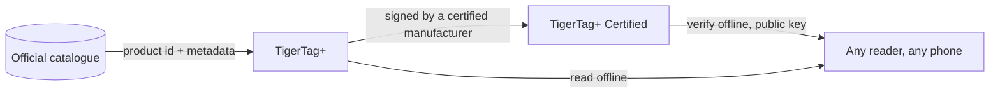

# TigerTag+ Certified

## Назначение

**Certified — это уровень, способный доказать, откуда взят чип.**
[TigerTag+](./tigertag-plus.md), дополнительно несущий **криптографическую
подпись**, является **TigerTag+ Certified**. Подпись записывает производитель, имеющий
[сертификацию TigerTag+](../developers/README.md), которому в её рамках
выдают инструменты подписи; закрытый ключ хранит TigerTag.

Это единственный из трёх уровней, не открытый для всех, и единственный,
отвечающий на вопрос, на который два других ответить не могут: *подлинная ли эта катушка?*

## Три уровня бок о бок

| | TigerTag | TigerTag+ | TigerTag+ Certified |
|---|---|---|---|
| Данные для печати, **на чипе** | ✅ | ✅ | ✅ |
| Полностью работает офлайн | ✅ | ✅ | ✅ |
| Идентификатор продукта из каталога, **на чипе** | — | ✅ | ✅ |
| Обогащающие метаданные, **через Web API, необязательно** | — | ✅ | ✅ |
| Подпись происхождения, **на чипе** | — | — | ✅ |
| Кто может изготовить | все | все | **сертифицированный производитель** |

Внимательно прочитайте левый столбец: обогащающие метаданные — единственная строка, которая
**не** хранится на чипе. Они запрашиваются из каталога, когда вы
оказываетесь онлайн, и могут улучшаться после записи чипа — именно поэтому они никогда не могут
быть тем, что нужно чипу. Всё, что требуется принтеру, находится в строках с пометкой
*на чипе*, и благодаря этому все три уровня остаются на 100 % офлайн.

## Проверка бесплатна — сертификация даёт право выпускать

**Проверка** подписи бесплатна, возможна офлайн и без ограничений: открытые ключи
опубликованы, и любой считыватель может проверить подпись без аккаунта и сети.
**Выпуск** подписи — это то, что даёт сертификация.

Подписываемое сообщение намеренно охватывает **собственный UID** чипа, поэтому подписанная
нагрузка, скопированная на другой чип, перестаёт ему соответствовать: клонированная метка не проходит
проверку на собственном телефоне покупателя. Это же свойство объясняет, почему два
чипа одной катушки несут две *разные* подписи
([как связаны два чипа](../concepts/tigertag-chip.md)).

## Где он находится

Побайтовая структура — идентификаторы типов чипов, 64-байтная область подписи на страницах
`0x18`–`0x27` — описана в
[TigerTag-RFID-Guide](https://github.com/TigerTag-Project/TigerTag-RFID-Guide).

## Кто сертифицирован

Авторитетный список производителей, которым разрешено наносить знак на продукт, —
это [реестр сертифицированных партнёров](../certified-partners.md). Логотип или название TigerTag
на чипе любого формата, носителе, катушке или её упаковке разрешены только для производителей с этой
страницы.

---

**◀ Назад:** [TigerTag+](./tigertag-plus.md) · **▲ [Оглавление документации](../../README.md)** · **Далее ▶** [Tiger NFC Connect](./tigertag-connect.md)

**См. также:** [Чип TigerTag](../concepts/tigertag-chip.md), [Сертифицированные партнёры](../certified-partners.md), [Документация для разработчиков](../developers/README.md)
