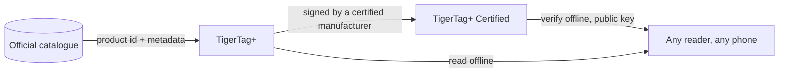

# TigerTag+

## Назначение

**Знак `+` означает «опознано».** TigerTag+ — это TigerTag, идентичность которого несёт
**идентификатор продукта из официального каталога** — не введённые кем-то значения, а
точный продукт: бренд, цвет, материал, температуры, диаметр, SKU, EAN —
прямо из источника. Сверх этого он может нести **необязательные обогащающие
метаданные**, предоставляемые Web API и улучшаемые после записи чипа.

Сам чип остаётся **100 % офлайн**. Всё необходимое для печати находится на нём,
как и на стандартном TigerTag — идентификатор каталога добавляет возможность запросить
более богатые и свежие данные, *когда вы оказываетесь онлайн*, и ничего не отнимает,
когда вас нет в сети. TigerTag+, считанный в режиме «в самолёте», ведёт себя как любой другой
TigerTag.

И *«онлайн»* тоже не является требованием. Весь справочник опубликован
одним файлом — каждый идентификатор каждого филамента в базе данных, свободно доступный для копирования
и зеркалирования, — так что считыватель с ним разрешает идентификатор каталога вообще без сети.
См. [Web API](../developers/web-api.md).

Это тот же `+`, что и в [TigerData+](../concepts/universal-filament-identity.md):
в обоих случаях он означает, что *эта идентичность — настоящий продукт из каталога*, и ни в одном
он не означает *сертифицировано*.

> **О названии:** ранее продавался как **«TigerTag Pro»** — теперь название
> **TigerTag+**.

## Что добавляет `+`

| | TigerTag | TigerTag+ |
|---|---|---|
| Данные для печати, **на чипе** | ✅ | ✅ |
| Полностью работает офлайн | ✅ | ✅ |
| Идентификатор продукта из каталога, **на чипе** | — | ✅ |
| Обогащающие метаданные, **через Web API, необязательно** | — | ✅ |
| Кто может изготовить | все | все |

Обогащающие метаданные — единственная строка, которая **не** хранится на чипе. Они
запрашиваются из каталога, когда вы оказываетесь онлайн, и могут
улучшаться после записи чипа — именно поэтому они никогда не могут быть
тем, что нужно чипу. Всё, что требуется принтеру, находится на чипе, и благодаря
этому каждый уровень остаётся на 100 % офлайн.

## Подписанный вариант

TigerTag+, дополнительно несущий криптографическую подпись, — это
**[TigerTag+ Certified](./tigertag-plus-certified.md)** — уровень, способный
доказать происхождение катушки и единственный, ограниченный сертифицированными
производителями. Проверка подписи остаётся бесплатной и офлайн для всех.

## Где он находится

## Резервное копирование чипа — отдельная функция

Tiger Studio может **сохранить точное содержимое чипа** в вашем аккаунте, привязав его
к физическому UID, а позже перепрограммировать чип обратно в это состояние. Это полезно
и не связано с `+`: подходит для любого чипа, который можно отсканировать, а наличие резервной копии
не делает чип TigerTag+.

- **Восстановление заводского состояния**: если чип случайно перезаписан или повреждён,
 верните его точно в прежнее состояние — вместе с подписью, если она была.
- **Только тот же чип**: восстановление допустимо на исходном чипе, потому что
 резервная копия привязана к его UID. Защита *этого* чипа, а не способ клонирования.
- **Доказательство владения**: сканирование, совпавшее с резервной копией, показывает, что исходный чип
 физически у вас в руках.

> **Примечание:** для создания резервной копии сейчас требуется **Tiger Studio + USB-считыватель
> (TigerPOD / ACR122U)**; поддержка мобильных запланирована.

## Взаимодействия

| С чем | Как |
|---|---|
| Tiger Studio + TigerPOD/ACR122U | Читает и проверяет подписи; создаёт и восстанавливает резервные копии чипов |
| Tiger NFC Connect | Читает и проверяет; поддержка резервных копий скоро |
| SDK | `tigertag[verify]` проверяет подпись офлайн, на Python или JS |
| Firebase (база данных аккаунтов) | Хранит каталог, обогащающие метаданные и резервные копии чипов по аккаунтам |

## Ссылки

- Официальные чипы: **[tigertag.io](https://tigertag.io)** (магазин)

---

**◀ Назад:** [TigerTag](./tigertag.md) · **▲ [Оглавление документации](../../README.md)** · **Далее ▶** [TigerTag+ Certified](./tigertag-plus-certified.md)

**См. также:** [Универсальная идентичность филамента](../concepts/universal-filament-identity.md), [Чип TigerTag](../concepts/tigertag-chip.md), [Документация для разработчиков](../developers/README.md)
