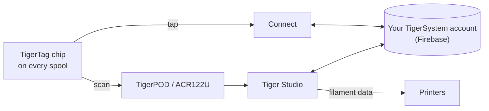

# TigerTag

## Назначение

**TigerTag даёт каждой катушке собственную память.** Небольшой NFC-чип хранит
всё о филаменте — бренд, материал, цвет, как его лучше печатать, — так что вам никогда не придётся
гадать, подписывать или запоминать. Коснитесь его телефоном, и катушка сама всё расскажет.

<a class="ts-cta-primary" href="https://tigersystem.io/tigertag">Что такое TigerTag — на tigersystem.io</a>

<a href="https://github.com/TigerTag-Project/TigerTag-RFID-Guide"> Открытая спецификация чипа</a>

С технической точки зрения это сердце экосистемы: открытый стандарт RFID, читаемый
любым совместимым приложением или считывателем — без привязки к производителю, без секретного формата.

## Где он находится

## Функции

- Стандартный чип **NTAG213 / 215 / 216** (рекомендуется круглый 25 мм), 144-байтная
 открытая нагрузка NDEF — рассчитана на самый маленький NTAG213; без ключей, без привязки.
- **Два чипа на катушку, на противоположных сторонах** — один всегда обращён к считывателю
 (слот принтера, AMS, телефон в руке), и каждый дублирует другой
 ([почему](../concepts/tigertag-chip.md)).
- Идентичность разрешается по общей [справочной базе данных](../concepts/universal-filament-identity.md).
- Доступен для записи и **перезаписи** — это делает возможным [процесс «Вторая жизнь»](../philosophy/second-life.md);
 официальные фирменные чипы поставляются как NTAG215, чтобы сам чип можно было использовать повторно как
 обычный объект NDEF (брелок, визитка…), когда катушка опустеет, —
 никаких электронных отходов.
- Читается любым смартфоном с NFC, считывателями ACR122U и [TigerPOD](./tigerpod.md).
- Зарезервированная **64-байтная область** (страницы `0x18`–`0x27`, остаётся 80 байт данных):
 свободна для **дополнительных функций сообщества** на стандартном TigerTag; на
 [TigerTag+](./tigertag-plus.md) хранит подпись происхождения — 32 байта `R`, 32 байта `S`.

## Архитектура

Краткое описание формата см. в разделе [Чип TigerTag](../concepts/tigertag-chip.md), а каноническую
побайтовую спецификацию — в
[TigerTag-RFID-Guide](https://github.com/TigerTag-Project/TigerTag-RFID-Guide).

## Взаимодействия

| С чем | Как |
|---|---|
| Tiger NFC Connect | Касание NFC: чтение, кодирование |
| Tiger Studio | Сканирование считывателем автоматически открывает катушку; управляемое обновление чипа |
| SDK | Разбор / проверка / кодирование из JS или Python |
| Принтеры | Косвенно — через [смартфон-мост](../philosophy/smartphone-bridge.md) и связи Studio с принтерами |

## В картинках

> **О названии:** стандартные чипы ранее продавались как **«TigerTag Maker»**
> — теперь название просто **TigerTag**.

## Официальные чипы и чипы всех остальных

**TigerSystem производит официальные чипы** и наносит на них логотип TigerTag.
Они бывают в двух форм-факторах, и оба поставляются **чистыми**:

| Форм-фактор | Для чего |
|---|---|
| **Наклейка** | любая катушка, которая у вас уже есть — по одной с каждой стороны ([почему две](../concepts/tigertag-chip.md)) |
| **Носитель для рефила** | [рефилы](../philosophy/second-life.md) филамента с картонной втулкой: один носитель уже несёт **оба чипа**, он находится внутри втулки до того, как рефил надевают на многоразовую мастер-катушку, так что чип путешествует вместе с филаментом, а не с катушкой |

Кто что вправе утверждать, когда чип продаётся:

| Кто | Что продаёт | Вправе называть | Логотип |
|---|---|---|---|
| **TigerSystem** | чипы собственного производства | **официальный** — сделан нами | да — она наносит знак |
| **Любой реселлер или дистрибьютор** | те же подлинные чипы | **официальный** — таков товар | да — знак на них уже нанесён |
| **Третья сторона, прошедшая аудит TigerSystem** | всё, что она создала — чипы, инлеи, носители, устройство, приложение | **сертифицированный** — присуждено, проверено аудитом, внесено в список, может быть отозвано | да, на продукте |
| **Любой, кто делает собственный чип** | свой собственный совместимый чип | *«совместим с TigerTag»* — и с **TigerTag+**, если проверяет подписи. Никогда не *«сертифицирован»*, что присуждает только TigerSystem | в своём приложении, документации и карточке в магазине; *«Compatible with TigerTag»* простым текстом на коробке совместимого устройства — **никогда не логотип и не название на чипе (любого формата), носителе, катушке или упаковке** |

Это последнее различие и есть вся политика в отношении товарного знака, и она уже, чем
кажется. Сказать, что ваш продукт *работает с* TigerTag, — факт о вашем продукте,
и показать логотип, чтобы сказать об этом, можно свободно. Нанесение знака — логотипа или названия —
**на** чип любого формата — это утверждение о том, **кто его сделал**: оно перестаёт значить «это работает с TigerTag»
и начинает значить «это *и есть* TigerTag». Только второе использование требует письменного
разрешения. См. [TRADEMARK.md](../../TRADEMARK.md).

Произведено более **2,5 миллиона чипов TigerTag** — большинство встроено
на заводе брендами филамента (Rosa3D, eSun, Sunlu, Landu, Jamg He, R3D,
Filforme, Lotactree, Smart3DPT, Nanovia, — а другие находятся в процессе интеграции). Все они —
[сертифицированные партнёры](../certified-partners.md); эта страница — реестр и
единственный авторитетный способ проверить, что знак на коробке легитимен.

|| | |
|---|---|---|
|  |  |  |

|| | | |
|---|---|---|---|
|  |  |  |  |

*Коробки и катушки внутри них — куплены в магазине, не постановочные для
фото. Вот как выглядит «самый распространённый».* Но протокол
намеренно **не привязан к официальным чипам**: любой дешёвый чистый чип NTAG, купленный
где угодно (Amazon, AliExpress, в местных магазинах), работает одинаково, и ничто этому не
мешает. Фирменные чипы помогают поддерживать разработку; распространение протокола — первая
награда. Другие способы помочь — в том числе те, что ничего не стоят, — описаны в разделе
[Поддержать проект](../support.md).

Свобода работает в обе стороны: **чипы никогда не блокируются от записи**. TigerTag —
просто базовый протокол, с которым заводы поставляют катушки, — если вы предпочитаете
другой протокол NFC/RFID (собственный или существующий), вы можете переписать чип
и перенести его данные в него. Ваша катушка, ваш чип, ваш формат.

## Где купить

Оба форм-фактора поставляются **чистыми** и продаются TigerSystem и
её реселлерами:

| | **Наклейка** | **Носитель для рефила** |
|---|---|---|
| Что вы получаете | круглые клейкие чипы 25 мм — **по два на катушку**, по одному с каждой стороны | один носитель = **два уже спаренных чипа**, по одному на загнутый конец, для картонной втулки |
| Для чего | любая катушка с бортами | рефилы филамента, устанавливаемые на мастер-катушку |
| Официальный магазин | [tigertag.io](https://shop.tigertag.io/collections/tigertag-rfid-maker) | [tigertag.io](https://shop.tigertag.io/collections/tigertag-rfid-maker) |
| Реселлер (FR) | [TigerTag Officiel, Atome3D](https://www.atome3d.com/products/tigertag) | [TigerTag Refill Officiel, Atome3D](https://www.atome3d.com/products/tigertag-pro-for-refill-1000-pcs) |

Оба доступны в нескольких размерах упаковки, вплоть до профессиональных количеств. И ничто из этого
не обязательно: **любой чистый чип NTAG, купленный где угодно, работает одинаково** — покупка
официальных финансирует протокол, не более.

## Ссылки

- Официальные чипы: **[tigertag.io](https://tigertag.io)** (магазин — поддерживает разработку)
- Формат чипа: [TigerTag-RFID-Guide](https://github.com/TigerTag-Project/TigerTag-RFID-Guide)

---

**◀ Назад:** [Продукты](./README.md) · **▲ [Оглавление документации](../../README.md)** · **Далее ▶** [TigerTag+](./tigertag-plus.md)

**См. также:** [Универсальная идентичность филамента](../concepts/universal-filament-identity.md), [Вторая жизнь](../philosophy/second-life.md)
