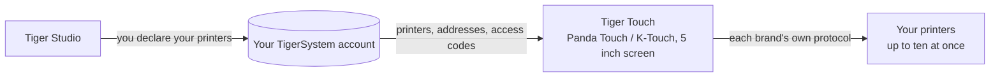

# Tiger Touch

**Ваш Panda Touch лежит в ящике. Подарите ему все ваши принтеры.** Бесплатная
прошивка с открытым исходным кодом, превращающая BIGTREETECH Panda Touch и K-Touch в единый
живой сенсорный экран для всех ваших 3D-принтеров — без пайки, без компьютера.

*Две живые карточки принтеров на одном экране: FlashForge AD5X и Bambu Lab X1C.*

<a class="ts-cta-primary" href="https://tigertag-project.github.io/Tiger-Touch/">Установить из браузера</a>

<a href="https://github.com/TigerTag-Project/Tiger-Touch"> Исходный код</a>

BIGTREETECH продаёт один небольшой 5-дюймовый сенсорный экран под двумя названиями: **Panda Touch**,
сделанный для принтеров Bambu Lab, и **K-Touch**, сделанный для принтеров на Klipper. Одна и та же
плата, две прошивки, каждая привязана к одному семейству машин. Сменили принтер —
и экран отправляется в ящик.

**Tiger Touch — новая прошивка для того же экрана**, написанная с нуля. Она
входит в ваш бесплатный аккаунт TigerTag, находит каждый объявленный там принтер
и общается с каждым напрямую, по его собственному протоколу, одновременно. Если у вас
есть Panda Touch или K-Touch, который больше не соответствует вашим принтерам, это то самое
оборудование, для которого создан Tiger Touch.

Открытый исходный код под **MIT**. Ничего паять, ничего печатать, никакого Raspberry Pi,
никакого сервера посередине: вы подключаете экран к порту USB, нажимаете **Install** в
браузере, и через две минуты он показывает ваши принтеры.

## Что он делает

- **Все бренды на одном экране** — Bambu Lab, Creality, Elegoo, Anycubic,
  Snapmaker, FlashForge, Prusa, а также любой Klipper (Moonraker) или OctoPrint.
- **Облако и LAN** — Bambu Lab через облако Bambu или в режиме LAN, Anycubic
  через облако Anycubic или по LAN, остальные — в вашей локальной сети.
- **Живое состояние для всех** — состояние, ход, файл, оставшееся время и время окончания,
  сопла, стол, камера и блоки филамента (AMS, CFS, Station, ACE, линии MMU / AFC),
  одновременно отслеживается до **десяти принтеров**.
- **Безопасное управление** — пауза, возобновление, остановка (удержание 1,5 с, чтобы случайное касание
  не прервало печать) и свет принтера. **Ничего другого никогда не отправляется**: ни
  нагрев, ни перемещение, ни запуск печати.
- **Обновляется сам** — новые версии приходят по Wi-Fi, проверяются перед установкой
  и откатываются сами, если не запускаются.
- **Одиннадцать языков** — английский, французский, немецкий, испанский, итальянский, китайский,
  португальский (Бразилия и Португалия), польский, русский, нидерландский.

<figure>

<figcaption><strong>Карточки</strong>: одна живая карточка на принтер, листайте для остальных.</figcaption>
</figure>
<figure>

<figcaption><strong>Список</strong>: все принтеры с одного взгляда. Одно касание переключает вид.</figcaption>
</figure>
<figure>

<figcaption><strong>Snapmaker U1</strong>: четыре инструментальные головки, активная обведена кольцом.</figcaption>
</figure>
<figure>

<figcaption><strong>FlashForge AD5X</strong>: внешняя катушка и станция материалов.</figcaption>
</figure>

## Где он находится

## Что должно существовать заранее

Tiger Touch читает ваши принтеры **из вашего аккаунта TigerSystem**, поэтому он никогда
не просит ввести адрес или код доступа на 5-дюймовом экране. Создайте аккаунт и добавьте
свои принтеры в **настольной** версии [Tiger Studio](./tiger-studio.md) (Windows,
macOS, Linux), которая находит их в вашей сети — веб-версия принтеры
добавлять не может.

> **Коротко:** Tiger Studio → создайте аккаунт → добавьте свои принтеры →
> *затем* настройте экран.

## Какие принтеры

Tiger Touch выбирает подключение по **бренду**, а не по модели: любой принтер
этих семейств, который может добавить Tiger Studio, может показать и Tiger Touch. В каталоге
Tiger Studio более 400 моделей примерно от 60 производителей.

| Бренд | Подключение | Проверено на реальной машине |
|---|---|---|
| [Bambu Lab](../compatibility/bambu-lab.md) (X1, P1, P2S, A1, H2…) | Облако Bambu или LAN (MQTT поверх TLS) | **Да** — печать через облако (P2S), простой в режиме LAN (X1C, A1) |
| [Creality](../compatibility/creality.md) (K2, K1, Hi, Ender-3 V4…) | WebSocket в LAN | **Да** — печать (K2), простой с CFS (Ender-3 V4) |
| [Snapmaker](../compatibility/snapmaker.md) U1 | Moonraker WebSocket | **Да** — простой, четыре инструментальные головки |
| [FlashForge](../compatibility/flashforge.md) (AD5X, Adventurer 5M, Creator 5, Creator 5 Pro) | HTTP в LAN | **Да** — AD5X: пауза, остановка и свет |
| [Anycubic](../compatibility/anycubic.md) (Kobra 3, Kobra X, Kobra S1…) | Облако Anycubic или LAN (MQTT поверх TLS) | **Да** — через облако (Kobra X), с его ACE: свет, пауза, возобновление и остановка |
| [Elegoo](../compatibility/elegoo.md) Centauri Carbon 1 и 2 | MQTT (CC2), SDCP (CC1) | **Да** — Centauri Carbon 2 и Centauri Carbon: пауза, возобновление, остановка и свет на CC2 |
| **Prusa** (MK4, Core One, XL, MINI) | PrusaLink | **Да** — прогресс, температуры, пауза, возобновление, остановка |
| [Klipper](../compatibility/klipper.md) — Voron, Qidi, Sovol, RatRig… | Moonraker HTTP | **Да** — на реальном принтере Klipper: пауза, возобновление, остановка и свет |
| **OctoPrint** — любой принтер Marlin за ним | REST API OctoPrint | Только на тестовом принтере Tiger Studio |

OctoPrint пока встречался только с тестовым принтером Tiger Studio, а у каждого бренда есть
модели, которые никто не пробовал: **отчёт с вашего принтера — самое полезное,
что вы можете прислать.** Пауза, возобновление и остановка работают везде, где подключение принимает
команды (не через облако Bambu); свет работает везде, кроме Prusa,
OctoPrint и Centauri Carbon 1. У каждого бренда есть своя страница с настройкой
и вопросами на [сайте установщика](https://tigertag-project.github.io/Tiger-Touch/).
Каждое поле и каждый тест описаны в
[статусе по брендам](https://github.com/TigerTag-Project/Tiger-Touch/blob/main/docs/PRINTER-COMPATIBILITY.md).

**Принтер показывает «offline»?** Сначала проверьте его режим LAN: по умолчанию он выключен у
Creality, FlashForge и Bambu Lab.

## Один экран, все бренды

Прошивки, с которыми поставляется экран, знают каждая **одно** семейство принтеров.

| | **Tiger Touch** | Прошивка Panda Touch | Прошивка K-Touch |
|---|---|---|---|
| Семейств принтеров на одном экране | **9** | 1 (Bambu Lab) | 1 (Klipper) |
| Принтеров вживую одновременно | **до 10**, все обновляются вместе | несколько Bambu Lab, в нашем использовании тормозит примерно с 3 | **1** за раз (50 сохранённых, переключение между ними) |
| Настройка принтеров | из вашего аккаунта TigerTag, на экране ничего не вводится | IP, серийный номер, код доступа | IP и порт или сканирование |
| Обновления по воздуху | Да, с проверкой и автоматическим откатом | Нет | Нет |

Прошивки BIGTREETECH дают полное управление их единственным семейством — запуск печати,
температуры, перемещения, — чего Tiger Touch намеренно не делает. Вы можете вернуться к
ним в любой момент.

*Столбцы Panda Touch и K-Touch взяты из собственной вики BIGTREETECH (прочитано
2026-10-16); «тормозит примерно с 3» — собственный опыт команды TigerTag, а не
цифра BIGTREETECH.*

## Установка за две минуты

1. **Объявите свои принтеры** в Tiger Studio, как описано выше.
2. **Прошейте экран из браузера.** Откройте
   **<https://tigertag-project.github.io/Tiger-Touch/>** в **Chrome или Edge** на
   компьютере (WebSerial: не Safari, не Firefox, не телефон), подключите экран
   кабелем USB-C **для передачи данных**, нажмите **Install** и выберите его порт. При замене
   прошивки BIGTREETECH: отметьте **Erase device**. При обновлении Tiger Touch по
   USB: оставьте неотмеченным, ваши Wi-Fi и аккаунт сохранятся.
3. **Следуйте указаниям на экране.** Язык, Wi-Fi, затем ваш аккаунт TigerTag — e-mail
   и пароль или **Continue with Google** с QR-кодом, сканируемым телефоном. Включите
   принтеры, которые хотите отслеживать, и всё. *Later* — всегда допустимый ответ:
   экран запускается сразу и подключается в фоне.

После этого делать нечего: экран раз в день проверяет новую версию
и устанавливает её двумя касаниями.

Впервые? [Руководство по установке](https://github.com/TigerTag-Project/Tiger-Touch/blob/main/docs/INSTALL.md)
охватывает драйвер USB (обязателен на macOS), сохранение копии прошивки BIGTREETECH,
чтобы можно было вернуться, и единственный флажок, который нужно отметить.

## Оборудование

**BIGTREETECH Panda Touch** и **K-Touch** разработаны и выпускаются
**BIGTREETECH** (BIQU): 5-дюймовый IPS-сенсорный экран 800×480 на базе ESP32-S3 с 8 МБ
PSRAM и 16 МБ флеш, Wi-Fi, USB-C и аккумулятором. Tiger Touch работает на нём
без модификаций и опирается на поддержку платы, опубликованную BIGTREETECH под
лицензией MIT. K-Touch — та же плата, что и Panda Touch, поэтому тот же
образ предназначен и для него, — но Tiger Touch пока запускался только на Panda Touch:
отчёт с K-Touch приветствуется.

Tiger Touch — независимый проект, не созданный и не одобренный BIGTREETECH, BIQU
или любым названным здесь производителем принтеров.

Соберите его сами на ESP-IDF 5.5 — шаги описаны в
[репозитории](https://github.com/TigerTag-Project/Tiger-Touch#build-it-yourself).

---

**▲ [Оглавление документации](../../README.md)** · **См. также:** [Tiger Studio](./tiger-studio.md), [TigerSpool](./tigerspool.md), [Совместимость принтеров](../compatibility/README.md)
