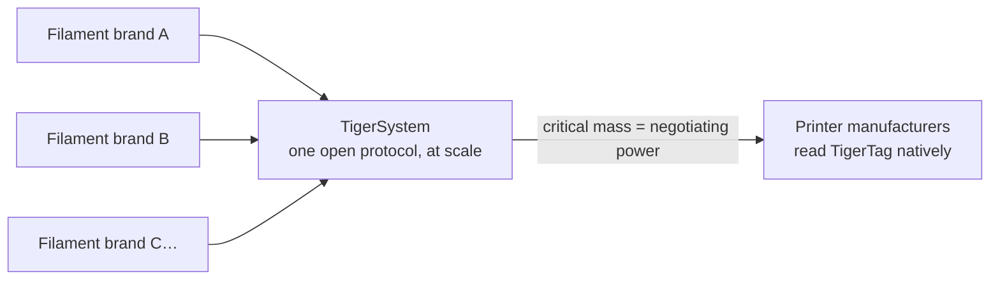

# Для производителей филамента

> **Сделайте свои катушки умными и подключёнными.**

## Умная катушка уже наступает — единственный открытый способ её сделать находится здесь

Принтеры всё чаще ожидают «умный» филамент: системы класса AMS, определение
материала для каждого слота, автоматические настройки. Каждый производитель принтеров отвечает на это
**закрытой меткой, привязанной к его машинам и работающей на его облако** — ноль
совместимости, ноль ценности для вашего бренда за пределами его стен. И каждая
закрытая метка служит ещё одной цели: **направлять ваших клиентов к
собственному филаменту производителя принтеров.** TigerTag был создан в 2023 году именно для того, чтобы
у сторонних брендов был лучший ответ — катушки умнее проприетарных,
без закрытого сада.

**TigerTag — самый распространённый сторонний RFID-протокол в мире**
и сегодня единственное жизнеспособное открытое решение для умной катушки, поставляемое в больших масштабах: открытый,
стандартный, агностичный, кросс-платформенный протокол, по которому уже произведено более
**2,5 миллиона чипов**, встроенных на заводе такими брендами,
как Rosa3D, eSun, Sunlu, Landu, Jamg He, R3D, Filforme, Lotactree и
Smart3DPT, а также Nanovia.

## Интеграция на заводе: дни, а не месяцы

У нас есть опыт и технологии, чтобы внедрить чипы TigerTag на вашу
производственную линию **быстро, просто и с очень низкими затратами — запуск уже
через 5 дней**, запись **каждого чипа примерно за 1 секунду** (тысячи
катушек в день, одним щелчком):

- Стандартное оборудование NTAG (никаких проприетарных компонентов, никакой привязки к оснастке),
 закупаемое в масштабе и по цене, выбранных ради одной непреложной цели: **добавить
 технологию, не прибавив к цене катушки для конечного пользователя ни цента.**
- Проверенный план интеграции, уже внедрённый на нескольких заводах,
 на основе промышленного набора [TigerTag Factory & Manager](../products/factory-suite.md):
 с одной стороны — ваша база данных филамента, с другой — массовая запись
 на скорости конвейера в каждую катушку, с **заводской подписью,
 подтверждающей происхождение каждого продукта**.
- Общая справочная база данных даёт вашим продуктам точную универсальную
 идентичность, которую одинаково распознаёт каждое совместимое приложение.

Бренды, поставляющие TigerTag в своей продукции, могут размещать знак **TigerTag
Certified** — заметный сигнал для клиентов, что катушка умная и
открытая.

> Напишите на **[tigertag@tigertag.io](mailto:tigertag@tigertag.io)** (или
> через [организацию на GitHub](https://github.com/TigerTag-Project)), чтобы
> начать разговор.

## Спасибо, интеграторы

Бренды ниже сделали открытую катушку реальностью — каждый на своём уровне
вовлечённости, и каждый заслуживает признания. Уровни образуют
**лестницу**: чем дальше бренд заходит в своих обязательствах, тем заметнее он представлен —
здесь и на всех площадках экосистемы. Лучшие стоят выше всех.

### Platinum — вершина

**TigerTag+ на всём производстве**: каждый формат катушек, подписанные чипы
как стандарт на каждой катушке, покидающей завод. Ничего необязательного,
ничего частичного — полноценный опыт открытой катушки для каждого клиента, по умолчанию. Интеграторы уровня Platinum получают **главное место везде**: названы первыми,
самый большой логотип, рассказана их история.

**[Rosa3D](https://rosa3d.pl)** — **первый в мире** интегратор, внедривший
TigerTag+ на всём своём производстве. Эталон, к которому стремятся все остальные.

### Gold — обязательства в больших масштабах

**Интеграция по запросу в момент производства**, уже с большими выпущенными
объёмами, высоким уровнем интеграции и **официальным публичным
обязательством**. Один шаг до вершины: сделать подписанные чипы стандартом
для всей линейки — и перейти в Platinum.

&nbsp;&nbsp;&nbsp;&nbsp;

**[R3D](https://r3dprint.com)** · **[eSun](https://www.esun3d.com)**

### Silver — на борту

**Технология, интегрированная по запросу** — первый шаг, и уже настоящий:
их клиенты могут купить катушки с TigerTag уже сегодня. Следующая ступень —
Gold: нарастить объёмы и сделать обязательство публичным.

&nbsp;&nbsp;&nbsp;&nbsp;&nbsp;&nbsp;&nbsp;&nbsp;

**[Sunlu](https://www.sunlu.com)** · **[Landu](https://www.landustore.com)** · **[Jamg He](https://www.jamghe.com)** · **[Filforme](https://www.filforme.com)** · **[Lotactree](https://www.lotactree.com)** · **[Smart3DPT](https://smart3d.pt)**

…а также на производственной линии —
[Nanovia](https://nanovia.tech), — и другие на подходе.

**Хотите увидеть свой логотип на этой лестнице — и покрупнее?** Производственная линия запускает
TigerTag уже через 5 дней:
[tigertag@tigertag.io](mailto:tigertag@tigertag.io).

## Они объявили об этом сами

Публичные посты в собственных каналах брендов — не наш пресс-релиз
(источники и полные анонсы:
[tigersystem.io/en/manufacturers](https://tigersystem.io/en/manufacturers)).
**Нажмите на любое изображение, чтобы открыть оригинальный пост:**

|| | |
|---|---|---|
|  |  |  |

> **ROSA 3D FILAMENTS** — *«официально интегрировала открытый RFID-протокол TigerTag
> во 100 % своего производства филамента.»* Уже произведено более 250 000
> катушек с TigerTag. (*"officially integrated the open TigerTag RFID
> protocol across 100 % of our filament production."*)
> ([оригинальный пост](https://www.instagram.com/p/DVyeOZajZSm/))

> **R3D Filament** — *«официально начала масштабное внедрение открытого
> RFID-протокола TigerTag в своём производстве филамента в Европе.»*
> (*"officially begun large-scale deployment of the open
> TigerTag RFID protocol across its filament production in Europe."*)
> ([оригинальный пост](https://www.instagram.com/reel/DVoAMqTk5ck/))

> **eSUN** — *«официально интегрировала RFID-технологию TigerTag!»* (*"officially integrated TigerTag RFID technology!"*) — пилотный запуск
> на французском рынке, расширение по Европе.
> ([оригинальный пост](https://www.instagram.com/p/DUjydNXkc1W/))

## Как метки попадают в ваши катушки

<table>
<tr>
<td align="center" width="55%">
<strong>Лицевая сторона</strong> 
 
<strong>Обратная сторона</strong> 

</td>
<td align="center">

</td>
</tr>
</table>

*Лицевая сторона — два фирменных чипа, посередине промышленный клей 3M
(468MP / 200MP). Обратная сторона — две независимые NFC-антенны, по одной
на каждом конце. Установлено на рефил: по чипу с каждой стороны, ваш оператор отклеивает
и наклеивает — больше ничего на линии не меняется.*

## Уже на полках

|| | |
|---|---|---|
|  |  |  |

*Rosa3D, eSun, Sunlu — настоящие коробки, поставляемые с TigerTag внутри.*

|| | | |
|---|---|---|---|
|  |  |  |  |

*Сам филамент: Rosa3D, eSUN, Sunlu, R3D — каждый из них поставляется
с чипами TigerTag на катушке.*

## Что ваши клиенты получают в первый же день

Катушка, которая представляется **любому NFC-телефону**, полноценная экосистема
инвентаря (мобильная, настольная, веб), интеграция в реальном времени с шестью брендами принтеров,
учёт веса, обмен — опыт, **намного превосходящий всё, что предлагает любая закрытая
среда одного производителя**, причём он работает с каждым принтером, которым владеют
ваши клиенты, а не только с принтерами одного бренда.

## Обновляйте данные даже после того, как катушка покинула завод

Напечатанная этикетка замирает в день печати. Катушка с TigerTag — нет:
поскольку чипы определяют свою идентичность по **общей справочной базе данных**,
вы можете уточнять или исправлять данные продукта — настройки, описания,
изображения — **даже для катушек, которые уже проданы и лежат у ваших
клиентов дома**. TigerTag — единственная технология на этом рынке, позволяющая обновлять
данные вашего продукта после того, как он покинул завод.

## Коллективная игра

Каждый бренд филамента, присоединяющийся к TigerSystem, усиливает всех остальных:

В одиночку ни один бренд филамента не сможет убедить производителей принтеров читать свои метки.
**Вместе, за единым открытым протоколом, — сможем.** И просьба небольшая: производитель
принтеров может добавить чтение TigerTag в свою прошивку **менее чем за 3 дня**. Чем больше брендов поставляет
TigerTag, тем весомее аргумент в пользу нативной поддержки TigerTag на уровне прошивки
в самих принтерах — и каждый участник выигрывает от этого
рычага.

---

**▲ [Оглавление документации](../../README.md)** · **См. также:** [Почему существует TigerSystem](./why-tigersystem.md), [Совместимость](../compatibility/README.md), [FAQ — Производители](../faq/README.md)
