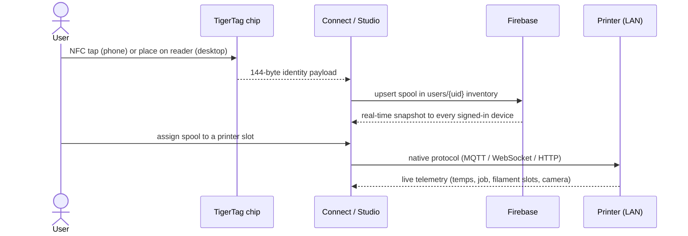
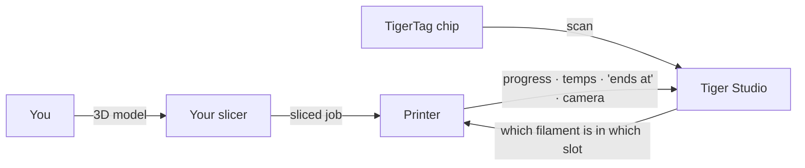

# 数据流

## 从轻触到打印

一卷线轴在系统中的完整旅程：

## 各类数据存放在哪里

| 数据 | 存放位置 | 备注 |
|---|---|---|
| 线轴身份 | 芯片 + 用户的云库存 | 离线使用时以芯片为准 |
| 参考数据库（品牌、材料等） | `cdn.tigertag.io`（同一个 Firebase 项目） | 随应用打包，并从 CDN 刷新 |
| 线轴图片（含 TigerTag+ 产品照片） | `cdn.tigertag.io`（同一个 Firebase 项目） | 提供给所有应用 |
| 库存、货架、好友、偏好 | Firestore `users/{uid}/…` | 默认仅所有者可访问，由规则强制执行 |
| 公开发现码 | Firestore `publicKeys/{code}` | O(1) 好友查找 |
| 打印机凭据与遥测数据 | **仅限本地**（桌面端） | 局域网流量从不经过云 |
| 实时重量（TigerScale） | 设备 → Firestore | 在所有客户端实时显示 |

## 切片软件的位置

TigerSystem **不会取代你的切片软件**——它是在切片软件周围把画面补完整：

- 你照旧使用任何切片软件进行切片并启动任务。
- Tiger Studio 会告诉打印机**哪种耗材位于哪个槽位**
 （AMS / CFS / Canvas / ACE / IFS），让机器端的信息与现实一致。
- 无论是什么启动了打印，任务都会实时显示在 Tiger Studio 中——
 进度、温度、完成时间、摄像头。
- 芯片携带耗材的推荐打印设置；**目前没有自动导入切片软件配置文件的功能**——
 你需要自己把它们同步到切片软件的配置文件中。

## 两个平面，刻意分开

- **云平面**——身份、库存、分享。互联网、Firebase，由规则强制执行。
- **局域网平面**——打印机控制与摄像头。仅限本地网络，使用厂商原生协议，
 完全不依赖云（桌面应用在离线时仍可与打印机配合工作）。

> **说明：** 例外是 Anycubic **云模式**，其打印机链路本身通过厂商的云端 MQTT 传输——
> 参见 [Anycubic 兼容性](../compatibility/anycubic.md)。

---

**◀ 上一页：** [架构概览](./overview.md) · **▲ [文档索引](../../README.md)** · **下一页 ▶** [产品](../products/README.md)

**另见：** [库存与云同步](../concepts/inventory-and-cloud-sync.md)、[兼容性](../compatibility/README.md)
