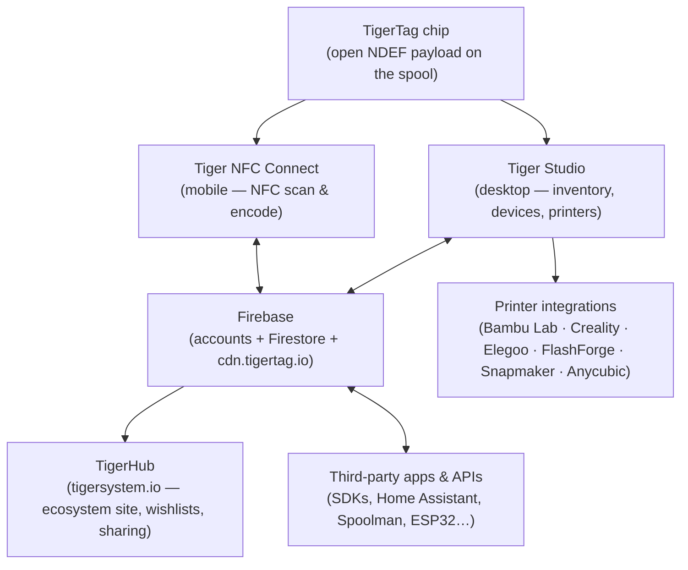
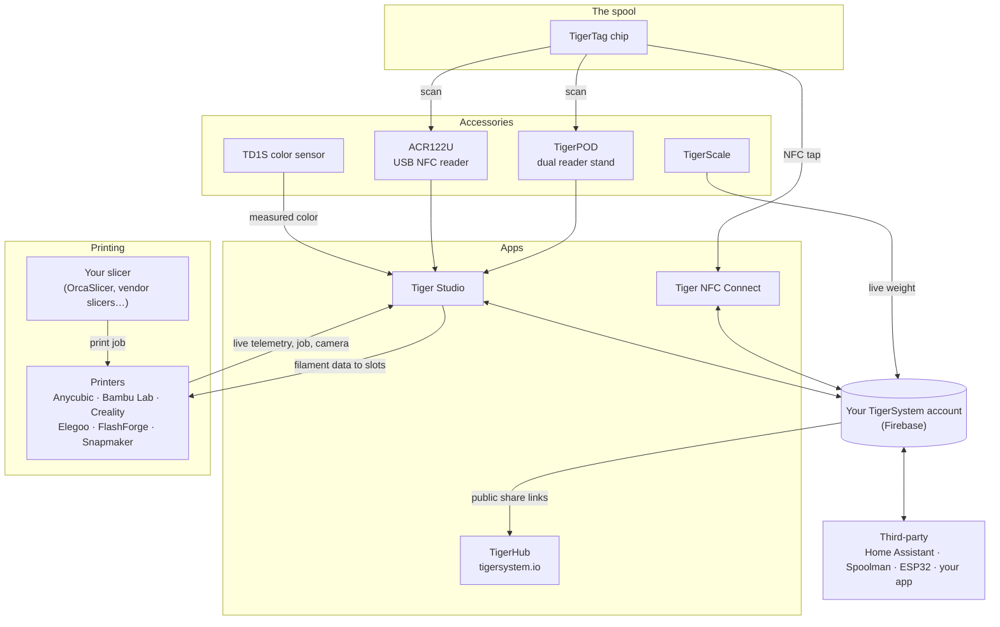

# 架构概览

## 技术栈，自上而下

## 各层

| 层 | 作用 | 权威文档 |
|---|---|---|
| **TigerTag 芯片** | 实体线轴可携带的开放身份 | [芯片格式](../concepts/tigertag-chip.md) |
| **Tiger NFC Connect** | 智能手机桥接：扫描、写入、浏览 | [产品页面](../products/tiger-nfc-connect.md) |
| **Firebase** | 一个共享数据库——账号、库存、同步；沙盒的互操作点 | [库存与云同步](../concepts/inventory-and-cloud-sync.md) |
| **TigerHub** | 生态系统的网站门户：展示、心愿单、好友、分享 | [产品页面](../products/tigerhub.md) |
| **Tiger Studio** | 桌面工作台：库存、货架、传感器、打印机 | [产品页面](../products/tiger-studio.md) |
| **打印机集成** | 与六个打印机品牌的实时局域网链路 | [兼容性](../compatibility/README.md) |
| **第三方 API** | 面向所有人的 SDK 与已公开的 Firestore 接口 | [开发者](../developers/README.md) |

## 完整地图——每个元素及其连接

配件、应用、云、打印机、切片软件和第三方集成，汇于一图：

从左到右阅读：**芯片**标识线轴；**配件**捕获现实（扫描、重量、颜色）；**应用**与**云**让一切保持同步；**打印机**接收耗材数据并实时回报。
你的**切片软件依然负责它的工作**——TigerSystem 不做切片，它要确保每一方（你、机器、应用）都清楚地知道哪种耗材在哪里。

## 设计原则

1. **芯片自给自足。** 线轴无需云、无需账号、无需网络即可自我标识——数据载荷完整且开放。
2. **云属于用户，而不是系统。** 所有状态都存放在用户的账号之下；
 由服务器端安全规则——而非客户端代码——强制执行访问控制。
3. **每一层都是可选的。** 仅手机、仅桌面、仅芯片或仅 API 的使用方式都能工作；
 各组件会增加价值，但绝不互为前提。
4. **集成使用打印机的原生协议。** 不改固件，不绕道云端：
 Tiger Studio 直接在局域网上使用 MQTT/WebSocket/HTTP 通信
 （参见[数据流](./data-flow.md)）。

---

**◀ 上一页：** [库存与云同步](../concepts/inventory-and-cloud-sync.md) · **▲ [文档索引](../../README.md)** · **下一页 ▶** [数据流](./data-flow.md)

**另见：** [产品](../products/README.md)、[开发者](../developers/README.md)
