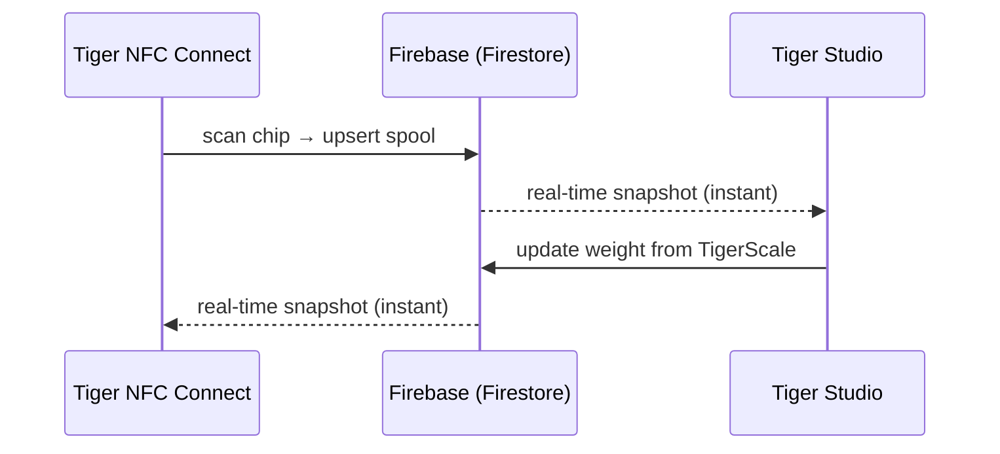

# 库存与云同步

## 一个账号，所有设备

用户的库存存放在**他们的 TigerSystem 账号**中，由普通的
**Firebase**（Auth + Firestore）支撑——这是刻意不带品牌的基础设施，
它的任务很简单：**一个共享数据库，放在一处**，让沙盒中的每个元素（桌面端、移动端、秤、网页）
都在同一份数据上互操作。每个客户端——移动端、桌面端、网页——都实时订阅同样的文档：

没有“同步按钮”：变更通过 Firestore 的实时监听器传播，客户端保留本地缓存以便离线读取。

## 同步哪些内容

- **库存**——每卷线轴一份文档（身份、重量、容器、图片等）。
- **货架**——实体架子的布局与线轴摆放位置。
- **好友与分享**——好友关系、收到的请求、通知。
- **偏好**——语言、账号级设置。
- **芯片备份**——[TigerTag+](../products/tigertag-plus.md) 芯片记录。

逐字段的权威数据模型记录在
[Firebase 集成仓库](https://github.com/TigerTag-Project/TigerTag_Firebase_Integration)
（`docs/03-data-model.md`）中——这是第三方集成者的参考。

## 哪些会离开你的工作台，哪些会留下

整个生态系统处处都说云是可选的。这里说明这究竟意味着什么，以及你说“不”的代价是什么。

**识别在设计上就是本地的。** 设备不会向服务器询问标签是什么。
品牌和材料表保存在它自己的存储中，并且每天最多一次从**公开的**
[参考仓库](https://github.com/TigerTag-Project/TigerTag-RFID-Guide)刷新。
因此查询从不等待网络，即使断网也能工作。

**没有账号，你恰好只失去一样东西：设备之间的同步。**
[TigerScale](../products/tigerscale.md) 仍然称重，仍然读取标签，仍然识别品牌和材料，
仍然在你的局域网上提供它自己的网页界面。
芯片本身的任何功能都不需要我们——这正是把数据写在[芯片上](./tigertag-chip.md)的全部意义。

**有了账号，设备实际会发送什么。** 以秤为例，每次完成称重以及在心跳时，
它会在你自己的用户文档下写入：线轴的标签 UID、净重/毛重/容器重量、固件版本、
WiFi 信号和 IP、校准系数、最近一次心跳时间、电池状态和屏幕状态。
只有诊断信息和测量值——仅此而已。每个字段都记录在
[秤自己的参考文档](https://github.com/TigerTag-Project/Tiger-Scale-V3/blob/main/docs/TELEMETRY.md)中。

**还有它在本地存储什么，这一点更重要。** 已登录的设备保存着刷新令牌、你的用户 id 和你的 WiFi 凭据。
它从不保存你的密码——登录时会把密码换成令牌。
但请把已配置好的设备当作**持有凭据**：在出借、出售或赠送之前，先退出登录，*并且*忘记 WiFi。
单纯刷机并不会清除这两者——这部分存储是刻意保留的，这样固件更新不会让你丢掉设置。

**两个值得了解的刻意选择。** 设备的局域网 API **没有身份验证**：
任何已在你网络中的人都可以读取其状态并触发去皮。这是对家庭网络的简化——
如果你不信任自己的网络，请把它放在访客 VLAN 上。
另外，源代码中可见的 Firebase 密钥是**公开的项目标识符**，不是机密；
每个 Firebase 客户端都会带有它，访问控制由针对已登录用户的服务器端规则强制执行，而不是靠藏起一个字符串。

对于秤，这一切都完整记录在
[`docs/CLOUD.md`](https://github.com/TigerTag-Project/Tiger-Scale-V3/blob/main/docs/CLOUD.md)，
该文档为权威来源。

## 分享模型（摘要）

- 每位用户都有一个公开的**发现码**（`XXX-XXX`），用于 O(1) 好友查找。
- 好友关系是**双向且基于同意的**：请求 → 接受；任何一方都可以解除。
 对好友库存的读取权限由 Firestore 安全规则在服务器端强制执行——绝不由客户端决定。
- 库存也可以标记为**公开**，或通过 [TigerHub](../products/tigerhub.md) 链接作为只读网页列表分享。

## 安全模型（摘要）

- 所有用户数据默认仅所有者可访问；跨用户访问始终需要事先建立关系（好友、请求），并由服务器端规则强制执行。
- Firebase 项目配置是有意公开的（标准做法）；**安全存在于规则之中，而不在于保密**。
 参见[账号 API 与集成](../developers/account-api.md)。

---

**◀ 上一页：** [TigerTag 芯片](./tigertag-chip.md) · **▲ [文档索引](../../README.md)** · **下一页 ▶** [架构概览](../architecture/overview.md)

**另见：** [TigerHub](../products/tigerhub.md)、[开发者——账号 API](../developers/account-api.md)
