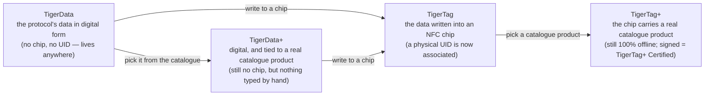

# 通用耗材身份

## 一个身份，处处可读

TigerTag 芯片赋予线轴一个**通用身份**：一份单一、开放的记录，说明这卷耗材*是什么*，
与谁制造它、谁销售它、哪台打印机会熔化它无关。

身份涵盖（并不详尽）：

| 字段族 | 示例 |
|---|---|
| **品牌** | 任何耗材制造商，来自共享参考列表 |
| **材料 / 类型** | PLA、PETG、ABS、TPU… + 子类型 |
| **外观 / 颜色** | 颜色值、表面效果 |
| **几何** | 直径（1.75 / 2.85 mm） |
| **打印设置** | 推荐温度 |
| **生命周期** | 重量、生产日期 |

## 共享参考数据库

身份不是自由文本：品牌、材料、外观、类型、直径和单位都来自在 `cdn.tigertag.io` 提供的
**共享参考数据库**（托管在与账号相同的 Firebase 项目中）。
每个应用都把相同的 ID 解析为相同的含义，因此一个工具写入的芯片在其他所有工具中读出来都完全一致。

> **TODO：** 待 RFID 指南记录公开数据库浏览端点 / 转储格式后，在此添加链接。
> 参考数据随 Tiger Studio 一同打包（`assets/db/tigertag/`），并从 CDN 刷新。

## 一个身份，四种状态

身份是*记录*，而不是*芯片*——它会经历四种状态：

- **TigerData** 是*芯片之前*的协议：同样的身份，以数字形式存储——
 存在于库存、数据库、文件，或任何地方。TigerTag 协议可以完全存在于 RFID 芯片之外。
 这种**虚拟芯片**的概念是 TigerSystem 的创新——别处都没有：
 不用任何 NFC 芯片就能管理完整库存，稍后或永不把身份送入芯片，两种情况下协议的互操作性都得以保留。
- **TigerData+** 是确切知道*自己是哪款产品*的 TigerData。依然没有芯片，依然无需购买任何东西——
 但它携带的不是主人随手输入的内容，而是官方产品库中的真实产品：
 确切的品牌、颜色、材料、温度、直径、SKU 和 EAN，直接来自源头。
 这是你通过挑选产品、而非描述产品所得到的东西。
 >它**不是** TigerTag+，也从不自称是：没有芯片，没有 UID。`+`
 >表示*已识别*，而不是*已认证*。对开发者而言：当线轴无芯片**且**带有真实的产品 id 时，它就是 TigerData+——
 >这一组合就是定义，并以 `protocol: "TigerData+"` 镜像到记录上，
 >你可以直接读取。参见
 >[Firestore 数据结构](https://github.com/TigerTag-Project/TigerTag_Firebase_Backend#-firestore-data-structure)。
- 一旦这些数据被**写入 NFC 芯片**，它就成为 **TigerTag**：
 一个实体 **UID 终于与该身份关联起来**。
- 向该芯片写入的是**产品库产品**而非手工输入的值，它就是
 [**TigerTag+**](../products/tigertag-plus.md)——与 TigerData+ 一样的 `+`，含义相同：*已识别*。
 由认证制造商签名后，它就成为 **TigerTag+ Certified**。无论哪种情况，芯片都保持 100 % 可离线读取。

TigerData 可以永远保持数字形式，也可以在你准备好时**原子地升级为真正的芯片**
（Tiger Studio 一步即可完成）。并且这四种状态都能以文件形式流转：
[**`.ttag` 交换格式**](../developers/ttag-format.md)可以在 U 盘上、邮件中、工具之间，
携带一个或多个库存材料——TigerData、TigerData+、TigerTag 或 TigerTag+。

---

**◀ 上一页：** [第二次生命工作流](../philosophy/second-life.md) · **▲ [文档索引](../../README.md)** · **下一页 ▶** [TigerTag 芯片](./tigertag-chip.md)

**另见：** [TigerTag 产品页面](../products/tigertag.md)、[库存与云同步](./inventory-and-cloud-sync.md)
