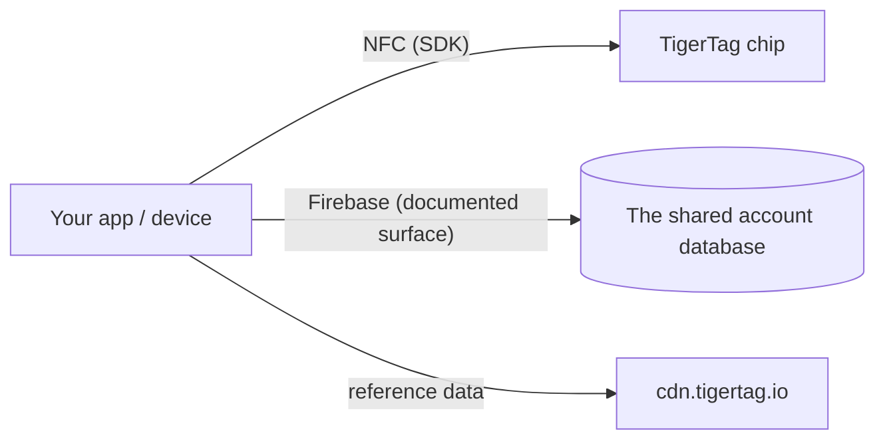

# 开发者文档

基于 TigerSystem 构建：读取芯片、与云通信，或集成你自己的硬件和软件。
一切都无需许可——协议是开放的。

## 你能构建什么？

读取 TigerTag 只需**任何 NFC 智能手机**、插在电脑上的 **ACR122U USB 读卡器**，
或**DIY 设备——一块简单的 ESP32 加 PN532 或 RC522 读卡模块**（TigerScale 采用的方式）。
普通硬件，没有专有设备。从这一次扫描出发，可以集成到任何身份有用的地方：

- **ERP / 库存管理**——把线轴身份和数量接入贵公司现有的库存系统。
- **用量追踪**——记录哪种材料用于哪个任务、机器或客户订单。
- **自定义仪表盘与自动化**——打印农场监控、低库存警报、补货触发。
- **借还系统**——创客空间、学校、制造实验室对材料的登记借出与归还。
- **研发项目，私有或公开**——一个开放、可重写、有文档的身份载体，供你试验。

这些都不需要我们的应用或我们的云：芯片 + SDK 就足够了。
只有当你需要账号和同步时，才添加[账号接口](./account-api.md)。

构建出来，它就是 **TigerTag Compatible**：免费、自行声明，无需审核，也无需许可。
让它通过审核，它就可以成为 **TigerTag Certified**——对第三方构建的任何东西开放，无论硬件还是软件，
分为两个范围（**TigerTag** 和 **TigerTag+**）。两个级别之间的界线不在于你的产品是什么，而在于是否有人检查过。
Compatible 凭你的话说*“它能用”*，Certified 凭我们的话说*“我们测试过了”*
（[标准](https://github.com/TigerTag-Project/TigerTag-RFID-Guide/blob/main/CERTIFICATION.md)，
可通过 [GitHub 组织](https://github.com/TigerTag-Project)联系我们）。

治理刻意设置了两道关口：**任何人**都可以实现该协议并声明“兼容 TigerTag”——永远无需许可——
也可以展示未经修改的 TigerTag 标志来表明这一点：在你的应用、文档、商店页面中。这种指称性使用是免费的。
只有**认证合作伙伴**（列于认证登记册）才可以把标志——标志**或名称**——放在
**任何格式的芯片（芯片、嵌入件、贴纸、标签、载体）、线轴或其包装上**，
因为在那里它不再描述兼容性，而是开始断言来源；
兼容的读卡器、打印机或应用包装盒上的纯文字*“Compatible with TigerTag”*依然免费，
并且只有他们才能签发 **TigerTag+ 签名**（私钥由 TigerTag 持有）。
商标关口属于营销；签名关口属于技术；**两者都不会对协议施加哪怕一行限制**——
未经认证的芯片完全可以正常工作，只是无法证明自己的来源。

有两个细节值得准确把握。兼容声明也涵盖 **`+` 级别**：验证 TigerTag+ 签名是免费、离线且不受限制的——
公钥已公开发布——所以检查签名的读卡器可以声明*“compatible with TigerTag+”*。
它不能做的是把**一枚标签**称为 TigerTag+，除非该标签确实带有 TigerTag 签发的签名。
而且“certified”（已认证）**从不自行套用**：由 TigerSystem 授予，没有人可以自称。

这刻意采用 Zigbee 和 Matter 所用的模式——任何人都可以进入的免费 *Compatible* 级别，
以及经授予的 *Certified* 级别，后者正因为是授予的，才对买家有意义。
完整政策、认证级别和品牌素材：
[TRADEMARK.md](https://github.com/TigerTag-Project/TigerTag-RFID-Guide/blob/main/TRADEMARK.md) 和
[CERTIFICATION.md](https://github.com/TigerTag-Project/TigerTag-RFID-Guide/blob/main/CERTIFICATION.md)。

## 从这里开始

| 我想… | 阅读 |
|---|---|
| 看看谁已经基于 TigerTag 构建了东西 | [第三方集成](./integrations.md) |
| 了解各个组成部分 | [架构概览](../architecture/overview.md) |
| 知道哪个仓库负责什么 | [仓库](./repositories.md) |
| 读写 TigerTag 芯片 | [SDK](./sdks.md) |
| 以文件形式交换库存 | [`.ttag` 格式](./ttag-format.md) |
| 像其他所有应用一样显示线轴的颜色 | [材料色卡](./material-swatch.md)——及其[实时参考渲染器](./material-swatch-playground.html) |
| 与用户的云库存同步 | [账号 API 与集成](./account-api.md) |
| 了解芯片载荷 | [TigerTag 芯片](../concepts/tigertag-chip.md) |

## 集成路径

1. **仅芯片**——用 SDK 解析和编码芯片。无需账号，无需网络。
2. **连接云**——验证*用户自己的账号*，并在服务器端安全规则范围内读写其数据
 （[集成契约](./account-api.md)）。
3. **硬件**——已有适用于 ESP32/Arduino、Home Assistant 和 Spoolman 桥接的可运行示例（参见
 [集成仓库的示例](https://github.com/TigerTag-Project/TigerTag_Firebase_Integration/tree/main/examples)）。

## 约定

- **版本管理**——产品发布使用 SemVer；芯片载荷自带格式版本，以实现向后兼容。
- **命名**——自描述的名称优先于编码式或取巧的名称；不要使用多状态的魔法值。
- **用 ID，不用标签**——任何依赖参考表（`id_aspect`、`id_brand`、`id_material`、`id_type`、
 `id_diameter`、`id_measure_unit`、`id_version` 等）中取值的逻辑，比较的都是其**数字 ID**，
 绝不比较字符串形式的标签。标签是显示文本：它会被翻译，
 可以在参考数据库中重命名或更正，并且在每种语言中读法各不相同——ID 永远不变。
 请把 ID 与标签放在一起，为你据以分支的 ID 命名（例如外观 `Tricolor 24`、`Rainbow 145`、
 `Bicolor 252`），并且只把标签用于显示。
- **颜色**——线轴的颜色是以数据而不是图片的形式存储的，因此每个界面都必须把该数据变成同样的画面：
 [材料色卡约定](./material-swatch.md)是规范性的，并附带一个
 [参考渲染器](./material-swatch-playground.html)，你可以用它核对自己的实现。
- **贡献**——每个仓库都有自己的指南；文档贡献请遵循此处的
 [CONTRIBUTING.md](../../CONTRIBUTING.md)。

---

**◀ 上一页：** [OpenSpool](../compatibility/openspool.md) · **▲ [文档索引](../../README.md)** · **下一页 ▶** [仓库](./repositories.md)
