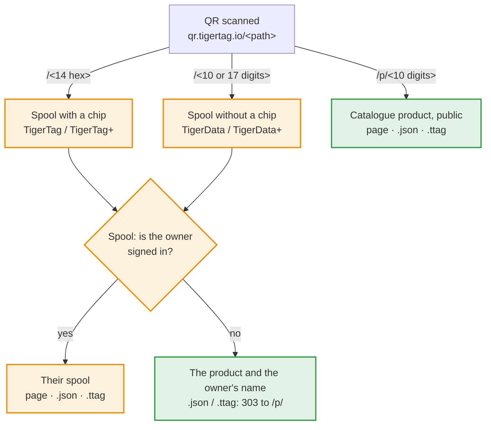

# 线轴 id 与二维码链接

> **已于 2026-11-05 批准——尚未实现。** 各应用都以这份约定为基础。仍未决定的问题列在文末；
> 解决其中一个，只会改变它所指明的内容。标为**提议**的章节尚未批准：在它们获批之前，不要以其为基础进行构建。

## 简要说明

TigerTag 二维码只包含一个短链接：`https://qr.tigertag.io/<path>`。路径决定它打开什么：



橙色表示私有，仅线轴的主人可见；绿色表示公开。

| 二维码所在 | 路径 | 示例 |
|---|---|---|
| 带芯片的线轴（TigerTag / TigerTag+） | 芯片 UID 的十六进制形式，14 个字符，以小写打印；孪生芯片的 UID 打开同一个线轴 | [qr.tigertag.io/1d33dbda0d1080](https://qr.tigertag.io/1d33dbda0d1080) |
| 无芯片的线轴（TigerData / TigerData+） | 去掉 `TigerData_` 前缀的 id：10 位或 17 位数字；长格式（`TigerData_6130922252`、`tigerdata-…`）同样可用 | [qr.tigertag.io/6130922252](https://qr.tigertag.io/6130922252) |
| 产品（TigerQR+） | `p/` + 十进制的 `id_product`，始终 10 位，不足补零（`p/0010303748`）；旧标签上的 8 位十六进制（`p/9f5e0644`）仍可打开 | [qr.tigertag.io/p/2673739332](https://qr.tigertag.io/p/2673739332) |

- **线轴链接：** 已登录的主人看到自己的线轴；其他任何人看到产品和主人的名字。`.json` 和 `.ttag` 只把线轴返回给主人；其他人收到 `303`，转到产品的 `.json` / `.ttag`。
- **产品链接**公开，无需登录：目录页面、数据（[`p/2673739332.json`](https://qr.tigertag.io/p/2673739332.json)）和文件（[`p/2673739332.ttag`](https://qr.tigertag.io/p/2673739332.ttag)）。
- 链接不区分大小写。
- 分享线轴或产品时，请分享这个短链接：标签上印的就是它，所有应用都能读取。分享的链接可以以语言开头（`qr.tigertag.io/fr/p/2673739332`）：页面随后对所有人都以该语言打开。打印的标签从不带语言。

本页其余部分是约定本身。

每个 TigerSystem 应用都遵循的规则：

1. **无芯片线轴**（TigerData / TigerData+）如何获得 id；
2. 线轴获得芯片时如何**保留其链接**；
3. 线轴的 id 如何写入打印标签的**二维码**，以及如何读回；
4. 应用如何通过链接**带着数值调用线轴**（重量、备注）；
5. **产品**如何获得自己的链接；
6. 链接如何以 **JSON** 或 **`.ttag` 文件**作答。
7. **打印标签**上有什么，以及它的模板。

## 1. 线轴 id

线轴是账号库存中的一个文档，`users/{uid}/inventory/{spoolId}`。文档 id **就是**线轴 id：
一个账号中不能有两个 id 相同的线轴。

| 线轴 | Id | 示例 |
|---|---|---|
| 芯片（TigerTag / TigerTag+） | 芯片的 NFC UID，大写十六进制，14 个字符（NTAG 的 7 字节 UID） | `04AB12CD3E4F80` |
| 无芯片，从现在起生成 | `TigerData_` + epoch **毫秒数**（13 位）+ 一个 **0000–9999** 的随机数（始终 4 位） | `TigerData_17623456789014213` |
| 无芯片，本约定之前生成 | `TigerData_` + 10 位随机数字 | `TigerData_4480517985` |
| 无芯片，旧前缀 | `CLOUD_` + 10 位随机数字 | `CLOUD_4480517985` |
| 旧十进制（旧版 Android 应用） | 以十进制书写的 UID，正在迁移为十六进制 | `1234567890123456` |

本约定**从不重写**已经生成的 id。读取方只检查前缀（`TigerData_` / `CLOUD_` → 无芯片）；
没有任何一方依赖数字的位数。id 只是一个标识符，别无他用：绝不要从中推断创建日期。
4 字节 UID（与线轴关联的专有芯片）从不作为库存文档的名称，因此也从不出现在链接中。

### 生成无芯片 id

每个创建无芯片线轴的应用（目前是 Tiger Studio，以后是移动应用）都以同样的方式生成 id：

1. **组合** `TigerData_<Date.now()><four random digits>`。
2. **本地检查**——如果该 id 已存在于应用持有的库存中（实时监听器的副本，包括离线缓存）
   或其 `uidMigrationMap` 中，就重新组合一个。这在离线时也能进行。
3. **写入**
   - **在线：**在一个先读取该文档、若文档已存在则失败的事务中写入；失败时回到第 1 步；
   - **离线：**普通写入，由 Firestore 排队，直到网络恢复。第 1 步和第 2 步是唯一的保护。

对一个已存在的 id 进行普通的 `set()`，会悄无声息地**覆盖**已经在那里的线轴。第 3 步正是为了防止这一点。

这四位随机数字还让新的无芯片 id 在**所有账号之间**几乎唯一（按每年一百万个无芯片线轴计算，
大约每 600 年发生一次冲突），这样服务器以后就能为线轴主人以外的人解析链接，而无需更改任何已打印的标签。

## 2. 线轴获得芯片时保留链接

在无芯片线轴上编程芯片，会把线轴迁移到芯片的 UID 下。在**一个批处理**中：

1. 把线轴写到芯片 UID 下（对于孪生对，还要写到孪生 UID 下）；
2. 删除 `TigerData_…` 文档；
3. 写入重定向 `users/{uid}/uidMigrationMap/{old id}` → `{ hex_uid, migrated_at }`。

批处理保证这三步要么一起发生，要么都不发生。重定向存放在 `uidMigrationMap` 中（这个集合原本就
把旧的十进制 id 映射到十六进制），绝不会作为占位文档放进库存：所有读取库存的地方都把一个文档算作一卷线轴。

## 3. 二维码链接

打印的线轴标签带有一个二维码，其中是指向该线轴的链接，**别无其他**（没有重量，没有备注——打印出来的数值会过时）：

```
https://qr.tigertag.io/<id>
```

二维码旁边不以明文打印任何内容：没有 id，也没有链接。二维码就是回到线轴的途径。

`<id>` 是**去掉前缀**的线轴 id：

| 线轴 | 链接 |
|---|---|
| 芯片 | `https://qr.tigertag.io/04ab12cd3e4f80` |
| 无芯片（新） | `https://qr.tigertag.io/17623456789014213` |
| 无芯片（本约定之前） | `https://qr.tigertag.io/4480517985` |
| `CLOUD_` | **没有二维码链接**——标签打印时不带二维码 |
| 旧十进制 | **没有二维码链接**——请先把线轴迁移为十六进制 |

### 编码

- 整个链接都是**小写**，包括 id：`https://qr.tigertag.io/04ab12cd3e4f80`。
  2026-11-07 测试：iPhone 相机无论大小写都能打开链接，但三星相机（Galaxy S24）会把大写的
  `HTTPS://` 链接显示为纯文本，只打开小写链接。
- 一个 **byte** 模式段。小写的协议头无法使用字母数字模式，而把链接拆成多段也省不了什么
  （实测：所有变体都是 29 × 29）。
- 纠错等级 **M**（15 %）：标签会被刮花、折弯。
- 结果：每个线轴链接和产品链接都是 **29 × 29 模块**。每个模块绘制在整数个打印机点上，并留出标准的 4 模块静区。

### 读回链接

读取方**离线**从链接中解析 id：扫描标签的应用从不需要访问网站。它们读取路径时不区分大小写，
忽略末尾的 `/`，并按形态解析：

| 路径 | 线轴 id |
|---|---|
| 17 位数字 | `TigerData_<17 digits>` |
| 10 位数字 | `TigerData_<10 digits>` |
| 14 个十六进制字符 | 该 UID，转为大写 |
| 以 `4` 开头的 13 个十六进制字符 | 被截断的 NTAG UID：`0` + 这 13 个字符（[修复规则](https://github.com/TigerTag-Project/TigerTag-Studio-Manager/issues/146)） |
| `p/` + `id_product`：10 位十进制数字（打印形式）或 8 个十六进制字符（旧标签） | 一个产品——[第 5 节](#5-产品链接) |

以 `.JSON` 或 `.TTAG` 结尾，表示请求给工具用的响应——[第 6 节](#6-json-与-ttag-响应)。

应用**写入**上面的短形式，但读取方也**接受长形式**：任意大小写的 `TigerData` 前缀，后跟 `_` 或 `-`，
再跟 17 位或 10 位数字——`TigerData_17623456789014213`、`TigerData-17623456789014213`、
`TIGERDATA-17623456789014213`、`tigerdata_4480517985` 都解析到同一卷线轴。手动输入或分享的链接仍然有效。
`CLOUD` 前缀在两种形式下都不被接受。

UID 可能全是数字，但它长 14 个字符，从不是 17 或 10 个，所以长度总能决定一切。旧的十进制 id 永远不会
到达读取方，因为它们从不被打印。任何**其他形态**都是来自更新版本的标签：读取方会如实说明
（“请更新应用”），而不是报错。其他每一类事物都有自己的文件夹，即一个字母加一个 `/`
（`p/` 表示产品，以后 `r/` 表示货架），因此永远不会与已打印的线轴链接冲突。

### 语言前缀

分享的链接可以在路径前带上分享者的语言。*（2026-11-11。）*

```
https://qr.tigertag.io/<lang>/<spool id>
https://qr.tigertag.io/<lang>/p/<id_product>
```

`<lang>` 为 `en`、`fr`、`de`、`es`、`it`、`zh`、`pt`、`pt-pt`、`pl`、`ru`、`nl` 之一，以小写书写，读取时不区分大小写。

- 页面随后对所有人都以该语言打开，包括链接预览爬虫：`/fr/p/2673739332` → `tigersystem.io/fr/catalog/2673739332`。
- 没有前缀时，由访问者浏览器的语言决定。
- 未知前缀返回 `404`。
- **打印的标签从不带前缀**：它们保持语言中立。只有分享按钮会加上前缀（tigersystem.io 和 Tiger Studio）。

**读取方会去掉它。** 拿到链接的读取方（Studio 的粘贴框、移动应用的扫描器或粘贴框、任何第三方读取方）先去掉开头的一个 `<lang>/`（不区分大小写），再按上文解析其余部分：`qr.tigertag.io/fr/p/2673739332` 打开的产品与 `qr.tigertag.io/p/2673739332` 相同。读取方从不打印或保存前缀：由分享链接生成的标签或导出内容带的是不含前缀的链接。分享链接是 `qr.tigertag.io/fr/p/2673739332`；二维码里始终是 `qr.tigertag.io/p/2673739332`。*（2026-11-11。）*

### 解析线轴

1. 在**已登录查看者自己的库存中**查找该 id。
2. 不在那里 → 在查看者的 `uidMigrationMap` 中查找，并跟随重定向。
3. 孪生对只有一张标签，带主 UID；两个 UID 中的任何一个都能打开线轴。
4. 已删除的线轴（`deleted: true`）会以“已删除”打开，而不是报错。

   **线轴主人在页面本身上看到线轴**，在浏览器中从其自己的库存文档读取（规则把它限定为本人）：
   产品（衬在其颜色上的照片）、品牌、材料、等级、剩余重量占容量的比例、喷嘴、热床和干燥温度、
   直径、货架和槽位、空线轴重量。两个按钮：“Open in Tiger Studio”
   （`https://studio.tigersystem.io/?spool=<docId>`，带上链接中的数值）和“See the product page”。
   在设备上登录了 Studio Web 但未登录网站的主人会被转到 Studio Web：网站没有自己的会话就无法读取文档。
   *（2026-11-07。）* 主人可以在那里修改重量和备注，写入方式与 Studio 相同：`weight_available` 或
   `message`（最多 28 字节 UTF-8）、`updatedAt`（服务器时间），芯片格式还有 `needUpdateAt`（服务器时间），
   孪生线轴在同一个批处理中。容器（空线轴）也可以在那里修改，按 Studio 的写法：`container_id`、
   `container_weight`（带账号自己的校正）、`updatedAt`，孪生线轴在同一个批处理中。页面上有一个退出登录按钮。
   *（2026-11-08。）*

5. 任何**不是主人**的人——未登录、其他账号，包括已接受的好友——都会**被转到该线轴的产品**，
   永远看不到线轴本身：服务器跨账号按 id 找到线轴（线轴 id 上的索引），读取其 `id_product`，
   并重定向到[第 5 节](#5-产品链接)的产品链接。同一个 id 出现在两个账号中且产品不同（一枚被重写的芯片，
   其旧文档被另一个账号保留）→ 取最后更新的文档（`updatedAt`）的产品，几乎在所有情况下都是对的。
   没有产品或没有匹配 → 显示一个说明该线轴为私密的页面，并带有“Start my inventory”。
   这种查找只在这些扫描时运行，所以它的成本随扫描次数而定，而不是随账号数量。
   *（2026-11-06 批准；冲突规则 2026-11-07。）*

   **没有会话**的访客（在设备上未找到登录）不会被重定向：页面让他们自己选择。页面显示该线轴产品的卡片
   （仅限公开产品，私密线轴绝不显示），可就地登录（登录后会再次进行主人检查，主人会直接看到线轴），
   或继续前往产品页面。已登录但不是主人的人，如上所述被转到产品。*（2026-11-07。）*

   **线轴是谁的。** 任何扫描线轴的人，无论是否登录，都能看到它的主人：最后更新文档的那个账号在
   `userProfiles` 中的显示名称和照片，即使该资料不公开，即使线轴没有产品，这样捡到线轴的人就知道它属于谁。
   绝不显示 uid 或电子邮件。*（2026-11-08。）*

**隐私：**知道一个 id 绝不会让人看到一卷线轴。扫描的链接只为线轴主人打开线轴；在应用内，线轴只展示给
Firestore 规则已经允许读取它的人（主人、已接受的好友、公开的库存）。id 中含有时间戳，可以被猜到；
这一点绝不能产生任何影响。线轴的产品不是私密的：它印在标签上，TigerTag+ 芯片也以明文携带它，
任何 NFC 手机都能读到。重量、备注和货架从不外泄；主人只以显示名称和照片出现（见上）。
每个浏览器标签页、每卷线轴只计一次扫描（刷新不算新的扫描），记录其产品、品牌、材料和一个城市级别的地点，
绝不记录线轴 id。扫描报告还包含访客的 IP 地址，为防范刷量和用于分析而保存：它只显示在管理员历史记录中，
从不展示给品牌，并用于核对 edge 报告的城市。它保存一年，仅用于安全目的。已登录访客的扫描会关联到其账号。

## 4. 带着数值调用线轴

应用可以构建一个打开线轴**并提议数值**的链接，使用普通的查询参数（这些链接从不打印，所以可读性优先于二维码尺寸）：

```
https://qr.tigertag.io/04AB12CD3E4F80?weight=640&note=Opened%20in%20June
```

### 参数

| 参数 | 值 | 限制 |
|---|---|---|
| `weight` | 耗材净重，单位为克 | 整数，从 0 到线轴容量 |
| `note` | 线轴的备注（`message` 字段） | 纯文本，最多 28 字节 UTF-8（芯片上的空间） |

参数名不区分大小写。未知参数会被忽略，绝不报错。超出限制的值会被拒绝。新参数要加入这张表，
绝不能由某个应用单独发明。

### 谁能应用它们

| 情况 | 会发生什么 |
|---|---|
| 未登录 | 数值**被拒绝**。链接会提示登录，然后不带这些数值打开线轴。 |
| 已登录，不是主人（包括好友的线轴） | 数值**被拒绝**。如果规则允许，线轴会打开。 |
| 已登录，是主人 | Studio：线轴打开时数值已**预先填好**，**一个操作**即可保存（“Update: 640 g”）。Hub 页面：不超过容量且与已存值不同的重量会**立即保存**，在一个批处理中写入线轴及其孪生线轴，然后横幅提示可恢复之前的重量（“Revert to 772 g”），以防旧链接被再次扫描。*（Hub，2026-11-08。）* |

来自其他任何人的链接都不会写入：数值只应用于主人自己的线轴。需要无确认写入的应用（持续更新重量的秤、
某个集成）不使用链接：它在 Firestore 规则下通过用户账号写入
（[集成指南](https://github.com/TigerTag-Project/TigerTag_Firebase_Integration)）。

## 5. 产品链接

> **已于 2026-11-06 批准。**

产品——产品库中的一种耗材，无论谁拥有它的线轴——都有自己的链接，用于包装、商店货架、展厅或印刷的产品目录：

```
https://qr.tigertag.io/p/<id_product>
```

- `<id_product>` 以**十进制书写，始终为 10 位数字**，前面补零：`id_product` 永远不超过 10 位（最大为 `4294967295`）。示例：产品 `2855882328` → `https://qr.tigertag.io/p/2855882328`；产品 `10303748` → `https://qr.tigertag.io/p/0010303748`。**29 × 29** 模块。
- 之前打印的标签使用旧形式，即 **8 个小写十六进制字符**的 `id_product`（`p/aa394e58`）；它将永久可读（见下文）。
- 不在或不再在产品库中的 id——`p/0000000000` 和 `p/4294967295`（“无产品”，从不打印）、未知 id、
  已归档、已删除或已合并的产品——都会打开**同一个“被遗忘的产品”页面**：这种耗材已不在产品库中，
  并附带搜索。所有情况都用同一个状态码 `404`（页面以及 `.json` / `.ttag` 响应都一样）：
  产品为什么消失，对读取者来说并不重要。`id_product` 绝不会分配给另一个产品：已经贴上的标签永远不会打开错误的耗材。
- 这些链接由 **Hub**（`tigersystem.io`）提供：`qr.tigertag.io` 指向它。页面就是 Hub 的产品库页面（见下文）；
  `.JSON` 和 `.TTAG` 响应是读取产品库（带缓存）的 Hub API 路由。
- 线轴标签从不重复其产品：线轴链接本身已经通向产品（[第 3 节](#解析线轴)）。

### 读取产品链接

格式正确的产品链接只有两种长度之一，因此永远不会被误读：

1. **10 位数字** → 十进制（`p/2673739332`、`p/0010303748`）。
2. **8 个字符** `0-9` / `a-f` → 十六进制，即旧的打印形式，仍然接受（`p/9f5e0644` 与 `p/2673739332` 打开同一个产品）。

作为容错（不作保证），手动输入的其他长度的十进制数按十进制读取，但恰好 8 位数字除外：先按十六进制读取，若该产品不存在再按十进制读取。大于 `4294967295` 的值为未知链接。`0` 和 `4294967295` 无论何种形式都表示"无产品"（`404`）。`.json` 和 `.ttag` 后缀对所有形式都有效，不区分大小写。

### 它打开的页面

`p/…` 以 `302` 重定向到该产品**现有的产品库页面**，`tigersystem.io/<lang>/catalog/<id_product in decimal>`，
使用链接的语言（[语言前缀](#语言前缀)），没有时使用手机的语言。没有单独的扫描页面：产品库页面**以手机优先**构建（响应式），因为它的大部分访问来自扫描——
照片和色块、品牌、材料和颜色名称位于顶部，打印设置一眼可读，然后是页面的其余部分。

## 6. JSON 与 .TTAG 响应

> **已于 2026-11-06 批准。**

以 `.JSON` 结尾（不区分大小写）——或带 `Accept: application/json` 发送——的链接，会以 JSON 而非页面作答。
以 `.TTAG` 结尾的链接，会把同一条记录作为可下载的 [`.ttag` 文件](./ttag-format.md)返回
（`Content-Disposition: attachment`）。这些是给工具用的地址，从不打印。

与扫描相同的逻辑（[解析线轴](#解析线轴)）：主人得到线轴，其他任何人得到它的产品。

| 链接 | 主人（`Authorization: Bearer <Firebase ID token>`） | 其他任何人（未登录、其他账号、好友） |
|---|---|---|
| `…/p/2855882328.json` | 产品记录 | 相同 |
| `…/p/2855882328.ttag` | 以 `.ttag` 文件形式提供的产品 | 相同 |
| `…/04ab12cd3e4f80.json` | 线轴 | `303` → `…/p/<id_product>.json`；没有产品库产品（TigerData、创客自制的 TigerTag）→ `404` |
| `…/04ab12cd3e4f80.ttag` | 以 `.ttag` 文件形式提供的线轴 | `303` → `…/p/<id_product>.ttag`；没有产品库产品 → `404` |

没有产品库产品时，不返回线轴的任何信息，连材料也不返回：这个 `404` 对应扫描时的“私密线轴”页面。

- **线轴：**一个只含这一条记录的 [`.ttag` 文件](./ttag-format.md)，即 Firestore 所存储的库存文档。
  它带有 `id_product`；需要产品的工具接下来调用 `…/p/<id_product>.json`。
- **产品：**产品 API 返回的产品库记录，语言由 `?lang=` 指定（默认英语）。在服务器上缓存，并允许任何网站访问。
- 线轴响应从不缓存：它取决于是谁在请求。
- 在 Tiger Studio 中打开时，线轴的 `.ttag` 以 **Restore** 模式导入（线轴保持原样，包括芯片和备份）；
  产品的 `.ttag` 以 **Import** 模式导入，成为一个带新 id 的新 TigerData+。
- JSON 或 `.TTAG` 请求从不写入：链接中的数值（`?weight=`、`?note=`）在这里会被忽略。

## 7. 打印标签

每个应用都打印相同的标签：两种类型、一套模板，这样从 Tiger Studio、移动应用或网站打印的标签，外观和扫描效果都一样。

| 标签 | 它的二维码 | 为谁打印 |
|---|---|---|
| **线轴** | 线轴链接（[第 3 节](#3-二维码链接)） | 任何有二维码链接的线轴（不包括 `CLOUD_`，不包括旧十进制） |
| **产品**（色卡） | 产品链接（[第 5 节](#5-产品链接)） | 带真实 `id_product` 的线轴或产品库产品（TigerTag+、TigerData+） |

扫描线轴标签的主人得到线轴；其他任何人得到它的产品（[解析线轴](#解析线轴)）。产品标签对所有人都打开产品：
它用于色卡、货架或展厅。

### 标签上有什么

- 品牌，位于制造商标志的位置（制造商标志稍后推出）；
- 黑色横条上的白色系列名（`PLA Rainbow`；没有系列时为材料）；
- 颜色名称及其十六进制代码（`#F2D066`，宽模板上最多三个）；
- 在线轴标签上，标签名称位于右上角，以描边胶囊形式显示：
  当其引用是产品库产品（真实的 `id_product`）或 TigerTag+ 芯片时为 `TigerQR+`，
  否则为 `TigerQR`（因此没有产品的 TigerTag 芯片显示 `TigerQR`）；产品（耗材）标签始终
  显示 `TigerQR+`。与 TigerTag 和 TigerTag+ 一样，`+` 表示已关联产品库。胶囊不表明线轴是否有芯片；
- 最多**四个数值栏**，由用户从以下选项中选择：喷嘴温度范围、热床温度范围、
  干燥（温度 · 时长）、TD、直径；
- 二维码。

只放不会变化的内容：绝不放剩余重量、备注、货架或主人。二维码旁边不放任何明文（[第 3 节](#3-二维码链接)）。

### 模板

九个模板，涵盖常见的线轴标签尺寸和版式：

| 模板 | 尺寸（宽 × 高） | 版式 |
|---|---|---|
| Classic（默认） | 40 × 30 mm | 品牌、横条、颜色 + 十六进制、四个数值栏、二维码在右下 |
| Wide | 50 × 30 mm | 即 Classic，横条更宽 |
| Compact | 40 × 25 mm | 品牌、二维码在左、横条、颜色、十六进制——无数值栏 |
| Slim | 40 × 12 mm | 二维码在左、品牌、横条、颜色——无数值栏 |
| Slicer-friendly | 40 × 30 mm | 品牌、系列、颜色以大字堆叠，大二维码在右——无数值栏 |
| Vertical | 30 × 40 mm | 品牌、横条、大字颜色、十六进制、一条分隔线、数值栏在左侧堆叠、二维码在右下 |
| Vertical bold | 30 × 40 mm | 品牌、通栏横条、颜色、一条分隔线、二维码居中在下方——无数值栏 |
| Vertical compact | 25 × 40 mm | 品牌、横条、颜色、十六进制、一条分隔线、大二维码在下方——无数值栏 |
| 仅二维码 | 25 × 30 mm | TigerQR / TigerQR+ 胶囊居中位于顶部，下方为 20 mm 二维码——别无其他，无数值栏 |

每个模板都是一个以十分之一毫米为单位排版、再缩放到打印机点阵的 SVG。二维码填充的方框与常见线轴标签相同
（Classic 上约 14 mm），每个模块占整数个打印机点：取最接近的值，若向上取整后仍在方框的 6 % 以内则向上取整。
标签的白色边距就是它的静区。在 203 dpi 下，29 × 29 的码在 Classic 上每个模块 4 个点（约 14.5 mm）。

### 输出

- **PDF**、**PNG**（按打印机分辨率）和 **SVG**，因此任何打印机都能使用，必要时通过其自带的应用；
- 直接打印到标签打印机（Brother QL、Niimbot、Phomemo）稍后推出，逐台适配，使用相同的模板。
- 想试用这些模板，[TigerQR playground](https://tigersystem.io/playground-tigerqr) 可为产品库中的产品生成每个模板的 TigerQR+ 标签，提供 PNG（203 或 300 dpi）和 SVG。

## 待定事项

- **应用链接。** iOS（`apple-app-site-association`）和 Android（intent filter）默认区分大小写匹配路径：
  链接以小写打印，但手动输入或分享的链接未必如此，因此移动应用声明不区分大小写的匹配（iOS），
  并在代码中过滤路径（Android）。
- **域名。** `qr.tigertag.io` 会被永久印在标签上：请长期续订 `tigertag.io`。

---

**▲ [文档索引](../../README.md)** · **另见：** [通用耗材身份](../concepts/universal-filament-identity.md)、[库存与云同步](../concepts/inventory-and-cloud-sync.md)、[开发者概览](./README.md)
