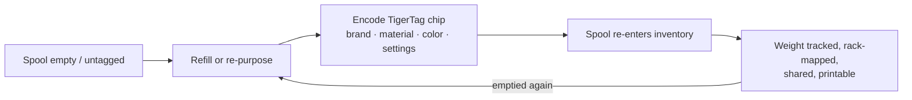

# 第二次生命工作流

## 如今“智能”线轴的问题

当制造商贴了标签的线轴用完时，标签也随之报废：它描述的是一卷出厂灌装的线轴，采用某一家厂商的格式，无法复用。线轴的线盘被扔掉，或者被“傻瓜式”地重新灌装。

## 第二次生命：重新识别，而不是丢弃

TigerTag 芯片**可写入、可重写**。当线轴被用完并重新灌装——或者任何品牌的线轴根本没有可用的标签——用户可以用新耗材的真实配置来编码一枚 TigerTag 芯片，然后贴上去。
这卷线轴便获得了*第二次生命*，成为一个能够自我识别的一等对象：

*即使是没有线盘的补充装也带着自己的身份——芯片就贴在线卷本身上。*

## 编码如何进行

- **Tiger NFC Connect**（移动端）——通过 NFC 轻触来编程芯片。
- **Tiger Studio**（桌面端）——使用 ACR122U /
 [TigerPOD](../products/tigerpod.md) 读卡器引导式更新芯片：放上芯片、UID 匹配检查、
 经验证的写入。
- **数字优先**——Tiger Studio 的 *TigerData* 让你现在就能创建一卷完全数字化
 （无芯片）的线轴，并在以后**以原子方式将其升级为真正的芯片**。

> **说明：** 编码时使用的品牌、材料和颜色目录由共享的[参考数据库](../concepts/universal-filament-identity.md)提供，
> 因此重新编码的芯片与出厂芯片一样精确。

## 芯片自己的第二次生命——零电子垃圾

获得第二次生命的不只是线轴：**芯片也一样。**
每卷线轴都带有[两枚芯片](../concepts/tigertag-chip.md)——所以你每打印一公斤耗材，就会留下**两枚标准 NTAG 芯片**可以回收。
把它们撕下来，重新编码成普通的 NDEF，用于任何用途：智能钥匙扣、NFC 名片、你自己的联网物件——编辑器就内置在应用里。
它甚至可以**按 Elegoo 打印机所期望的格式**重写一枚芯片：你的芯片，由你做主。

这正是官方品牌芯片生产改用 **NTAG215** 的原因：更大的内存余量意味着线轴用空之后有更多复用的可能。
目标很简单——**线轴的芯片绝不应沦为电子垃圾。**

---

**◀ 上一页：** [智能手机桥接](./smartphone-bridge.md) · **▲ [文档索引](../../README.md)** · **下一页 ▶** [通用耗材身份](../concepts/universal-filament-identity.md)

**另见：** [TigerTag](../products/tigertag.md)、[TigerTag+](../products/tigertag-plus.md)
