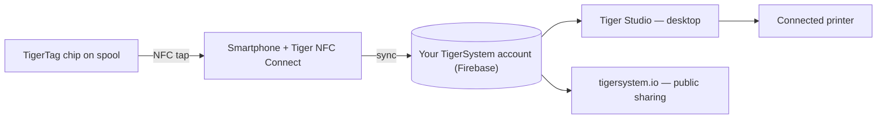

# 智能手机桥接理念

## 洞见

> 在中国，我们一直在问：*“RFID 读卡器在哪里？”* 所有人都回答：
> *“在 Bambu Lab 里。”* 错——Bambu 的读卡器在 AMS 里，不在
> 打印机里；机器根本无法检测第三方线轴。**RFID
> 读卡器就在你的口袋里**——每一部手机里都有，随时可用，而你
> 甚至并不知道。

每一部现代智能手机都内置 NFC 读卡器。这意味着**每一位 3D 打印
用户都已经拥有 TigerTag 硬件**——无需专有读卡器，无需升级打印机，
无需购买任何东西即可开始。

手机充当实体线轴与数字库存之间的**桥梁**：

1. **轻触**——一个动作即可读取芯片的资料（品牌、材料、颜色、设置）。
2. **同步**——线轴立即出现在用户的云库存中。
3. **随处可用**——桌面应用、网页和已连接的打印机现在都认识这卷线轴了。

## 原生 RFID 与桥接

有些打印机能原生读取标签（读取它们自己的专有格式）；大多数
则什么都读不到。桥接让打印机自身的能力变得无关紧要：

| 路径 | 需要 | 适用于 |
|---|---|---|
| **原生 RFID** | 能读取该厂商锁定标签的打印机 | 仅限一个品牌 |
| **智能手机桥接** | 任何支持 NFC 的手机 | **所有打印机**、所有品牌，甚至完全离线的机器 |

借助桥接，耗材数据通过
[Tiger Studio 的打印机集成](../compatibility/README.md)（目前已有六个品牌
上线）到达打印机——线轴向*系统*表明自己的身份，再由系统与
机器对话。

用实例证明：**FlashForge 打印机根本没有 RFID 读卡器**——
而通过桥接，它们如今照样能配合 NFC 识别的耗材使用。给别人的机器
增添了一整项新能力，**对用户完全免费**
（[FlashForge 案例](../compatibility/flashforge.md)）。

---

**◀ 上一页：** [开放生态](./open-ecosystem.md) · **▲ [文档索引](../../README.md)** · **下一页 ▶** [第二次生命工作流](./second-life.md)

**另见：** [Tiger NFC Connect](../products/tigertag-connect.md)、[架构概览](../architecture/overview.md)
