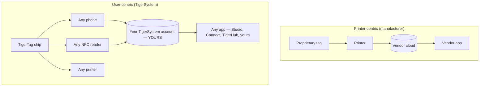

# 以用户为中心 vs 以打印机为中心

> **智能服务于用户——而不只是服务于打印机。**

## 两种截然相反的架构

在以打印机为中心的世界里，**打印机**是核心：标签的存在是为了服务
机器，数据则流入制造商的孤岛。

在 TigerSystem 中，**用户**才是核心。用户拥有：

- **耗材**——任何品牌、任何厂商；
- **元数据**——材料、颜色、打印设置，编码在由他们掌控的芯片上；
- **库存**——存放在他们自己的云账号下，可导出；
- **历史**——重量、位置、长期的使用情况；
- **同步**——同一个账号为所有应用和设备供数。

TigerSystem 只是**把每个组成部分连接在一起**。

## 为什么制造商要给 RFID 上锁

制造商的标签通常在密码学上被锁定（各厂商的详细情况见
[兼容性部分](../compatibility/README.md)：
由 UID 派生的密钥、AES 加密的扇区、RSA 签名）。上锁服务于
厂商：它把耗材的购买与机器绑定，并让数据管道保持
私有。这也意味着**你自己的线轴库存并不属于你**。

TigerTag 芯片采取相反的立场：标准 NTAG 芯片上的开放 NDEF 载荷，
公开记录，并配有开放的 SDK 来读写。

---

**◀ 上一页：** [为什么会有 TigerSystem](../vision/why-tigersystem.md) · **▲ [文档索引](../../README.md)** · **下一页 ▶** [开放生态](./open-ecosystem.md)

**另见：** [通用耗材身份](../concepts/universal-filament-identity.md)、[兼容性](../compatibility/README.md)
