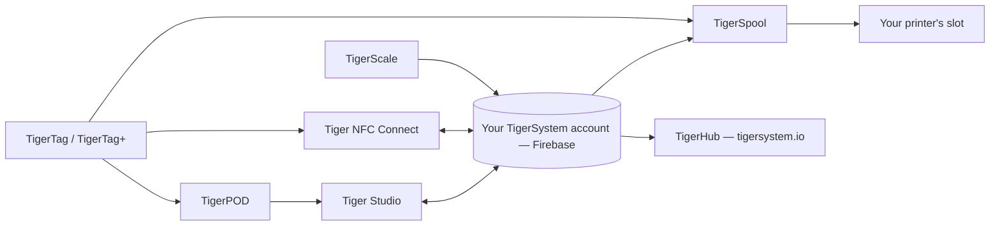

# 产品

TigerSystem 生态系统，每个产品一页。

**这些是官方产品**——由 TigerSystem 设计并发布。
这里的“官方”意思是*我们做的*，而不是*你必须要用*：它们每一个都是开源且可分叉的，
它们的名称（Tiger Studio、TigerHub、TigerScale、TigerPOD、Tiger NFC Connect）有意**不作为商标主张权利**。
只有 **TigerTag** 这个标志本身是保留的，而且只用于芯片。

任何人都可以构建并销售替代品——读卡器、应用、秤，乃至整套库存系统。
关于已经存在的东西，请见[第三方硬件](../compatibility/third-party-hardware.md)和
[基于 TigerTag 构建的软件](../developers/integrations.md)。第三方产品只要能工作，就是 **TigerTag Compatible**；
只有在 TigerSystem 授予时，它才会成为 **TigerTag Certified**
（[商标政策](../../TRADEMARK.md)）。

> **说明：** 下面每一个**面向用户**的产品——以及将来的每一个——都是一个可运行的**概念验证**。
> 它们唯一的目标，是展示一个开源、标准、与厂商无关、跨平台协议的潜力，并启发其他人用它构建什么。
> （工厂端的芯片编程工具链是另一回事：工业级，已投入生产。）见
> [有意为之的沙盒](../vision/why-tigersystem.md)。

| 产品 | 它是什么 | 类型 |
|---|---|---|
|  [TigerData](../concepts/universal-filament-identity.md) | 虚拟芯片——数字形式的身份，无需芯片，随时可升级 | 概念 |
|  [TigerTag](./tigertag.md) | 开放的 RFID/NFC 芯片 + 线轴身份标准 | 硬件 + 规范 |
|  [TigerTag+](./tigertag-plus.md) | 携带产品库产品 ID 和可选补充数据的 TigerTag——依然 100% 离线；加上签名，即为 TigerTag+ Certified | 硬件 + 规范 |
|  [Tiger NFC Connect](./tiger-nfc-connect.md) | 移动应用（iOS/Android）——扫描、编码、浏览 | 应用 |
|  [Tiger Studio](./tiger-studio.md) | 桌面应用——库存、货架、传感器、打印机 | 应用 |
|  [TigerHub](./tigerhub.md) | 生态系统的网络主页——展示、心愿单、好友与分享，位于 `tigersystem.io` | 网站 |
|  [TigerPOD](./tigerpod.md) | 可 3D 打印的双 NFC 读卡器支架 | 硬件 |
|  [TigerScale](./tigerscale.md) | 开源 ESP32 耗材秤 | 硬件 |
|  [TigerSpool](./tigerspool.md) | 放在打印机旁的开源 ESP32 盒子——轻触线轴、选择槽位，适用于任何品牌 | 硬件 |
|  [Tiger Touch](./tigertouch.md) | 面向 BIGTREETECH Panda Touch / K-Touch 屏幕的开源固件——所有品牌的打印机，实时显示在同一块屏幕上 | 固件 |
|  [TigerTag Factory 与 Manager](./factory-suite.md) | 面向工厂的工业级芯片编程与耗材数据库工具——**不对外公开**，生产级 | 工业 |

---

**◀ 上一页：** [数据流](../architecture/data-flow.md) · **▲ [文档索引](../../README.md)** · **下一页 ▶** [TigerTag](./tigertag.md)
