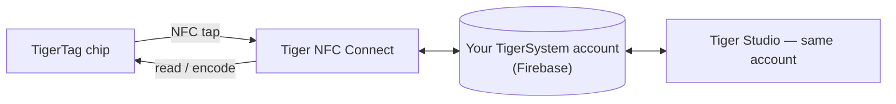

# Tiger NFC Connect（移动应用）

## 用途

**你的手机本来就是 TigerTag 读卡器——Connect 把它打开。** 这款
iOS/Android 应用轻触即可读取任何线轴，写入芯片同样轻松，
并把你的全部收藏装在口袋里。它是进入生态系统的日常入口，也是
[智能手机桥接](../philosophy/smartphone-bridge.md)的化身。

<strong>iPhone · iPad</strong>
<a class="ts-cta-primary" href="https://apps.apple.com/app/id6745437963">App Store</a>
用相机扫描，或点击按钮

<strong>Android</strong>
<a class="ts-cta-primary" href="https://play.google.com/store/apps/details?id=com.tigertag.connect">Google Play</a>
用相机扫描，或点击按钮

<a href="https://tigersystem.io/download">tigersystem.io 上的所有下载</a>
<a href="https://testflight.apple.com/join/jVHhmK4C">TestFlight 测试版（iOS）</a>
<a href="https://play.google.com/apps/testing/com.tigertag.connect">Google Play 测试版</a>

两大应用商店均免费。应用使用手机自带的 NFC 读取芯片——无需购买任何东西，无需读卡器，读取也无需账号。

## 它所处的位置

## 功能

- **随时随地的 NFC 扫描**——轻触一卷线轴，查看其完整资料。
- **芯片编程**——直接在手机上编码和重新编码 TigerTag 芯片。
- **浏览产品库**——共享的品牌/材料/颜色参考数据库。
- **共享账号**——与 Tiger Studio 使用同一个 Firebase 后端：库存、
 好友和货架在各设备之间实时保持同步。
- **USB-C 配件**——支持通过 USB-C 连接 AJAX-3D **TD-1 / TD1s** 耗材
 分析仪：直接在手机上测量耗材的透射距离（Transmission Distance，以及
 颜色）
 （[兼容的第三方硬件](../compatibility/third-party-hardware.md)）。

## 获取方式

- 已在 **App Store（iOS）**和 **Google Play（Android）**上**发布**——
 目前版本为 1.0.2。
- 也有**公开测试版**（iOS 上的 TestFlight，Android 上的公开测试）。
- 所有下载链接：**[tigersystem.io/download](https://tigersystem.io/download)**
 ——Tiger Studio 的侧边栏中也始终有二维码可用。

> **命名说明：** 以前以 *“TigerTag RFID Connect”* 之名发布——现已更名为
> **Tiger NFC Connect**，以呼应每部手机里本来就有的 NFC 读卡器。
> 该应用目前**可免费使用但属于专有软件**（非开源）——
> 这不同于 Tiger Studio、各 SDK 和硬件，它们都是开放的。

## 架构

Flutter 应用，与 Firebase（Auth + Firestore）通信——所有应用背后唯一共享的账号数据库。移动端的打印机连接在厂商允许的情况下以云为主。

## 交互

| 对象 | 方式 |
|---|---|
| TigerTag 芯片 | 通过 NFC 轻触读取与写入 |
| Firebase（账号数据库） | 实时同步库存 / 好友 / 偏好设置 |
| Tiger Studio | 桌面端的搭档——同一个账号，功能互补 |

## 图片展示

|| | | |
|---|---|---|---|
|  |  |  |  |

---

**◀ 上一页：** [TigerTag+ Certified](./tigertag-plus-certified.md) · **▲ [文档索引](../../README.md)** · **下一页 ▶** [Tiger Studio](./tiger-studio.md)

**另见：** [智能手机桥接](../philosophy/smartphone-bridge.md)、[库存与云同步](../concepts/inventory-and-cloud-sync.md)
