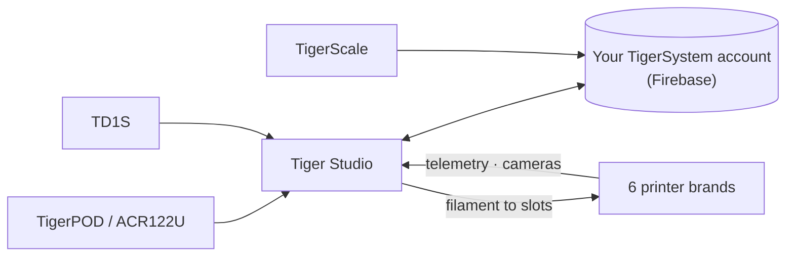

# Tiger Studio（桌面应用）

## 用途

**Tiger Studio 是你耗材的指挥中心。** 每一卷线轴、每一个货架、每一台打印机都在同一块屏幕上——扫描一枚芯片，它的线轴就会弹出；
更新重量，它会在所有地方同步；瞥一眼打印机，就能看到它此刻在做什么。开源，支持 Windows / macOS / Linux。

*桌上的 Tiger Studio，口袋里的应用，旁边的读卡器——无论你在哪里触碰，都是同一份库存。*

<a class="ts-cta-primary" href="https://tigersystem.io/download">下载 Tiger Studio——免费</a>

<a href="https://github.com/TigerTag-Project/TigerTag-Studio-Manager"> 源代码</a>

它有意被设计成**一个实验室，而不是终点**——一次对开放协议所能实现之事的演示，可读、可分叉、可自由复制
（[理念](../philosophy/open-ecosystem.md)）。

## 它所处的位置

## 功能（要点）

- **库存**——实时 Firestore 同步、表格/网格视图、详情面板、
 重量跟踪、容器校准、数字线轴（TigerData）以及
 原子化的芯片升级。
- **打印机**——**6 个品牌**的实时集成（遥测、每个槽位的耗材、任务进度、摄像头，部分品牌还有完整的控制面板）。见
 [兼容性](../compatibility/README.md)。
- **货架**——拖放式的实体存储映射。
- **好友与分享**——发现代码、只读的好友库存。
- **设备**——官方：[TigerPOD](./tigerpod.md) 和
 [TigerScale](./tigerscale.md)；第三方：ACR122U NFC 读卡器、
 **AJAX-3D TD-1 与 TD1s** 分析仪（TD 值和颜色直接进入线轴的资料）以及
 **USB HID 秤**（DYMO M 系列及任何兼容的秤）——
 完整列表：[兼容的第三方硬件](../compatibility/third-party-hardware.md)。
- **11 种语言**——EN · FR · DE · ES · IT · NL · PL · PT-BR · PT-PT · RU · 中文。

完整且始终最新的目录见应用仓库中的
[FEATURES.md](https://github.com/TigerTag-Project/TigerTag-Studio-Manager/blob/main/FEATURES.md)。

## 架构

Electron + 原生 JS，无打包工具。打印机连接直接使用各厂商的**原生局域网协议**（MQTT / WebSocket / HTTP）——
各品牌的协议说明维护在应用仓库中（`renderer/printers/<brand>/PROTOCOL.md`）。

## 图片展示

## 链接

- 仓库与下载：[TigerTag-Studio-Manager](https://github.com/TigerTag-Project/TigerTag-Studio-Manager)（MIT）
- 完整功能目录：[FEATURES.md](https://github.com/TigerTag-Project/TigerTag-Studio-Manager/blob/main/FEATURES.md)

---

**◀ 上一页：** [Tiger NFC Connect](./tiger-nfc-connect.md) · **▲ [文档索引](../../README.md)** · **下一页 ▶** [TigerHub](./tigerhub.md)

**另见：** [兼容性](../compatibility/README.md)、[架构](../architecture/overview.md)
