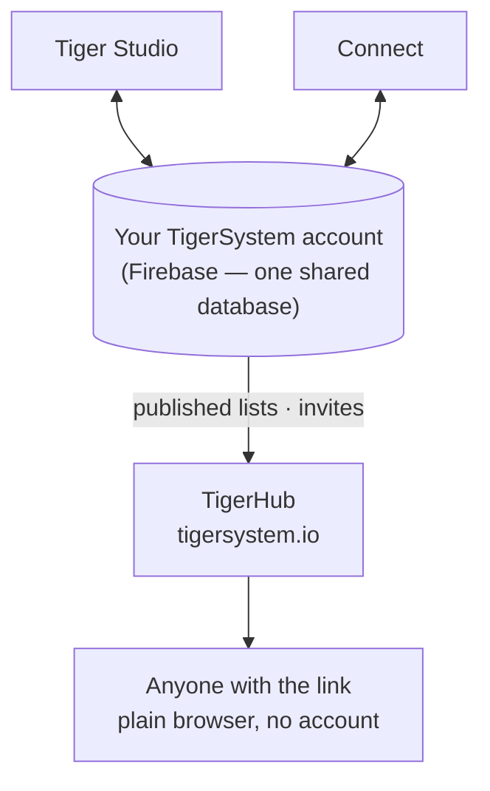

# TigerHub

## 用途

**TigerHub 是生态系统在网络上的家**——位于
**[tigersystem.io](https://tigersystem.io)** 的网站。它展示 TigerSystem 沙盒，以及开放的 TigerTag 协议所能实现的一切，
并承载沙盒的**社交一面**：分享心愿单、邀请某人成为好友、发布一份任何人都能在浏览器中打开的只读列表。

## 它所处的位置

## 功能——今天全部可用

- **生态系统展示**——首页讲述完整的故事：它如何运作、
 六个打印机品牌、各个组件，以及三个层级（TigerData——
 纯软件跟踪 · TigerTag——离线芯片 · TigerTag+——经过验证的
 真实性）。
- **你在网页上的账号**（`/account`）——在浏览器中登录你的 TigerSystem
 账号。
- **心愿单**——公开的和仅好友可见的，均已上线。
- **好友代码与邀请**——可以在网页上互相添加为好友。
- **公开列表链接**——以 `https://tigersystem.io/wishlist/<token>` 的形式只读分享一个列表；查看者无需应用，也无需
 账号。
- **材料产品库与参考数据库**（`/materials`、`/database`）——
 浏览所有应用据以解析的共享产品库。
- **打印机与功能**（`/printers`、`/features`）——什么与什么兼容。
- **3D 模型**（`/models`）——可打印的模型（TigerPOD 等）。
- **面向制造商、开发者与媒体**（`/manufacturers`、`/developers`、
 `/press`）——B2B 的故事、集成指引、媒体素材。
- **周边**（`/goodies`）——官方帽子和 Polo 衫。购买其中一件，是
 [支持本项目](../support.md)的方式之一。

## 公开列表链接的实际用法

公开列表链接的形式是 `https://tigersystem.io/wishlist/<token>`。在把它贴到任何地方之前，
需要了解三件事：

- **令牌就是整把钥匙。** 任何持有链接的人都能打开该列表——无需账号、无需应用、无需任何证明。
  把它当作一个你选择分享出去的密码：发到论坛帖子里或给好友都没问题，但不适合一个你不希望被
  进一步复制传播的列表。
- **把列表设为公开，才会生成链接。** 在应用中把列表设为*公开*，会生成它的令牌并发布该列表的一份副本；
  再把它设回私密，则会删除这份副本和令牌。再次设为公开时，它会得到一个**新的**令牌，所以之前
  发出去的链接不会复活。TigerHub 只展示应用所发布的内容。
- **只读，并且会显示是谁分享的。** 查看者只能看到这一个列表——其中的条目，以及你设置的场合或留言
  （如有）——绝不会看到你的库存或你的其他列表。不过，页面确实会显示你的**显示名称**、你的
  **社交链接**，以及一个带有你**发现码**的*添加为好友*按钮。

链接是两种分享方式之一；另一种是好友：

| | 公开列表链接 | 好友 |
|---|---|---|
| 谁能看到 | 任何持有链接的人 | 你接受的某一个人 |
| 是否需要账号 | 否 | 是 |
| 方式 | 把列表设为公开 | 交换发现码 |
| 撤销 | 把列表设为私密 | 删除该好友 |

这里对好友部分只做概述，以便与链接并列；请求和删除的规则，以及两者在服务器端的强制执行，见
[库存与云同步](../concepts/inventory-and-cloud-sync.md)。

## TigerHub 不是数据库

用户账号以及所有应用背后的数据都存放在**原生 Firebase**
（Auth + Firestore）中——有意采用不带品牌的基础设施：**一个共享数据库，放在一个地方**，
因此 Tiger Studio、Tiger NFC Connect、TigerScale 和 TigerSystem 账号都在同一份数据上协同工作。TigerHub 是建立在其上的
**网络界面**。见
[库存与云同步](../concepts/inventory-and-cloud-sync.md)。

## 交互

| 对象 | 方式 |
|---|---|
| Tiger Studio / Connect | 把列表设为公开或私密——这会创建或删除它的链接——并发送好友邀请 |
| Firebase（账号数据库） | 已发布数据的来源 |
| 访客 | 普通浏览器，无需账号 |

---

**◀ 上一页：** [Tiger Studio](./tiger-studio.md) · **▲ [文档索引](../../README.md)** · **下一页 ▶** [TigerPOD](./tigerpod.md)

**另见：** [库存与云同步](../concepts/inventory-and-cloud-sync.md)、[架构](../architecture/overview.md)
