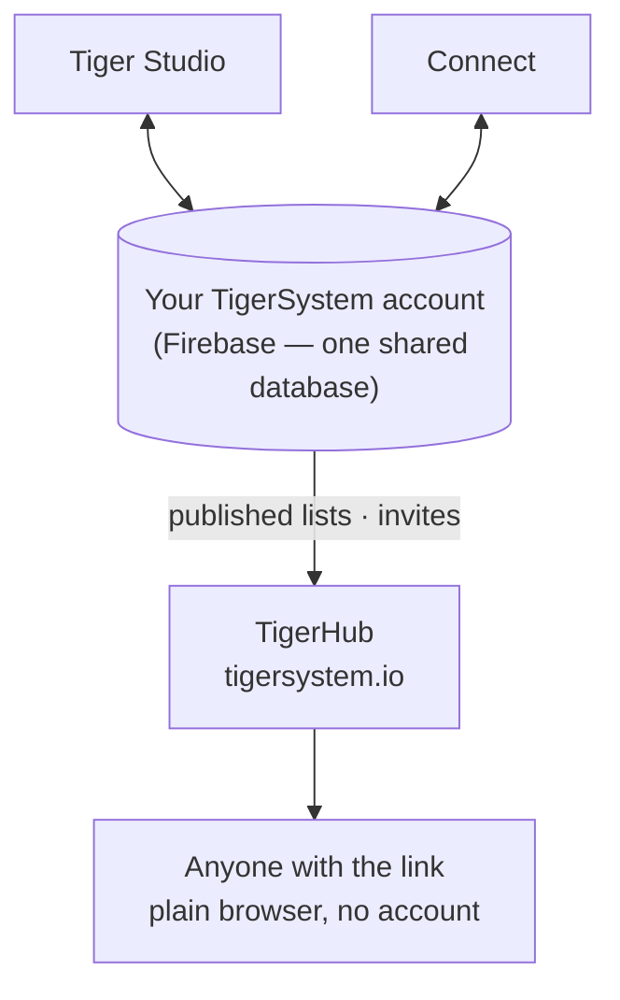

# TigerHub

## 用途

**TigerHub 是生态系统在网络上的家**——位于
**[tigersystem.io](https://tigersystem.io)** 的网站。它展示 TigerSystem 沙盒，以及开放的 TigerTag 协议所能实现的一切，
并承载沙盒的**社交一面**：分享心愿单、邀请某人成为好友、发布一份任何人都能在浏览器中打开的只读列表。

## 它所处的位置

## 功能——今天全部可用

- **生态系统展示**——首页讲述完整的故事：它如何运作、
 六个打印机品牌、各个组件，以及三个层级（TigerData——
 纯软件跟踪 · TigerTag——离线芯片 · TigerTag+——经过验证的
 真实性）。
- **你在网页上的账号**（`/account`）——在浏览器中登录你的 TigerSystem
 账号。
- **心愿单**——公开的和仅好友可见的，均已上线。
- **好友代码与邀请**——可以在网页上互相添加为好友。
- **公开列表链接**——以 `https://tigersystem.io/list/<token>` 的形式分享只读的库存或心愿单；查看者无需应用，也无需
 账号。
- **材料产品库与参考数据库**（`/materials`、`/database`）——
 浏览所有应用据以解析的共享产品库。
- **打印机与功能**（`/printers`、`/features`）——什么与什么兼容。
- **3D 模型**（`/models`）——可打印的模型（TigerPOD 等）。
- **面向制造商、开发者与媒体**（`/manufacturers`、`/developers`、
 `/press`）——B2B 的故事、集成指引、媒体素材。
- **周边**（`/goodies`）——官方帽子和 Polo 衫。购买其中一件，是
 [支持本项目](../support.md)的方式之一。

## TigerHub 不是数据库

用户账号以及所有应用背后的数据都存放在**原生 Firebase**
（Auth + Firestore）中——有意采用不带品牌的基础设施：**一个共享数据库，放在一个地方**，
因此 Tiger Studio、Tiger NFC Connect、TigerScale 和 TigerSystem 账号都在同一份数据上协同工作。TigerHub 是建立在其上的
**网络界面**。见
[库存与云同步](../concepts/inventory-and-cloud-sync.md)。

## 交互

| 对象 | 方式 |
|---|---|
| Tiger Studio / Connect | 生成与撤销分享链接，发送好友邀请 |
| Firebase（账号数据库） | 已发布数据的来源 |
| 访客 | 普通浏览器，无需账号 |

---

**◀ 上一页：** [Tiger Studio](./tiger-studio.md) · **▲ [文档索引](../../README.md)** · **下一页 ▶** [TigerPOD](./tigerpod.md)

**另见：** [库存与云同步](../concepts/inventory-and-cloud-sync.md)、[架构](../architecture/overview.md)
