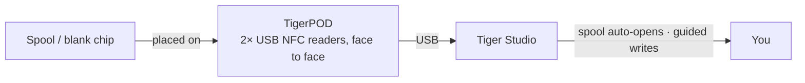

# TigerPOD

## 用途

**第一台面向智能耗材线轴的“CD 播放器”。** TigerPOD 把线轴扫描仪放到你的桌面上——而且由你自己打印。
这是一个免费、开源、可 3D 打印的支架，容纳**两台**相向而置的 USB NFC 读卡器：放上一卷线轴，它就在 Tiger Studio 里自我识别；放上一枚空白芯片，就可以编码。像用手机轻触一样自然，只是在桌面上无需动手。

*把线轴放下；它会自己介绍自己。*

<a class="ts-cta-primary" href="https://tigersystem.io/tigerpod">获取 TigerPOD</a>
<a href="https://makerworld.com/fr/models/1289152-tigerpod-for-openspool-tigertag-rfid-filament#profileId-1318958">自己打印——免费 STL</a>

<a href="https://github.com/TigerTag-Project/TigerPOD"> 源代码</a>

## 为什么是两台相向的读卡器

这是外壳存在的全部意义，也是唯一需要做对的事。**我们始终推荐两台读卡器。** 从技术上说一台读卡器也能工作，但它会在两个具体方面降低体验：

- **读取。** 一卷线轴带有
 [**两枚芯片，位于相对的两面**](../concepts/tigertag-chip.md)。只有一台读卡器时，如果线轴落下的方向“不对”，就得把它拿起来翻个面才能被识别。每一侧各有一台读卡器时，无论你把线轴往哪个方向放，总有一枚芯片已经对着一台读卡器。不用翻转，不用瞄准。
- **写入。** 当你自己给线轴贴标签时，要写入**两**枚芯片。一台读卡器意味着两次操作，也意味着两次写得不一致的机会。两台读卡器可以**一次性**写入这一对，而且 Tiger Studio 可以让它们互相核对。

Pod 的存在就是为了保持这种几何结构：两台读卡器，竖直，相向，间距正好是线轴的距离。其余的一切都只是围绕它的外壳。

## 它所处的位置

## 两种待打印的外壳——都免费

| | **TigerPOD Mini**——*推荐* | **TigerPOD（原版）** |
|---|---|---|
| |  |  |
| 打印 | 更快，更省耗材 | 更久，更费耗材 |
| 桌面空间 | 更少 | 更多 |
| 线缆 | 布在外壳**内部** | 外露 |
| 标签 | TigerTag **和** OpenSpool（NDEF） | TigerTag **和** OpenSpool（NDEF） |
| 下载 | **[MakerWorld——TigerPOD Mini](https://makerworld.com/fr/models/3190348-tigerpod-mini-for-openspool-tigertag-rfid-filament#profileId-3609236)** | **[MakerWorld——TigerPOD 原版](https://makerworld.com/fr/models/1289152-tigerpod-for-openspool-tigertag-rfid-filament#profileId-1318958)** |

两者容纳的都是同样的两台 ACR122U 级读卡器，相向而置。Mini 是对原版的重新设计，简单说就是更好的 Pod：除非你特别想要更大的托架，否则从它开始。

采用 **CC BY 4.0** 许可——可自由改编和再创作。

## 它由什么构成

STL 是外壳；这些是装在里面的零件。这里没有什么是独占的——任何 ACR122U 级读卡器和任何 USB-C 分线器都能用——但这是外壳围绕其设计的组合：

| 零件 | 数量 | 它是什么 |
|---|---|---|
| **TigerTag Player** | **2** | USB NFC 读卡器——ACR122U 级设备。每侧一台，因此线轴的两枚芯片在一次操作中就都能触及。 |
| **TigerTag Spliter** | 1 | USB-C 转 2× USB-A，使两台读卡器通过一个端口连接电脑，并可并行编程。 |
| **打印的外壳** | 1 | **Mini** 或原版——见上文。 |

### 获取零件

外壳可免费下载；两台读卡器和分线器则是你要购买的部分。它们作为套装出售，这是最便宜地凑齐正确一对的办法：

- **[TigerTag Player Bundle——2 台读卡器 + Spliter](https://www.atome3d.com/products/tigertag-player-bundle-2pcs-spliter)**（Atome3D）
- 也可在 **[tigertag.io](https://shop.tigertag.io/collections/tigertag-rfid-maker)** 购买

> **说明：** 自己组装和购买预装好的，得到的是完全相同的设备。任何两台 ACR122U 级读卡器都可以——套装只是省去你分别采购的麻烦。

## 自己动手做一个

1. **打印一个外壳**——上面的 Mini 或原版。
2. **准备两台兼容 ACR122U 的读卡器**，到你喜欢的任何商店购买，再加一包用于写入的空白 NTAG 213 / 215 / 216 芯片。
3. **把一台读卡器滑进每个卡槽**——不用螺丝，不用胶水，不用接线。
4. **把两台都插到电脑上。** 用分线器只需一根线；两个 USB 端口同样可以。
5. **安装 [Tiger Studio](./tiger-studio.md)**——它会自动识别这些读卡器。

大致预算，分别采购——价格因商店和地区而异：

| 零件 | 数量 | 大约价格 | 购买地点 |
|---|---|---|---|
| 兼容 ACR122U 的 NFC 读卡器 | 2 | 每台 15–25 欧元 | [Amazon](https://amzn.to/4vok3d7) · 或任何商店 |
| 空白 NTAG 213 / 215 / 216 芯片 | 1 包 | 10–20 欧元——每卷线轴用两枚，所以一包能给很多线轴贴标签 | [Amazon](https://amzn.to/3TzxGc7) · [官方芯片](./tigertag.md) |
| 打印的外壳 | 1 | 仅耗材 | MakerWorld，见上文 |
| USB 分线器（2× USB-A 母口 → 1× USB-A 公口） | 1 | 5–10 欧元，可选 | [Amazon](https://amzn.to/4plgsv8) |

> 此表中的一些链接是 **Amazon 联盟链接**：作为 Amazon 联盟成员，TigerTag 从符合条件的购买中获得收入，**不会给你增加任何费用**。这有助于资助开放协议。在其他任何地方购买同样的零件，效果完全一样。

购买[套件](https://shop.tigertag.io/collections/tigertag-rfid-maker)比逐件采购同样的零件花费更少，读卡器到手时带有项目的官方标志，而且它是在资助这个标准——这是[支持本项目](../support.md)的几种方式之一。但用通用零件自己组装**并不是次一等的路径——它就是同一个 Pod**。这就是开放协议的含义。

### 读卡器兼容性

ACR122U 使用 **PC/SC**，这是此类读卡器都实现的操作系统级智能卡标准。由于 Pod 建立在 PC/SC 而不是厂商驱动之上，同样的配置可在 **Windows、macOS 和 Linux** 上运行，任何 PC/SC 库都能驱动它。

## 功能

- 可 3D 打印的外壳——**MakerWorld 上的免费 STL**，有 **Mini** 和
 **原版** 两种尺寸。
- 容纳两台 ACR122U 级 USB 读卡器，面对面放置（读取 + 写入工位）。
- 与 [Tiger Studio](./tiger-studio.md) 即插即用：扫描芯片会
 自动打开匹配的线轴；引导式芯片更新流程用它进行
 带 UID 校验的写入。
- 不局限于 TigerTag：同样的两台读卡器也能处理 **OpenSpool**（NDEF）标签。

## 不止 TigerTag——一个通用的 NFC 工位

Pod **并不局限于 TigerTag 协议**。确切地说，它就是两台标准 PC/SC 读卡器装在一个线轴形状的托架里：**ACR122U 能做的一切，Pod 都能做。**

你对芯片拥有完全的控制权——读取上面有什么、写入新内容、更改现有内容、擦除回空白。四项全能，双向进行。没有一次性写入，没有单行道，没有厂商锁定。而对耗材来说，这一切都在 **Dual NFC** 中完成，一卷线轴的两枚芯片一起处理，适用于任何品牌的线轴。

ACR122U 能处理的远不止 NTAG：**ISO 14443 Type A 和 B**、**MIFARE**（Classic 1K/4K、Ultralight、DESFire）、**FeliCa**、**Topaz/Jewel**，以及 **NFC Forum 标签类型 1–4**。凡是你能用 ACR122U 读取或写入的，都能在 Pod 里读取或写入——包括 [OpenSpool](../compatibility/openspool.md) 标签。

这也是让[第二次生命](../philosophy/second-life.md)成为现实的原因。TigerTag 从不被写保护锁定，所以一卷线轴用完后，你可以擦除它的芯片并把它们重写为全新的 TigerTag——或者把它们变成完全不同的东西：用于家庭自动化的普通 **NDEF** 标签、Wi-Fi 交接、一个网址、一张名片。你想要的时候，还可以变回 TigerTag。芯片是可重复使用的资产，而不是一次性包装。

## 交互

| 对象 | 方式 |
|---|---|
| TigerTag 芯片 | 读取 / 编码 / 验证——一卷线轴的两枚芯片一起处理 |
| Tiger Studio | 即时识别线轴、芯片升级与更新 |

## 图片展示

## 链接

- 仓库：[TigerPOD](https://github.com/TigerTag-Project/TigerPOD)
- STL——**[TigerPOD Mini](https://makerworld.com/fr/models/3190348-tigerpod-mini-for-openspool-tigertag-rfid-filament#profileId-3609236)** · [TigerPOD 原版](https://makerworld.com/fr/models/1289152-tigerpod-for-openspool-tigertag-rfid-filament#profileId-1318958)
- 读卡器：[TigerTag Player Bundle（2 台 + Spliter）](https://www.atome3d.com/products/tigertag-player-bundle-2pcs-spliter)

---

**◀ 上一页：** [TigerHub](./tigerhub.md) · **▲ [文档索引](../../README.md)** · **下一页 ▶** [TigerScale](./tigerscale.md)

**另见：** [第二次生命工作流](../philosophy/second-life.md)
