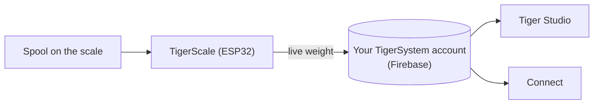

# TigerScale

## 用途

**TigerScale 回答那个永恒的问题：还剩多少耗材？** 把线轴放到这台开源的 ESP32 秤上，实时重量就直接流入你的库存——无需手动输入，也不用把线轴举到耳边晃一晃。

*线轴放上去，秤就已经知道它是什么：芯片提供品牌、材料和颜色，称重传感器提供克数。无需输入，无需猜测。*

<a class="ts-cta-primary" href="https://tigertag-project.github.io/Tiger-Scale-V3/">从浏览器安装</a>

<a href="https://tigersystem.io/tigerscale">tigersystem.io 上的 TigerScale</a>
<a href="https://makerworld.com/en/models/3161869-tigerscale-v3-best-smart-filament-scale-with-nfc#profileId-3573543">打印外壳</a>
<a href="https://github.com/TigerTag-Project/Tiger-Scale-V3"> 源代码</a>

> **芯片知道耗材*是什么*；秤知道还*剩*多少。**
> 两者合在一起，才让库存真正属实：身份来自
> [TigerTag](./tigertag.md)，实时数量来自 TigerScale。

## TigerScale V3——当前这一代

[Tiger-Scale-V3](https://github.com/TigerTag-Project/Tiger-Scale-V3)，MIT。
这就是值得构建的那一款。

- **它知道上面放的是哪一卷线轴**：**双 PN532 NFC 读卡器**，每侧一个——
 [贴有孪生标签的线轴](../concepts/tigertag-chip.md)无论你怎么放下
 都能被识别。读取标签、称重、减去空线轴的重量、同步——无需输入，无需猜测。
- **ESP32-S3**（16 MB 闪存，PSRAM），**3.5″ 480×320 彩色触摸屏**
 （LVGL），所有设置都可在屏幕上完成：WiFi 选择器 + 键盘、校准向导、
 硬件自检、OTA 更新。
- **电池供电**（AXP2101 电源管理芯片，屏幕上显示充电状态），音频编解码器。
- 精密称重：HX711 + 称重传感器，中值 + 自适应 EMA 滤波——
 调校出厨房秤的手感。
- **8 种固件语言**，9 种语言的网页界面。
- **实时重量跟踪**——更新通过 Firestore 实时出现在 Tiger Studio 和
 Tiger NFC Connect 中。
- 配合 Tiger Studio 的**容器重量校准**，因此每种容器类型的耗材净重
 都保持准确。
- **可离线工作。** 品牌和材料识别来自保存在设备自身闪存中的数据库，最多每天刷新一次——标签查询从不等待网络。
- **云同步是可选的。** 没有账号，这台秤也完全可用。
- **自带网页界面**，由设备提供，适配手机，通过 WebSocket 以 10 Hz 实时更新——无需安装应用就能用手机操作它。
- **没有二进制黑盒**：一切都从源代码编译。

*在工作台上：把线轴放下，它自己识别，自己称重。*

## 自己动手做一台

> **不熟悉电子制作？** 一台 USB 秤加一个 [TigerPOD](./tigerpod.md) 就能完成
> 同样的工作，不用接线，也不用烧录——这是
> [官方的无电子制作替代方案](#无需电子制作的-usb-秤与-tigerpod)。

这台秤需要自己动手制作，而人们以为会很难的那些步骤其实并不难：

1. **打印外壳。** 一个 `.3mf` 的 Bambu Studio 工程，分板已经排好——
 [在 MakerWorld 上](https://makerworld.com/en/models/3161869-tigerscale-v3-best-smart-filament-scale-with-nfc#profileId-3573543)。
 在 Bambu Studio 或 Orca 中打开它并点击切片：无需调整方向，也无需放置支撑。
2. **连接组件。** 按照下面的[接线图](#接线图)，把称重传感器、HX711、扬声器和两个
 PN532 读卡器连接到主板上——两种板子变体的引脚定义相同。
3. **从浏览器烧录。**
 [网页安装程序](https://tigertag-project.github.io/Tiger-Scale-V3/)始终提供当前版本；之后秤会通过无线方式自行更新。

零件都是通用件：

| 数量 | 组件 | 购买地点 |
|---|---|---|
| 1 | Waveshare **ESP32-S3-Touch-LCD-3.5B**——480×320 IPS 触摸屏（不带 B 的 **-3.5** 也可以） | [-3.5B](https://link.amazon/B0gaANfF5) · [-3.5](https://link.amazon/B0dpgOlOQ) |
| 2 | **PN532 V3** NFC 模块——需要排针**和**模式开关 | [Amazon](https://link.amazon/B0iTXrhjd) |
| 1 | 5 kg 称重传感器 + HX711 | [Amazon](https://link.amazon/B09LOUuI1) |
| 1 | USB-C 4 针线缆 + 接头 | [线缆](https://link.amazon/B0aoW8qQx) · [接头](https://link.amazon/B0aiEyjLx) |
| 1 | 锂离子电池——**可选**，秤可以用 USB 供电运行 | [Amazon](https://link.amazon/B0etKlE1i) |
| — | 杜邦线、M3 自攻螺丝 | [线](https://link.amazon/B0bl6jvMs) · [螺丝](https://link.amazon/B0ekzxx1E) |
| — | 2× M4×30 和 2× M5×30（称重传感器），4× M2×6（显示屏） | 任何五金店 |
| 1 | 一个小扬声器 | 随 ESP32-S3 板子附带 |

<figure>

<figcaption><strong>两种变体都能用，但需要不同的固件。</strong> 看丝印：<strong>-3.5B</strong> 还是 <strong>-3.5</strong>。网页安装程序会询问你用的是哪一种；接线和外壳在两种情况下都相同。烧录了错误的版本，秤会正常启动，却永远看不到标签，屏幕上也没有任何提示说明原因。</figcaption>
</figure>
<figure>

<figcaption><strong>警告：</strong>称重传感器必须带有 2× M4 和 2× M5 螺纹孔，HX711 板必须与图中所示完全相同——否则它无法装进指定的卡槽。</figcaption>
</figure>

> 此表中的一些链接是 **Amazon 联盟链接**：作为 Amazon 联盟成员，TigerTag 从符合条件的购买中获得收入，**不会给你增加任何费用**。这有助于资助开放协议。在其他任何地方购买同样的零件，效果完全一样。

完整的带价格物料清单在
[仓库](https://github.com/TigerTag-Project/Tiger-Scale-V3)中。

### 组装

<figure>

<figcaption>前方四分之三视角</figcaption>
</figure>
<figure>

<figcaption>后方四分之三视角</figcaption>
</figure>
<figure>

<figcaption>后方四分之三视角，特写</figcaption>
</figure>
<figure>

<figcaption>侧视图</figcaption>
</figure>

<figure>

<figcaption>秤的位置和朝向</figcaption>
</figure>
<figure>

<figcaption>PN532 嵌入卡槽</figcaption>
</figure>

### 接线图

*[Cirkit Designer 中的交互式原理图](https://app.cirkitdesigner.com/project/c6aa6c0a-9462-498f-8923-9ad4454e0e69)*

### 故障排除

**[网页安装程序](https://tigertag-project.github.io/Tiger-Scale-V3/)里检测不到 ESP32-S3 的 COM 端口？**

你的系统可能缺少驱动。[请按照驱动安装指南操作](../tutorials/tigerscale-serial-port-driver.md)。

## 由你制造，由你销售

**任何人都可以制造和销售 TigerScale 硬件。没有授权费，没有版税，无需注册。** 自己做，烧录官方固件，发货即可。

把你的产品称为 **TigerScale** 的唯一条件，是运行**未经修改**的官方固件，这样每一台设备在生态系统中的行为都完全一致。如果你想改动，就分叉它——并给分叉起一个不同的名字。交易的全部内容就是这些。

## 它所处的位置

## 迄今为止的故事

三代产品，而这东西的形态在每一代都发生了变化：

| | 读取 | 屏幕 | 主板 | 外形 |
|---|---|---|---|---|
| **V1**——从未公开发布 | **一个** PN532 | 迷你 OLED | ESP32 | **线轴支架**：一根穿过线轴中心的中央支撑 |
| **V2**——[Tiger-Scale](https://github.com/TigerTag-Project/Tiger-Scale)，MIT | 2× RC522 | 0.96″ OLED | ESP32-WROOM，USB 供电 | 平板秤 |
| **V3**——[Tiger-Scale-V3](https://github.com/TigerTag-Project/Tiger-Scale-V3)，MIT | 2× PN532 | 3.5″ 彩色触摸屏 | ESP32-S3，电池 | 平板秤，自成一体 |

V1 已经基本带有 V2 的电子元件——ESP32、迷你 OLED、
带 5 kg 称重传感器的 HX711 板——但只有**一个**读卡器，而且机身完全不同。

> **V3 是不同的硬件，而不是固件更新。** 两者不能互换：你已经做好的 V2 保留它自己的仓库，并继续工作。只是它不再继续开发了。

三代都是完全开源（MIT），使用通用零件——这有力地证明，一块 ESP32 加一个 NFC 读卡模块（PN532 / RC522 级）就足以构建读取 TigerTag 的设备。

## 无需电子制作的 USB 秤与 TigerPOD

这是**为不想自己造秤的人提供的官方替代方案**。一台标准的 USB 秤加一个 [TigerPOD](./tigerpod.md)，都插到电脑上，其余的由 Tiger Studio 完成——不用焊接，不用接线，也不用烧录。

1. **用 USB 把秤接到电脑上。**
2. **把 TigerPOD 放在秤上**——Mini 或原版均可。
3. **给秤去皮**，TigerPOD 就放在上面。
4. **打开 Tiger Studio。**
5. **把线轴放到 TigerPOD 上。** 它读取线轴的芯片，Tiger
 Studio 打开它的卡片。
6. **秤称出重量**，Tiger Studio 会自动更新线轴的重量。

### 哪些秤可用

Tiger Studio 读取标准的 **USB “HID Scale” 设备**（HID 用法页 `0x8D`，用法 `0x20`）：首先是 **DYMO M5** 和 DYMO M 系列的其他型号（M10、M25……协议相同），以及**任何兼容的 HID Scale**，无论品牌。这台秤是第三方硬件，不是 Tiger 的产品；围绕它的设置是官方的，并受到支持。

协议，已在真实硬件上验证——6 字节的*秤数据报告*，约 1 Hz：

| 字节 | 含义 |
|---|---|
| `[0]` | 报告 ID `0x03` |
| `[1]` | 状态：1 故障 · 2 零点稳定 · 3 运动中 · 4 稳定 · 5 负值 · 6 超量程 |
| `[2]` | 单位（HID PoS 代码）：`0x02` 克 · `0x0B` 盎司 · `0x0C` 磅 |
| `[3]` | 应用于原始值的带符号十的幂指数 |
| `[4..5]` | 重量，LE16（LSB，MSB） |

DYMO 厂商 ID 为 `0x0922`；M5 的 pid 为 `0x8009`。怪癖：去皮之后的第一帧会报告单位 `0x00`。

> **不支持 DYMO M2**——它根本没有 USB 端口，所以没有任何东西可以接到电脑上。协议在这里无关紧要。

## 交互

| 对象 | 方式 |
|---|---|
| Firebase（账号数据库） | 将实时重量写入用户的账号 |
| Tiger Studio / Connect | 显示实时重量；健康监测 |

## 链接

- **V3（当前）**：[Tiger-Scale-V3](https://github.com/TigerTag-Project/Tiger-Scale-V3)（MIT）
- 从浏览器烧录：[网页安装程序](https://tigertag-project.github.io/Tiger-Scale-V3/)
- 打印外壳：[MakerWorld](https://makerworld.com/en/models/3161869-tigerscale-v3-best-smart-filament-scale-with-nfc#profileId-3573543)
- V2，不再开发：[Tiger-Scale](https://github.com/TigerTag-Project/Tiger-Scale)（MIT）

---

**◀ 上一页：** [TigerPOD](./tigerpod.md) · **▲ [文档索引](../../README.md)** · **下一页 ▶** [兼容性](../compatibility/README.md)

**另见：** [库存与云同步](../concepts/inventory-and-cloud-sync.md)
