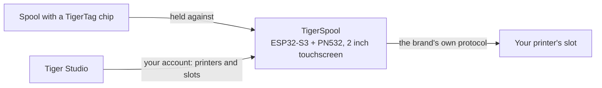

# TigerSpool

**打印机旁的一个小盒子。轻触一个槽位，把线轴贴上去，耗材就被写入那个槽位——适用于任何品牌的打印机。**

*盒子、一卷线轴，以及屏幕上打印机自己的槽位——每一个都显示着里面装的是什么。选一个槽位，把线轴贴到盒子上，搞定。*

<a class="ts-cta-primary" href="https://tigertag-project.github.io/TigerSpool-RFID/">从浏览器安装</a>

<a href="https://github.com/TigerTag-Project/TigerSpool-RFID"> 源代码</a>

你的打印机本来就维护着一份槽位列表。你的线轴本来就带着自己的[身份](../concepts/universal-filament-identity.md)。TigerSpool 就是两者之间的那三十厘米：不用打开应用，不用键盘，芯片已经知道的东西一概不必重新输入。

采用 **MIT** 许可开源，ESP32-S3，通用零件约 **40 欧元**。

## 它做什么

1. 在触摸屏上**轻触你想要的槽位**——名称与打印机自己使用的槽位名称相同。
2. **把线轴贴到盒子上。** [TigerTag 芯片](../concepts/tigertag-chip.md)一接触就被读取，分配信息随即通过该品牌自己的协议发往打印机：材料、品牌、颜色和温度，写入正确的槽位。无需任何确认。
3. **装上线轴。** 盒子会告诉你它被分配到了哪个槽位。

它支持九种语言，在一切开始之前先询问你用哪一种，并能通过无线方式自行更新。

:::caution[警告]
在屏幕上把 TigerTag 扫描到某个槽位，并不会装入任何东西——它只是告诉打印机这卷线轴*是什么*。**你仍然必须亲手把线轴物理地放进那个槽位**——CFS、AMS、ACE 单元，或者那台打印机称作自己料盘的任何东西。如果跳过这一步，打印机会报告没有耗材，因为确实没有装入任何耗材。
:::

## 它所处的位置

TigerSpool 不是芯片写入器——那是桌面上 [TigerPOD](./tigerpod.md) 的工作。TigerSpool 接受一个已经存在的身份，并把它放到打印机期望它所在的地方。

## 首先必须具备什么

**这是最容易让人栽跟头的地方，所以放在硬件之前。**

这个盒子没有键盘，也无法输入打印机的地址，这是有意为之。它从**你的 TigerSystem 账号**读取你的打印机，这意味着在它变得有用之前，必须先具备两样东西：

1. **一个在 [Tiger Studio](./tiger-studio.md) 中创建的账号。** 盒子会登录它——通过电子邮件，或通过二维码用 Google 登录，因此永远不必在两英寸的屏幕上输入密码。
2. **在 Tiger Studio 中添加好你的打印机。** 地址、访问码、品牌和型号都保存在那里。

如果跳过这一步，盒子上的打印机列表会是**空的**。这不是故障，设备上也没有什么需要修复的：它显示的正是你的账号里有的东西。在 Tiger Studio 中添加打印机，它会在下一次同步时出现。

> **简言之：** Tiger Studio → 创建账号 → 添加你的打印机 →
> *然后*再设置盒子。

## 支持哪些打印机

**Tiger Studio 集成的六个品牌都已覆盖**——已编写，并已在硬件上测试。这并不是市场上的每一台打印机，*“任何打印机”*依然是目标；它是这个生态系统今天能对话的每一个品牌：

| 品牌 | 固件 | 传输方式 |
|---|---|---|
| [Creality](../compatibility/creality.md) | 已实现，已验证 | WebSocket |
| [FlashForge](../compatibility/flashforge.md) | 已实现，已验证 | HTTP |
| [Bambu Lab](../compatibility/bambu-lab.md) | 已实现，已验证 | 基于 TLS 的 MQTT |
| [Snapmaker](../compatibility/snapmaker.md) | 已实现，已验证 | 基于 WebSocket 的 Moonraker |
| [Elegoo](../compatibility/elegoo.md) | 已实现，读取已验证——写入尚未在打印机上确认 | MQTT |
| [Anycubic](../compatibility/anycubic.md) | 已实现，读取已验证——写入尚未确认；仅限局域网模式 | 基于 TLS 的 MQTT |

槽位名称沿用打印机自己的：Creality 和 FlashForge 上是 `Ext.` 和 `1A`–`1D`，Bambu Lab 上是 `A1`–`A4` 然后 `B1`–`B4`，Snapmaker 上是 `E1`–`E4`，Elegoo 的 Canvas 上是 `S1`–`S4`，Anycubic 上每个 ACE 单元一个字母——`A1`、`A2`……，第二个盒子则是 `B1`……

在为某台特定机器购买零件之前，请先查看[各品牌的状态](https://github.com/TigerTag-Project/TigerSpool-RFID/blob/main/docs/PRINTER-COMPATIBILITY.md)。

## 自己动手做一个

三样东西要买，四根线，一个打印的外壳——外加两样值得考虑的附件。**所有打印机品牌的电子部分都完全相同**——只有外壳不同，这使得固件和零件清单保持唯一。

| 数量 | 组件 | 购买地点 |
|---|---|---|
| 1 | Waveshare **ESP32-S3-Touch-LCD-2** 开发板——2.0" 240×320 IPS 电容触摸屏，ESP32-S3**R8**，16 MB 闪存，8 MB 八线 PSRAM。屏幕、触摸面板和 MCU 在同一块板子上，而 16 MB 让两个 OTA 槽位变得宽裕 | [Amazon](https://link.amazon/B0c5hr3uf) |
| 1 | **PN532 V3** NFC 模块——带 DIP 开关，必须支持 **HSU/UART**，两个开关都拨到 `0` / OFF。两个一包的价格几乎和一个差不多 | [Amazon](https://link.amazon/B0dyEfwKa) |
| 1 | 一根**能传输数据**的 USB-C 线——速度无关紧要，任何 USB 2.0 数据线都行 | [Amazon](https://link.amazon/B00Xg3WT4) |
| 1 | 磁吸 USB-C 接头——**推荐**：这个端口是每天都要动的部件，线缆会脱开而不是插座被拉坏 | [Amazon](https://link.amazon/B0bWVIBa0) |
| 1 | 3.7 V 1000 mAh 锂聚合物电池，PH1.25——**可选**，通过 USB 充电；盒子随后可以无线运行。板子无法检测电池，所以你要在“设置 › 电池”中声明。请检查极性 | [Amazon](https://link.amazon/B0fL0jjf3) |

> 此表中的一些链接是 **Amazon 联盟链接**：作为 Amazon 联盟成员，TigerTag 从符合条件的购买中获得收入，**不会给你增加任何费用**。这有助于资助开放协议。在其他任何地方购买同样的零件，效果完全一样。

**四根杜邦线随 PN532 附带**——3V3、GND、TX、RX，这就是全部线束。无需电平转换器：PN532 与板子一样工作在 3V3。电池是**可选的**——盒子通常放在已经插着电的打印机旁，上面的电池是为不插电的情况准备的。

*全部线束。PN532 上两个数据引脚的丝印是 `SDA` 和 `SCL`——在 HSU 模式下它们传输的是 UART：板子的 **TX 接 `SCL`**，**RX 接 `SDA`**，两个 DIP 开关都在 `0` / OFF。
[交互式原理图](https://app.cirkitdesigner.com/project/5b546f4e-70b8-4735-afff-be6bd36bc10c)。*

**烧录在浏览器中完成**——插上板子，点击安装，等一分钟。需要桌面版的 Chrome、Edge 或 Opera；Safari 和 Firefox 没有实现 WebSerial，所有移动浏览器也都没有。

**[从浏览器安装 →](https://tigertag-project.github.io/TigerSpool-RFID/)**

### 下单之前值得知道的三个陷阱

- **读卡器接在 GPIO43/44，绝不是 GPIO6/7。** 这一对在这块板子上是带上拉电阻的 I²C 总线：接在那里的 PN532 会上电、会应答，却返回随机的 UID，读取失败。看起来像是坏标签。其实不是，而且这会让你白白耗掉一天。
- **`TXD` 交叉接到板子的 RX，`RXD` 接到它的 TX。** 发送要对着接收。如果读卡器在启动时报告固件版本为 0，请先把这两根线对调，再改动其他任何东西。
- **只能充电的 USB 线会让一块好板子看起来像坏了。** 屏幕会亮，但始终不会出现串口，所以网页安装程序找不到可以安装的目标。请使用你确定能传文件的线。

Waveshare 销售几种相似的板子；同系列的 1.28"、1.69" 和 3.5" 型号面板控制器和引脚都不同，本固件无法在它们上正确运行。请核对丝印，而不是商品标题。

完整的零件清单、接线图和调试清单：
[TigerSpool-RFID](https://github.com/TigerTag-Project/TigerSpool-RFID)。

## 目前的进展

是写下来的，而不是事后才发现的：

- **第一个打印外壳已经发布**：一个独立的桌面支架，线轴可放在左边或右边，见
 [Model3D/](https://github.com/TigerTag-Project/TigerSpool-RFID/tree/main/Model3D)。
 安装在特定打印机上的外壳遵循同样的规则——同一块板子、同一个读卡器、同样的四根线、同样的 USB-C 入口——因此同一个固件镜像可在每一种型号上运行，任何人都可以在不碰代码的情况下贡献一个外壳。
- **固件没有签名。** 它的更新连接会对照根证书库进行验证，所以盒子知道自己在和谁对话——但不知道镜像是谁制作的。
- **最多同时连接十台打印机**——一个账号最多可交给它 24 台——其中使用 TLS 的（Bambu Lab、Anycubic）不超过三台，因为它们消耗的内存最多。

---

**▲ [文档索引](../../README.md)** · **另见：** [TigerPOD](./tigerpod.md)、[Tiger Studio](./tiger-studio.md)、[TigerTag 芯片](../concepts/tigertag-chip.md)、[打印机兼容性](../compatibility/README.md)
