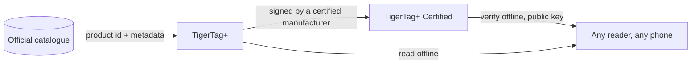

# TigerTag+ Certified

## 用途

**Certified 是能够证明芯片来源的等级。** 另外携带**加密签名**的
[TigerTag+](./tigertag-plus.md) 就是 **TigerTag+ Certified**。签名由持有
[TigerTag+ 认证](../developers/README.md)的制造商写入，认证同时会向其提供签名工具；私钥由 TigerTag 持有。

它是三个等级中唯一不向所有人开放的，也是唯一能回答另外两个等级回答不了的问题的：*这卷线轴是正品吗？*

## 三个等级对照

| | TigerTag | TigerTag+ | TigerTag+ Certified |
|---|---|---|---|
| 打印数据，**在芯片上** | ✅ | ✅ | ✅ |
| 完全离线可用 | ✅ | ✅ | ✅ |
| 产品库产品 ID，**在芯片上** | — | ✅ | ✅ |
| 补充元数据，**通过 Web API，可选** | — | ✅ | ✅ |
| 来源签名，**在芯片上** | — | — | ✅ |
| 谁能生产 | 所有人 | 所有人 | **认证制造商** |

请仔细读左边一列：补充元数据是唯一**不**存放在芯片上的一行。它在你恰好在线时从产品库中查询，并且可以在芯片写入之后得到改进——这恰恰就是它永远不可能成为芯片所需之物的原因。打印机需要的一切都在标有*在芯片上*的那几行里，这正是三个等级都能 100 % 离线的原因。

## 验证免费——签发才是认证所授予的

**验证**签名是免费、离线且不受限制的：公钥是公开的，任何读卡器都可以在没有账号、没有网络的情况下检查。**签发**签名才是认证所授予的权利。

被签名的消息有意涵盖芯片**自身的 UID**，因此被复制到另一枚芯片上的已签名负载不再与之匹配：克隆的标签在客户自己的手机上就无法通过验证。同样的特性也是一卷线轴的两枚芯片携带两个*不同*签名的原因
（[两枚芯片如何绑定](../concepts/tigertag-chip.md)）。

## 它所处的位置

字节级的布局——芯片类型 ID、位于页 `0x18`–`0x27` 的 64 字节签名区——在
[TigerTag-RFID-Guide](https://github.com/TigerTag-Project/TigerTag-RFID-Guide) 中有详细规定。

## 谁是认证的

获准在产品上使用该标记的制造商的权威名单，就是
[认证合作伙伴登记册](../certified-partners.md)。任何格式的芯片、载体、线轴或其包装上出现 TigerTag 标志或名称，只有该页面上的制造商才获授权。

---

**◀ 上一页：** [TigerTag+](./tigertag-plus.md) · **▲ [文档索引](../../README.md)** · **下一页 ▶** [Tiger NFC Connect](./tigertag-connect.md)

**另见：** [TigerTag 芯片](../concepts/tigertag-chip.md)、[认证合作伙伴](../certified-partners.md)、[开发者文档](../developers/README.md)
