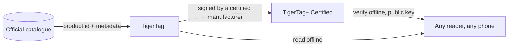

# TigerTag+

## 用途

**`+` 的意思是已识别。** TigerTag+ 是这样一种 TigerTag：其身份携带**来自官方产品库的产品 ID**——不是某人手工输入的值，而是确切的产品：品牌、颜色、材料、温度、直径、SKU、EAN，直接来自源头。在此之上，它还可以携带**可选的补充元数据**，由 Web API 提供，并可在芯片写入之后继续改进。

芯片本身依然**100 % 离线**。打印所需的一切都在上面，与标准 TigerTag 完全一样——产品库 ID 增加的是在你恰好在线时查询更丰富、更新鲜数据的能力，而在你离线时不会带走任何东西。在飞行模式下读取 TigerTag+，表现和任何其他 TigerTag 一样。

而且*“在线”*也不是必要条件。整个参考数据作为一个文件发布——数据库中每一种耗材的每一个 ID，任何人都可以免费复制和镜像——因此持有它的读卡器完全不用网络就能解析产品库 ID。见 [Web API](../developers/web-api.md)。

这与 [TigerData+](../concepts/universal-filament-identity.md) 中的 `+` 是同一个：两处的意思都是*这个身份是产品库中的真实产品*，而两处都不意味着*已认证*。

> **命名说明：** 以前以 **“TigerTag Pro”** 之名销售——现在的名称是
> **TigerTag+**。

## `+` 增加了什么

| | TigerTag | TigerTag+ |
|---|---|---|
| 打印数据，**在芯片上** | ✅ | ✅ |
| 完全离线可用 | ✅ | ✅ |
| 产品库产品 ID，**在芯片上** | — | ✅ |
| 补充元数据，**通过 Web API，可选** | — | ✅ |
| 谁能生产 | 所有人 | 所有人 |

补充元数据是唯一**不**存放在芯片上的一行。它在你恰好在线时从产品库中查询，并且可以在芯片写入之后得到改进——这恰恰就是它永远不可能成为芯片所需之物的原因。打印机需要的一切都在芯片上，这正是每个等级都能 100 % 离线的原因。

## 签名变体

另外携带加密签名的 TigerTag+ 就是
**[TigerTag+ Certified](./tigertag-plus-certified.md)**——能够证明线轴来源的等级，也是唯一仅限认证制造商的等级。验证签名对所有人依然免费且可离线。

## 它所处的位置

## 备份芯片——一项独立的功能

Tiger Studio 可以在你的账号中**备份芯片的精确内容**，以其物理 UID 为键，之后再把它重新编程回那个状态。这很有用，但与 `+` 无关：它适用于你能扫描的任何芯片，拥有备份也不会让一枚芯片变成 TigerTag+。

- **恢复出厂状态**：如果一枚芯片被意外改写或损坏，可以把它原样放回去——如果原来有签名，签名也包括在内。
- **仅限同一枚芯片**：恢复只对原来的那枚芯片有效，因为备份与它的 UID 绑定。这是对*那一枚*芯片的保障，绝不是克隆的手段。
- **持有证明**：与备份相符的一次扫描，说明原芯片确实在你手中。

> **说明：** 目前创建备份需要 **Tiger Studio + USB 读卡器（TigerPOD / ACR122U）**；移动端支持已在计划中。

## 交互

| 对象 | 方式 |
|---|---|
| Tiger Studio + TigerPOD/ACR122U | 读取并验证签名；创建和恢复芯片备份 |
| Tiger NFC Connect | 读取并验证；备份支持即将推出 |
| SDK | `tigertag[verify]` 可离线检查签名，支持 Python 或 JS |
| Firebase（账号数据库） | 保存产品库、补充元数据以及每个账号的芯片备份 |

## 链接

- 官方芯片：**[tigertag.io](https://tigertag.io)**（商店）

---

**◀ 上一页：** [TigerTag](./tigertag.md) · **▲ [文档索引](../../README.md)** · **下一页 ▶** [TigerTag+ Certified](./tigertag-plus-certified.md)

**另见：** [通用耗材身份](../concepts/universal-filament-identity.md)、[TigerTag 芯片](../concepts/tigertag-chip.md)、[开发者文档](../developers/README.md)
