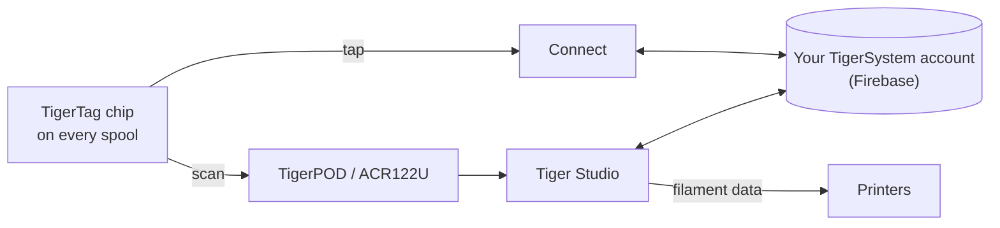

# TigerTag

## 用途

**TigerTag 给每一卷线轴一份属于它自己的记忆。** 一枚小小的 NFC 芯片记录着关于耗材的一切——品牌、材料、颜色、它喜欢怎样被打印——这样你再也不用猜测、贴标签或凭记忆。用手机轻触一下，线轴自己就会告诉你。

<a class="ts-cta-primary" href="https://tigersystem.io/tigertag">什么是 TigerTag——见 tigersystem.io</a>

<a href="https://github.com/TigerTag-Project/TigerTag-RFID-Guide"> 开放的芯片规范</a>

从技术上说，它是生态系统的核心：一个开放的 RFID 标准，任何兼容的应用或读卡器都能读取——没有厂商锁定，没有秘密格式。

## 它所处的位置

## 功能

- 标准 **NTAG213 / 215 / 216** 芯片（推荐 25 mm 圆形），144 字节
 开放 NDEF 负载——按能装进最小的 NTAG213 来设计；没有密钥，没有锁定。
- **每卷线轴两枚芯片，位于相对的两侧**——总有一枚正对着读卡器
 （打印机槽位、AMS、手中的手机），而且两枚互为备份
 （[原因](../concepts/tigertag-chip.md)）。
- 身份依据共享的[参考数据库](../concepts/universal-filament-identity.md)解析。
- 可写入，并且**可重写**——这使[第二次生命工作流](../philosophy/second-life.md)成为可能；
 官方品牌芯片以 NTAG215 出货，因此线轴用空之后，芯片本身可以作为
 普通 NDEF 物件（钥匙扣、名片……）被复用——
 绝不成为电子垃圾。
- 任何 NFC 智能手机、ACR122U 读卡器和 [TigerPOD](./tigerpod.md) 都能读取。
- 一个保留的 **64 字节区域**（页 `0x18`–`0x27`，保留 80 字节数据）：
 在标准 TigerTag 上留给**社区的附加功能**；在
 [TigerTag+](./tigertag-plus.md) 上则承载来源签名——32 字节的 `R`，32 字节的 `S`。

## 架构

格式概要见 [TigerTag 芯片](../concepts/tigertag-chip.md)，
权威的字节级规范见
[TigerTag-RFID-Guide](https://github.com/TigerTag-Project/TigerTag-RFID-Guide)。

## 交互

| 对象 | 方式 |
|---|---|
| Tiger NFC Connect | NFC 轻触：读取、编码 |
| Tiger Studio | 读卡器扫描自动打开线轴；引导式芯片更新 |
| SDK | 通过 JS 或 Python 解析 / 验证 / 编码 |
| 打印机 | 间接——通过[智能手机桥接](../philosophy/smartphone-bridge.md)和 Studio 的打印机连接 |

## 图片展示

> **命名说明：** 标准芯片以前以 **“TigerTag Maker”** 之名销售
> ——现在的名称就是 **TigerTag**。

## 官方芯片，以及其他所有人的芯片

**TigerSystem 制造官方芯片**，并在上面印有 TigerTag 标志。它们有两种形态，出货时均为**空白**：

| 形态 | 适用于 |
|---|---|
| **贴纸** | 你已有的任何线轴——两侧各贴一枚（[为什么是两枚](../concepts/tigertag-chip.md)） |
| **补充装载体** | 带纸芯的耗材[补充装](../philosophy/second-life.md)：一个载体已经带有**两枚芯片**，在补充装装到可重复使用的母线盘之前，它被放在纸芯里面，因此芯片跟着耗材走，而不是跟着线盘走 |

芯片出售时，谁可以说什么：

| 谁 | 他们在卖什么 | 可以称之为 | 标志 |
|---|---|---|---|
| **TigerSystem** | 它制造的芯片 | **官方**——由我们制造 | 可以——由它加印标记 |
| **任何经销商或分销商** | 同样那些正品芯片 | **官方**——货物本身就是 | 可以——标记已经印在芯片上 |
| **经 TigerSystem 审核的第三方** | 它构建的任何东西——芯片、嵌体、载体、设备、应用 | **已认证**——被授予、经审核、已登记、可撤销 | 可以，用在产品上 |
| **自己制造芯片的任何人** | 他们自己的兼容芯片 | *“兼容 TigerTag”*——如果能验证签名，也可称兼容 **TigerTag+**。绝不能称*“已认证”*，该称号只有 TigerSystem 才能授予 | 可用于他们的应用、文档和商店页面；兼容设备的包装盒上可用纯文字写*“Compatible with TigerTag”*——**绝不能把标志或名称用在芯片（任何格式）、载体、线轴或包装上** |

最后这一条区分就是整个商标政策，而且它比看上去要窄。说你的产品*能与* TigerTag 对话，是关于你产品的一个事实，展示标志来说明这一点是免费的。把标记——标志或名称——放在任何格式的芯片**上**，则是在声明**是谁制造的**——它不再表示“这能配合 TigerTag 使用”，而是开始表示“这*就是* TigerTag”。只有第二种用法才需要书面授权。见 [TRADEMARK.md](../../TRADEMARK.md)。

已生产超过 **250 万枚 TigerTag 芯片**——大多数由耗材品牌在工厂集成（Rosa3D、eSun、Sunlu、Landu、Jamg He、R3D、Filforme、Lotactree、Smart3DPT、Nanovia——还有更多正在集成）。它们全部都是[认证合作伙伴](../certified-partners.md)；该页面就是登记册，也是核实包装盒上的标记是否合法的唯一权威方式。

|| | |
|---|---|---|
|  |  |  |

|| | | |
|---|---|---|---|
|  |  |  |  |

*包装盒和里面的线轴——是在商店里买到的，不是为拍照摆拍的。这就是“部署最广”的样子。* 但协议有意**不与官方芯片绑定**：在任何地方（亚马逊、速卖通、本地）买来的任何廉价空白 NTAG 芯片，工作方式完全相同，也没有任何东西会阻止它。品牌芯片有助于支持研发；协议被采用是首要的回报。其他帮助的方式——包括那些不花钱的方式——见[支持本项目](../support.md)。

自由是双向的：**芯片从不被写保护锁定**。TigerTag 只是耗材工厂用来出货线轴的基础协议——如果你更喜欢另一种 NFC/RFID 协议（自定义的或现成的），你可以重写芯片，把数据迁移过去。你的线轴，你的芯片，你的格式。

## 在哪里购买

两种形态出货时均为**空白**，TigerSystem 及其经销商均有销售：

| | **贴纸** | **补充装载体** |
|---|---|---|
| 你得到什么 | 圆形 25 mm 自粘芯片——**每卷线轴两枚**，两侧各一枚 | 一个载体 = **两枚已配对的芯片**，每个折叠端一枚，用于纸芯 |
| 适用于 | 任何带挡板的线轴 | 装在母线盘上的耗材补充装 |
| 官方商店 | [tigertag.io](https://shop.tigertag.io/collections/tigertag-rfid-maker) | [tigertag.io](https://shop.tigertag.io/collections/tigertag-rfid-maker) |
| 经销商（法国） | [TigerTag Officiel, Atome3D](https://www.atome3d.com/products/tigertag) | [TigerTag Refill Officiel, Atome3D](https://www.atome3d.com/products/tigertag-pro-for-refill-1000-pcs) |

两者都有多种包装规格，直至专业用量。而且这一切都不是必需的：**在任何地方买来的任何空白 NTAG 芯片，工作方式完全相同**——购买官方芯片是在资助协议，仅此而已。

## 链接

- 官方芯片：**[tigertag.io](https://tigertag.io)**（商店——支持研发）
- 芯片格式：[TigerTag-RFID-Guide](https://github.com/TigerTag-Project/TigerTag-RFID-Guide)

---

**◀ 上一页：** [产品](./README.md) · **▲ [文档索引](../../README.md)** · **下一页 ▶** [TigerTag+](./tigertag-plus.md)

**另见：** [通用耗材身份](../concepts/universal-filament-identity.md)、[第二次生命](../philosophy/second-life.md)
