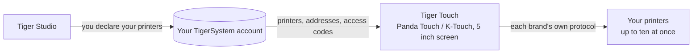

# Tiger Touch

**你的 Panda Touch 正躺在抽屉里。让它接管你所有的打印机。** 一个免费、开源的固件，把 BIGTREETECH 的 Panda Touch 和 K-Touch 变成一块能实时显示你所有 3D 打印机的触摸屏——无需焊接，也无需电脑。

*一块屏幕上的两张实时打印机卡片：一台 FlashForge AD5X 和一台 Bambu Lab X1C。*

<a class="ts-cta-primary" href="https://tigertag-project.github.io/Tiger-Touch/">从浏览器安装</a>

<a href="https://github.com/TigerTag-Project/Tiger-Touch"> 源代码</a>

BIGTREETECH 以两个名字销售同一块 5 英寸小触摸屏：为 Bambu Lab 打印机而做的 **Panda Touch**，以及为 Klipper 打印机而做的 **K-Touch**。同一块板子，两套固件，各自绑定一类机器。换了打印机，这块屏幕就进了抽屉。

**Tiger Touch 是为同一块屏幕从零写成的全新固件。** 它登录你的免费 TigerTag 账号，找到你在那里声明的每一台打印机，并通过各自的协议同时与每一台直接通信。如果你有一块已经和你的打印机不再匹配的 Panda Touch 或 K-Touch，它正是 Tiger Touch 为之而生的硬件。

采用 **MIT** 许可开源。不用焊接，不用打印，没有树莓派，中间也没有服务器：你把屏幕插到 USB 端口，在浏览器里点击**安装**，两分钟后它就显示出你的打印机。

## 它做什么

- **所有品牌在一块屏幕上**——Bambu Lab、Creality、Elegoo、Anycubic、
  Snapmaker、FlashForge、Prusa，以及任何 Klipper（Moonraker）或 OctoPrint
  机器。
- **云和局域网**——Bambu Lab 通过 Bambu 云或局域网模式，Anycubic
  通过 Anycubic 云或局域网，其他的在你的本地网络上。
- **全部实时**——状态、进度、文件、剩余时间和结束时间、
  喷嘴、热床、腔体和耗材单元（AMS、CFS、Station、ACE、MMU / AFC
  通道），最多可同时跟踪**十台打印机**。
- **安全的控制**——暂停、继续、停止（需按住 1.5 秒，这样手指误触绝不会
  终止打印）以及打印机的灯。**除此之外绝不发送任何指令**：不加热，
  不移动，不开始打印。
- **自行更新**——新版本通过 Wi-Fi 到来，安装前经过验证，
  如果启动失败会自动回滚。
- **十一种语言**——英语、法语、德语、西班牙语、意大利语、中文、
  葡萄牙语（巴西和葡萄牙）、波兰语、俄语、荷兰语。

<figure>

<figcaption><strong>卡片</strong>：每台打印机一张实时卡片，滑动查看更多。</figcaption>
</figure>
<figure>

<figcaption><strong>列表</strong>：所有打印机一目了然。轻触一下即可切换视图。</figcaption>
</figure>
<figure>

<figcaption><strong>Snapmaker U1</strong>：四个工具头，当前使用的那个被圈出。</figcaption>
</figure>
<figure>

<figcaption><strong>FlashForge AD5X</strong>：外置线轴和材料站。</figcaption>
</figure>

## 它所处的位置

## 首先必须具备什么

Tiger Touch **从你的 TigerSystem 账号**读取你的打印机，因此它从不在 5 英寸屏幕上询问地址或访问码。请在**桌面版**
[Tiger Studio](./tiger-studio.md)（Windows、macOS、Linux）中创建账号并添加你的打印机，它会在你的网络中找到它们——网页版无法添加打印机。

> **简言之：** Tiger Studio → 创建账号 → 添加你的打印机 →
> *然后*再设置屏幕。

## 支持哪些打印机

Tiger Touch 根据**品牌**而不是型号来选择连接方式：凡是 Tiger Studio 能添加的这些系列的打印机，Tiger Touch 都能显示。Tiger Studio 的产品库收录了约 60 家厂商的 400 多个型号。

| 品牌 | 连接方式 | 是否在真机上见过 |
|---|---|---|
| [Bambu Lab](../compatibility/bambu-lab.md)（X1、P1、P2S、A1、H2……） | Bambu 云，或局域网（基于 TLS 的 MQTT） | **是**——通过云打印中（P2S），局域网模式下空闲（X1C、A1） |
| [Creality](../compatibility/creality.md)（K2、K1、Hi、Ender-3 V4……） | 局域网上的 WebSocket | **是**——打印中（K2），带 CFS 空闲（Ender-3 V4） |
| [Snapmaker](../compatibility/snapmaker.md) U1 | Moonraker WebSocket | **是**——空闲，四个工具头 |
| [FlashForge](../compatibility/flashforge.md)（AD5X、Adventurer 5M、Creator 5、Creator 5 Pro） | 局域网上的 HTTP | **是**——AD5X：暂停、停止和灯光 |
| [Anycubic](../compatibility/anycubic.md)（Kobra 3、Kobra X、Kobra S1……） | Anycubic 云，或局域网（基于 TLS 的 MQTT） | **是**——通过云（Kobra X），带它的 ACE：灯光、暂停、继续和停止 |
| [Elegoo](../compatibility/elegoo.md) Centauri Carbon 1 和 2 | MQTT（CC2），SDCP（CC1） | **是**——Centauri Carbon 2 和 Centauri Carbon：暂停、继续、停止，CC2 上还有灯光 |
| **Prusa**（MK4、Core One、XL、MINI） | PrusaLink | **是**——进度、温度、暂停、继续、停止 |
| [Klipper](../compatibility/klipper.md)——Voron、Qidi、Sovol、RatRig…… | Moonraker HTTP | **是**——在一台真实的 Klipper 打印机上：暂停、继续、停止和灯光 |
| **OctoPrint**——其后的任何 Marlin 打印机 | OctoPrint REST API | 仅对照 Tiger Studio 的测试打印机 |

OctoPrint 到目前为止只对接过 Tiger Studio 的测试打印机，而每个品牌都有无人试过的型号：**来自你的打印机的一份报告，是你能发送的最有用的东西。** 暂停、继续和停止在连接能接受指令的地方都有效（通过 Bambu 云则不行）；灯光在除 Prusa、OctoPrint 和 Centauri Carbon 1 之外的所有地方都有效。每个品牌在[安装站点](https://tigertag-project.github.io/Tiger-Touch/)上都有自己的页面，包含设置方法和常见问题。
每个字段和每项测试都在
[各品牌状态](https://github.com/TigerTag-Project/Tiger-Touch/blob/main/docs/PRINTER-COMPATIBILITY.md)中。

**打印机显示“离线”？** 请先检查它的局域网模式：在 Creality、FlashForge 和 Bambu Lab 上它默认是关闭的。

## 一块屏幕，所有品牌

这块屏幕自带的各套固件，每一套都只认识**一**类打印机。

| | **Tiger Touch** | Panda Touch 固件 | K-Touch 固件 |
|---|---|---|---|
| 一块屏幕上的打印机系列 | **9** | 1（Bambu Lab） | 1（Klipper） |
| 同时实时显示的打印机 | **最多 10 台**，同时更新 | 多台 Bambu Lab，在我们的使用中约 3 台起会变慢 | 一次 **1** 台（保存 50 台，可在它们之间切换） |
| 打印机的设置 | 来自你的 TigerTag 账号，屏幕上无需输入任何东西 | IP、序列号、访问码 | IP 和端口，或扫描 |
| 无线更新 | 有，经过验证，并带自动回滚 | 无 | 无 |

BIGTREETECH 的固件提供对其所属那一类打印机的完全控制——开始打印、温度、移动——而 Tiger Touch 有意不这样做。你可以随时换回它们。

*Panda Touch 和 K-Touch 两列来自 BIGTREETECH 自己的 wiki（2026-10-16 查阅）；“约 3 台起会变慢”是 TigerTag 团队自己的使用经验，不是 BIGTREETECH 的数据。*

## 两分钟安装

1. 如上所述，**在 Tiger Studio 中声明你的打印机**。
2. **从浏览器烧录屏幕。** 在电脑上用 **Chrome 或 Edge** 打开
   **<https://tigertag-project.github.io/Tiger-Touch/>**（WebSerial：不支持 Safari、Firefox 或手机），用 USB-C **数据**线把屏幕插上，点击**安装**并选择它的端口。要替换
   BIGTREETECH 固件：勾选**擦除设备**。要通过
   USB 更新 Tiger Touch：不勾选，你的 Wi-Fi 和账号会保留。
3. **跟着屏幕走。** 语言、Wi-Fi，然后是你的 TigerTag 账号——电子邮件
   和密码，或用手机扫描二维码**通过 Google 继续**。打开你想跟踪的打印机，就完成了。*以后再说*
   永远是一个可选项：屏幕会立即启动，并在后台连接。

此后无需再做任何事：屏幕每天检查一次新版本，并通过两次触摸完成安装。

第一次使用？[安装指南](https://github.com/TigerTag-Project/Tiger-Touch/blob/main/docs/INSTALL.md)
涵盖了 USB 驱动（macOS 必需）、保留一份 BIGTREETECH 固件的副本以便你可以换回去，以及那个需要勾选的选项。

## 硬件

**BIGTREETECH Panda Touch** 和 **K-Touch** 由
**BIGTREETECH**（BIQU）设计和制造：一块围绕 ESP32-S3 的 5 英寸 800×480 IPS 触摸屏，带 8 MB
PSRAM 和 16 MB 闪存、Wi-Fi、USB-C 和电池。Tiger Touch 在上面原样运行，并建立在 BIGTREETECH 以 MIT 许可为其发布的板级支持包之上。K-Touch 与 Panda Touch 是同一块板子，所以同一个镜像应当适用——但迄今为止 Tiger Touch 只在 Panda Touch 上运行过：欢迎提供 K-Touch 上的报告。

Tiger Touch 是一个独立项目，并非由 BIGTREETECH、BIQU 或这里提到的任何打印机厂商制造或认可。

你可以用 ESP-IDF 5.5 自己构建——步骤在
[仓库](https://github.com/TigerTag-Project/Tiger-Touch#build-it-yourself)中。

---

**▲ [文档索引](../../README.md)** · **另见：** [Tiger Studio](./tiger-studio.md)、[TigerSpool](./tigerspool.md)、[打印机兼容性](../compatibility/README.md)
