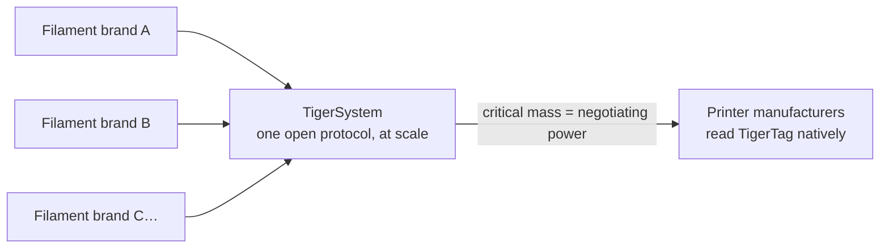

# 致耗材制造商

> **让你的线轴变得智能并联网。**

## 智能线轴正在到来——唯一开放的实现方式就在这里

打印机越来越期待智能耗材：AMS 级别的系统、按槽位检测材料、自动设置。每一家打印机厂商给出的答案都是**封闭的标签，锁定在他们自己的机器上，向他们的云提供数据**——零互操作性，在他们的围墙之外，对你的品牌毫无价值。而每一枚被锁定的标签还有第二个用途：**把你的客户引向打印机厂商自己的耗材。** TigerTag 创建于 2023 年，正是为了让第三方品牌有一个更好的答案——比专有线轴更智能的线轴，而且没有围墙花园。

**TigerTag 是全球部署最广的第三方 RFID 协议**——并且是如今唯一可行的、已大规模出货的开放智能线轴方案：一个开放、标准、与厂商无关、跨平台的协议，已生产超过 **250 万枚芯片**，并由 Rosa3D、eSun、Sunlu、Landu、Jamg He、R3D、Filforme、Lotactree 和 Smart3DPT 以及 Nanovia 等品牌在工厂集成。

## 工厂集成：以天计，而不是以月计

我们有经验也有技术，能够**快速、轻松、以极低的成本**把 TigerTag 芯片带入你的生产线——**最快 5 天即可上线运行**，写入**每枚芯片约 1 秒**（每天数千卷线轴，一键完成）：

- 标准 NTAG 硬件（没有专有组件，没有工装锁定），
 采购的规模和成本都服务于一个没有商量余地的目标：**加入这项技术，而不给线轴的终端用户价格增加一分钱。**
- 一套已在多家工厂部署的成熟集成方案，
 由 [TigerTag Factory 与 Manager](../products/factory-suite.md)
 工业套件驱动：一边是你的耗材数据库，另一边是以产线速度向每卷线轴批量写入——并以**工厂签名
 证明每件产品的来源**。
- 共享的参考数据库为你的产品提供精确、通用的身份，每一个兼容的应用都以完全相同的方式解析它。

在产品中出货 TigerTag 的品牌可以带上 **TigerTag Certified** 标记——向客户发出的明显信号，表明这卷线轴是智能且开放的。

> 请通过 **[tigertag@tigertag.io](mailto:tigertag@tigertag.io)**（或
> 通过 [GitHub 组织](https://github.com/TigerTag-Project)）联系我们，
> 开始洽谈。

## 感谢集成商

下面的品牌让开放线轴成为现实——各自承诺的程度不同，但每一家都值得被肯定。这些层级是一个**阶梯**：品牌投入越深，它出现得就越醒目——在这里，也在生态系统的每一个界面上。最优秀的站得最高。

### 铂金——顶峰

**TigerTag+ 覆盖整个生产**：每一种线轴形态，每一卷出厂线轴都标配签名芯片。没有任何可选，没有任何局部——完整的开放线轴体验，默认提供给每一位客户。铂金集成商在**所有地方都享有最高的曝光**：第一个被点名、最大的标志、讲述他们的故事。

**[Rosa3D](https://rosa3d.pl)**——**世界上第一家**在其全部生产中采用 TigerTag+ 的集成商。是其他所有人都在追赶的标杆。

### 黄金——致力于规模化

**在生产时按需集成**，已经生产了大量产品，集成程度很高，并有**官方的公开承诺**。离顶峰只差一步：把签名芯片变成整条产线的标配，就能加入铂金。

&nbsp;&nbsp;&nbsp;&nbsp;

**[R3D](https://r3dprint.com)** · **[eSun](https://www.esun3d.com)**

### 白银——已经上船

**按需集成这项技术**——第一步，而且已是实实在在的一步：他们的客户今天就能买到配备 TigerTag 的线轴。下一级台阶是黄金：扩大产量并公开承诺。

&nbsp;&nbsp;&nbsp;&nbsp;&nbsp;&nbsp;&nbsp;&nbsp;

**[Sunlu](https://www.sunlu.com)** · **[Landu](https://www.landustore.com)** · **[Jamg He](https://www.jamghe.com)** · **[Filforme](https://www.filforme.com)** · **[Lotactree](https://www.lotactree.com)** · **[Smart3DPT](https://smart3d.pt)**

……生产线上也有——
[Nanovia](https://nanovia.tech)——还有更多即将加入。

**想让你的标志出现在这个阶梯上——而且更大？** 一条生产线最快 5 天即可运行 TigerTag：
[tigertag@tigertag.io](mailto:tigertag@tigertag.io)。

## 他们自己宣布了

品牌自己渠道上的公开帖子——不是我们的新闻稿
（来源和完整公告：
[tigersystem.io/en/manufacturers](https://tigersystem.io/en/manufacturers)）。
**点击任意图片可打开原帖：**

|| | |
|---|---|---|
|  |  |  |

> **ROSA 3D FILAMENTS**——*“已在我们 100 % 的耗材生产中正式集成开放的
> TigerTag RFID 协议。”* 已有超过 250 000
> 卷线轴使用 TigerTag 生产。
> （[原帖](https://www.instagram.com/p/DVyeOZajZSm/)）

> **R3D Filament**——*“已在其欧洲的耗材生产中正式开始大规模部署开放的
> TigerTag RFID 协议。”*
> （[原帖](https://www.instagram.com/reel/DVoAMqTk5ck/)）

> **eSUN**——*“已正式集成 TigerTag RFID 技术！”*——正在法国市场试点，
> 并向欧洲扩展。
> （[原帖](https://www.instagram.com/p/DUjydNXkc1W/)）

## 标签如何进入你的线轴

<table>
<tr>
<td align="center" width="55%">
<strong>正面</strong> 
 
<strong>背面</strong> 

</td>
<td align="center">

</td>
</tr>
</table>

*正面——两枚品牌芯片，中间是工业级 3M 胶
（468MP / 200MP）。背面——两个独立的 NFC 天线，每端一个。装在补充装上：每侧一枚芯片，你的操作员撕下并贴上——产线上的其他一切都不用改变。*

## 已经上架

|| | |
|---|---|---|
|  |  |  |

*Rosa3D、eSun、Sunlu——真实的包装盒，内含 TigerTag 出货。*

|| | | |
|---|---|---|---|
|  |  |  |  |

*耗材本身：Rosa3D、eSUN、Sunlu、R3D——这些线轴上都带有 TigerTag 芯片出货。*

## 你的客户第一天就能得到什么

一卷能向**任何 NFC 手机**自我识别的线轴，一套完整的库存生态系统（移动端、桌面端、网页端），与六个打印机品牌的实时集成，重量跟踪，分享——这种体验**远远超出任何封闭的单一厂商环境所能提供的**，而且它适用于客户拥有的每一台打印机，而不只是某一个品牌的。

## 即使离开了你的工厂，也能更新数据

印刷的标签在印出的那一天就凝固了。TigerTag 线轴则不然：由于芯片依据**共享的参考数据库**解析身份，你可以优化或更正产品的数据——设置、描述、图像——**甚至对已经售出、正放在客户家中的线轴也一样**。TigerTag 是这个市场上唯一能让你的产品数据在离开工厂之后仍可更新的技术。

## 集体的力量

每一个加入 TigerSystem 的耗材品牌，都会让其他所有品牌更强大：

单独一个耗材品牌，无法说服打印机厂商去读取它的标签。
**团结在一个开放协议之后，我们可以。** 而且要求很小：打印机厂商可以在**不到 3 天**内把 TigerTag 读取加入其固件。出货 TigerTag 的品牌越多，让打印机自身原生、固件级支持 TigerTag 的理由就越充分——每一位参与者都能从这种杠杆效应中受益。

---

**▲ [文档索引](../../README.md)** · **另见：** [TigerSystem 为何存在](./why-tigersystem.md)、[兼容性](../compatibility/README.md)、[常见问题——制造商](../faq/README.md)
